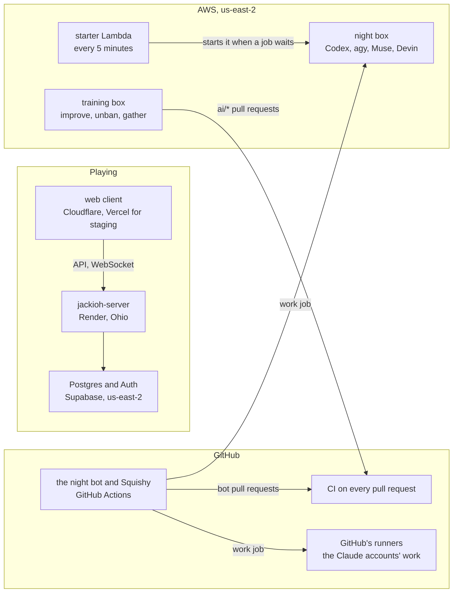
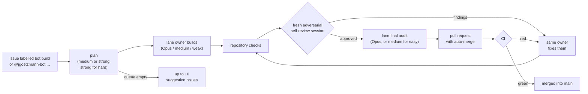

# JackiOh

A 1v1 card game: Hearthstone-style mana, combat and keywords played on Yu-Gi-Oh-style lanes with
a hidden trap backrow. Games are short: 20-card decks with no duplicates, 4 max mana, 30 health
and a 30-turn cap. Every card has a stronger Radiant form. A pure, seeded rules engine runs every
match, so any game replays exactly from its seed and action log. You can play hotseat, online, or
against a practice AI.

| Read | For |
|---|---|
| [`SPEC.md`](SPEC.md), [`spec/`](spec/README.md) | The rules, all 396 cards and 84 tokens of Core, Classic, Classic+, Meditative and Meditative+, the architecture and the engine design, one note per section and per ruling. The only source of rules |
| [`BUILD.md`](BUILD.md) | The work order: milestones, acceptance criteria, the definition of done |
| [`REVIEW.md`](REVIEW.md) | The audit procedure |
| [`CLAUDE.md`](CLAUDE.md) | How the codebase is laid out, the rules every change follows, and every command |
| [`bot/README.md`](bot/README.md) | The night bot that builds issues while nobody is awake |
| [`bot/machine/README.md`](bot/machine/README.md) | The two AWS boxes: the night box and the training box |

## How it is built

The rules engine, the 318 card scripts, the deck validator, the practice AI, the server and every
tool are Rust, in one Cargo workspace; the browser client is TypeScript and React, and runs the
engine and the AI as WebAssembly.

| Path | What |
|---|---|
| [`crates/engine`](crates/engine/README.md) | the rules, the wire types and the deck validator: pure and seeded |
| [`crates/cards`](crates/cards/README.md) | `catalog.json`, one script per card with its tests, the patch history |
| [`crates/ai`](crates/ai/README.md) | the practice opponent |
| [`crates/wasm`](crates/wasm/README.md) | the engine, cards and AI as WebAssembly for the browser |
| [`crates/server`](crates/server/README.md) | the HTTP API and the match actors, one binary in a Docker image |
| [`crates/tools`](crates/tools/README.md) | `jackioh`: fuzz, replay, the catalog and spec checks, the AI's gates, the training arena |
| [`apps/web`](apps/web/README.md) | the client (Vite, React) |
| [`e2e`](e2e/README.md) | the Cypress specs |
| [`training`](training/README.md) | the AI training lanes |

## Running it

Rust 1.97 (pinned in `rust-toolchain.toml`), Node 22.13 or newer and pnpm 11.

```sh
cargo test --workspace --features jackioh-engine/testkit   # every crate's tests
cargo jackioh fuzz --seeds 200                              # seeded random games, each replayed to its hash
pnpm install
pnpm --dir apps/web dev        # the client at http://localhost:5173 (hotseat at /dev/hotseat, AI at /practice)
pnpm --dir apps/web test       # the client's tests
```

`CLAUDE.md` lists every command, including the server, the database suites and the Cypress specs.

## Where it runs



| Part | Where | What runs there | Read |
|---|---|---|---|
| The web client | Cloudflare; Vercel is staging | the Vite and React app, with the engine and the AI as WebAssembly | [`apps/web`](apps/web/README.md), [`docs/deploy-cloudflare.md`](docs/deploy-cloudflare.md) |
| The server | Render, in Ohio | `jackioh-server`: the HTTP API and one match actor per match. `/api/catalog` is Render's health check | [`crates/server`](crates/server/README.md), [`render.yaml`](render.yaml) |
| The database and sign-in | Supabase, in `us-east-2` | Postgres and Auth | [`docs/deploy-cloudflare.md`](docs/deploy-cloudflare.md) |
| CI | GitHub's runners | the five required checks on every pull request, and the slow suites once a day | [`CLAUDE.md`](CLAUDE.md), CI |
| The night bot | GitHub Actions | `bot-commands.yml` answers comments and labels within seconds; each `bot-night.yml` run is four jobs: gate, plan, work and deliver. Only the work job runs a model, and it holds no GitHub write token | [`bot/README.md`](bot/README.md) |
| The Claude accounts' work | GitHub's runners | the work jobs of `claude-1` to `claude-7`, logged in from secrets | [`bot/README.md`](bot/README.md), Subscriptions |
| The night box | AWS EC2, `m7i-flex.large`, tagged `jackioh-night-vm` | the work jobs of Codex, agy, Muse and Devin, each a Linux user of its own with its own runners. A Lambda starts it when a job waits, and it powers off after 30 idle minutes | [`bot/machine/README.md`](bot/machine/README.md) |
| The training box | AWS EC2, `m7i-flex.large`, tagged `jackioh-train-box`, always on | the AI's training lanes, `improve`, `unban` and `gather`, as systemd services outside the night bot | [`training/README.md`](training/README.md), [`bot/machine/README.md`](bot/machine/README.md#the-training-box) |
| Squishy | GitHub Actions and GitHub's runners | `@squishy-squooby`, the same harness on its own Claude account | [`bot/README.md`](bot/README.md#squishy) |
| The local runner | the owner's PC, in Docker | the learned evaluation's self-play exports, and night-box jobs while the PC is idle | [`bot/machine/README.md`](bot/machine/README.md#the-local-runner) |

The AWS account is on the Free plan: its credits pay for both boxes, and a Lambda opens an issue
when they fall under $20. [`docs/architecture.md`](docs/architecture.md) covers the code's own
architecture: the crates, the wire and the client.

## The night bot

`@jgoetzmann-bot` builds the issues you hand it, at any hour, on whichever of its subscriptions is
free: seven Claude accounts (Opus and Sonnet), and ChatGPT through Codex, Gemini through agy, Muse
and Devin on the night box. Label an issue `bot:build`, assign it the bot, or comment
`/harness build` or `@jgoetzmann-bot <what you want>`.

Every item has a difficulty, which decides who may plan, build and approve it. A medium or strong
model plans it first (a strong one for a hard item) and rates an item nobody rated. One
subscription owns it from then on: it builds it, runs the checks, and reviews itself in a fresh
adversarial session, never an approval from its own context, fixing what that finds for up to 3
rounds (10 for a hard item). Then the lane's final audit approves it: a strong model for a medium
or hard item, a medium one for an easy item. The pull request merges itself once CI passes on the
commit the audit approved. When nothing is queued, the bot suggests improvements as issues, at
most ten at a time. `/harness status`, `/harness halt` and `/harness start` work in any comment,
and the pinned **Night bot status** issue shows what it is doing.



[`bot/README.md`](bot/README.md) has the full picture: commands, labels, subscriptions, safety,
setup and operations.
