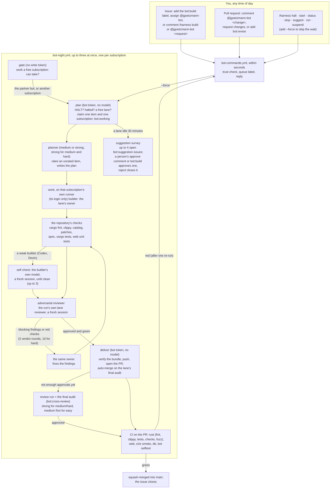

# The JackiOh night bot

`@jgoetzmann-bot` works through the issues you hand it, on whichever of your subscriptions is
free: up to seven Claude accounts (Opus at extra-high effort), ChatGPT through the Codex CLI,
Google through the Antigravity CLI (`agy`), Meta through Muse Code and Cognition through the
Devin CLI, each with its own hours
and limits ([Subscriptions](#subscriptions)). Up to eleven items run at once on GitHub's runners
(the Claude accounts') and, apart from those, up to six on the bot's own machine, the night box:
neither waits on the other. (The AI's two training
lanes run on a box of their own, outside the harness: [`machine/`](machine/README.md#the-training-box).)
Every model has a tier (weak,
medium or strong) and every item a difficulty (easy, medium or hard), which decides who may plan,
build and review it ([Difficulty and tiers](#difficulty-and-tiers)). A medium or strong model plans
each item first (a strong one for medium and hard items) and rates an item nobody rated, under a
strict [easy rule](#the-easy-rule); one subscription owns the item end to end (a medium or
hard item stays with its planner), builds it,
runs the repository's checks, and reviews itself in a fresh adversarial session, going round
until its lane's verdict rounds run out or its reviewer approves. Then the lane's final audit
(a Strong seat for medium and hard items, a medium one for easy items) reviews, fixes and
pushes. Three failures of an item's own raise its difficulty a step and rebuild it from
`main` ([Rating, strikes and the step up](#rating-strikes-and-the-step-up)). A change merges itself into `main` once CI passes and its lane's final audit approved the
same commit: one strong model for a medium or hard item, one medium model for an easy item. When it has nothing to do, it proposes
improvements to the game as issues, at most four open at a time.

It runs on GitHub Actions. The model sessions run on the bot's own machine on AWS, where each
subscription is a Linux user of its own with its own runner ([`machine/`](machine/README.md));
everything that holds a GitHub write token runs on GitHub's runners. It is modelled on
[bright-bots-harness](https://github.com/jgoetzmann/bright-bots-harness), cut down to one
repository and reshaped around an adversarial review loop and auto-merge.



## Giving it work

Any of these queues an issue for the next run a free subscription can take (the reply says
when that is):

- add the **`bot:build`** label (an issue form's Who does it puts it on for you); `human` hands
  it to people instead ([Triage](#triage)). On one of the bot's suggestions (`bot:suggestion`) any
  of these is your yes to it, and the queue takes `bot:suggestion` off. So is a comment that says
  only **`approve`**, while **`reject`** closes the suggestion unbuilt (as not planned), which
  makes room for the next survey (#760);
- **assign** `@jgoetzmann-bot`;
- comment **`/harness build`**, or **`@jgoetzmann-bot <what you want>`**. Your words become part
  of the request.

To change one of its pull requests, comment **`@jgoetzmann-bot <what to change>`** or
**`/harness revise <notes>`** on it, submit a review that requests changes, or add **`bot:revise`**.
It also revises its own pull requests without being asked: when CI fails twice on the same
commit (it re-runs the failed jobs once first, in case the failure was flaky), and when `main`
moves on and leaves the branch with conflicts (once the reviews approved a change, resolving its
conflicts takes no review run again: [the review rule](#difficulty-and-tiers)). After three
tries at fixing CI on one pull request
it stops and labels it `bot:blocked`. Asking for a revision turns auto-merge off until the
revision lands. It can revise a pull request a person opened too, as long as the branch is in this
repository. It never turns on auto-merge for someone else's pull request.

A comment you leave while it is working on the thread is not lost: once the run ends, it queues
another pass to answer it. Auto-merge waits for that pass.

Add **`--force`** to `build`, `revise` or `suggest` to start now, on a subscription outside its
hours if need be (its usage caps still hold). A forced item stays forced until it is done.

Label an issue **`difficulty:easy`**, **`difficulty:medium`** or **`difficulty:hard`** to say
how hard it is ([Difficulty and tiers](#difficulty-and-tiers)); with none, the planner rates it
under [the easy rule](#the-easy-rule), and it counts as medium until then. `difficulty:hard` keeps
it for strong models: planning, building, every revision and the approval that ships it. A label you set is never
changed by the bot.

### Priority and `human`

Three labels set the order queued work is picked up in: **`priority:high`** first, then
**`priority:medium`**, then work with no priority label, then **`priority:low`**. On a thread with
more than one, the highest counts, and any other `priority:*` label counts as none. Inside a tier
the order is the usual one ([who takes what](#subscriptions)), and a forced item still goes before
every tier. A priority label never makes work eligible or ineligible.

**`human`** takes work away from the bot altogether: people do it. That is a decision, an
account or a secret, repository work the bot may not do (a change to `bot/`, `.harness/` or
`.github/`), or work a person is already building. No model picks it up, whatever else it is
labelled, forced or not, and the bot never touches it: it is never queued, planned or built,
gets no `bot:*` stage label, and a conflicted `human` pull request is not revised. A
`/harness build`, an assignment or a mention gets one reply saying so, and nothing else. Take
the label off to hand it to the bot.

**`human required`** is the bot handing an item to people because it found it cannot do it
(#793): it needs a change under `bot/`, `.harness/`, `.squishy/` or `.github/`, a secret or a
token, a setting in a dashboard (GitHub's, Vercel's, Render's, Supabase's, Cloudflare's) or an
account. Instead of asking the same question on every run (#760 spent two runs on one), it lets go
of the item as a person's `human` would make it: its own labels come off (`bot:blocked`,
`bot:build`, `bot:working`, `bot:needs-plan`, the modes), it unassigns itself and assigns both
people, puts on `human required`, and comments naming them (@MaxGoetzmann and @jgoetzmann) with
what a person must do. So an item is always one or the other: `human` or `human required`
(people's, the bot not working on it), or the bot's own labels (the bot working on it).
It does so when its plan's **Files to touch** table lists only paths the bot may not change, or the
planner opens the plan with a `**Human required:**` line (either way the plan still goes into the
description, for the person, and nothing is built); when a builder or reviser stops with
`"human_required": true`; and when the path guard puts back the whole of a build's change. From
then on it is `human`: nothing queues, plans or builds it, and a request gets one reply. A person
may put the label on too, which triage treats as `human`. When the rest is the bot's once a
person has done their part, they take the label off and queue it (`/harness build`); one who
builds it all closes it ([`harness/human.py`](harness/human.py)).

**Dependencies.** An issue waits, unless it is forced, while something it waits for is still open:
an issue a line of its description names ("Blocked by #125", "Depends on #12 and #14", "Do not
start until #125 has merged"; the Plan section does not count), an issue GitHub's own issue
dependencies say blocks it, or an earlier part of the same patch (a title such as
`Patch v0.2.X (part 3 of 4): …` waits for parts 1 and 2 of 4 under the same name,
[docs/issues-and-patches.md](../docs/issues-and-patches.md)). Revisions and reviews never wait.

Label names match whatever their case. Labels are read afresh at every pickup, so a change counts
at the next run, and a run already going is never stopped. The pull request the bot opens for an
issue, a draft or not, starts with the issue's difficulty and priority labels, so its revisions and
its reviews follow the same rules. A label changed on the issue after that, `human` included, does
not reliably reach the pull request (a later build of the issue copies added labels again, never
removed ones): change it there too. The `peek` and `plan` steps of a night run log the chosen
item's priority tier and difficulty, the model and tier picked for each role, any step up in tier
and why, and every item passed over because of `human` or a dependency.

The issue is the spec, so write it the way you would for a careful contributor: what should
happen, where, and how you would check it. The builder reads the issue body, every comment from
people on the trust list, `CLAUDE.md` and `SPEC.md`. Comments from anyone else are left out.

## Fullsend

Label an issue **`bot:fullsend`**, or comment **`/harness fullsend`**, to have it built the way
[fullsend](../.claude/skills/fullsend/SKILL.md) builds a project: many builders at once, each
blind to the others, reconciled at the end (#505). It suits a big issue that splits into parts
touching different files. Squishy has the same mode, `squishy:fullsend` ([Squishy](#squishy)).

1. **The split.** A fullsend item counts as `difficulty:hard`, whatever its label says, so a
   strong model takes it. Its first run splits it as Squishy's `split` does (`prompts/split.md`,
   `harness/split.py`), told also that the parts land on one branch and are reconciled there
   (`split.FULLSEND_NOTES`): vertical slices, no file in two parts, `blocked_by` only where one
   part reads another's code, and no "make it green" part. Deliver then makes the issue's own
   branch, `bot/issue-<n>`, from `main`'s head: the integration branch. It opens the parts as
   sub-issues, each queued as `bot:build` with its plan, its difficulty and a record of where it
   lands (`onto`, `part_of`), and labels the parent `bot:tree`.

   **An issue split already.** On an issue whose sub-issues someone opened before (a tracker split
   by hand), `fullsend` takes those as its parts and splits nothing (`queue.adopt`): it makes the
   integration branch from `main`'s head through the API, writes each open sub-issue's `onto` and
   `part_of`, queues any that was not queued, and labels the parent `bot:tree`. A sub-issue
   labelled `human` or the other bot's, one a run holds, or one with a pull request of the bot's
   open is left to finish on `main`, and the reconcile waits for it to close too.
2. **The parts.** A part is a queued issue like any other, with its own difficulty and its own
   plan from a model of its plan floor (a strong one above easy), which the planning lane writes
   for the parts before the other items ([Who takes what](#subscriptions)). Once its plan is on
   record, the subscriptions whose strongest seat is weakest take it first, and one with no seat
   of its difficulty's tier may build it on a medium seat (`config.PART_FLOOR`): Muse builds a
   hard part from Opus's plan, while a Claude account still builds a hard one on Opus, never on
   Sonnet. The parts build side by side with the parts that do not wait for them. Its run starts from the integration branch, not `main`, and measures every diff against
   it (`work.Worker._part`): one builder pass and the path guard, and no checks, self check,
   catch-up with `main` or review. Deliver lands the change on the integration branch
   (`deliver.Deliverer._land_part`): a fast-forward when nothing landed since the part started,
   and otherwise a merge commit made without a worktree (`git merge-tree`); a push that loses a
   race is tried once more. It refuses what `_publish` refuses: a bundle that is not the head the
   result names, does not descend from where the work started, changes a forbidden path or holds a
   conflict marker. A part that conflicts with the parts before it, or loses the race twice, is
   kept on its own branch, `bot/issue-<part>`, and listed on the parent's record (`parked`).
   Either way the part closes as completed, with a comment saying where its change is. No part
   ever has a pull request.
3. **The reconcile.** Nothing builds the parent while a part is open: `/harness fullsend`,
   `bot:build` and the queue all leave it alone. When the last part closes, the sweep queues its
   reconcile, an ordinary build of the parent on the integration branch, by a strong model again,
   whose first prompt is `prompts/reconcile.md`. It merges the parked branches, follows
   fullsend's Phases 3 to 6 in its one worktree (classify the damage, one winner per collision
   and the losers deleted, green with the code losing to a test by default, then the cull), and
   checks the issue's "Done when". Then it goes through the checks and the adversarial review like
   any build, and deliver opens one pull request from the integration branch into `main`, which
   closes the issue under [the review rule](#difficulty-and-tiers) and auto-merge.

Why it is built this way:

- **No review or pull request per part.** The reconcile's review and CI read the whole diff, and
  parts that need each other could not pass alone; a pull request per part into the branch would
  pay for review and CI twice.
- **Only deliver writes the integration branch**, by a fast-forward or a merge commit on top of
  it, never with force, so a part that landed is never lost.
- **The parent's own branch is the integration branch**, so the reconcile is an ordinary build:
  it already starts from that branch and merges `main` into it, and its pull request closes the
  parent.
- **One label per bot** (`bot:fullsend`, `squishy:fullsend`), so each issue has one owner
  (`queue.owner`).
- **Medium builders, strong planners and a strong reconcile.** A part is one blind pass whose
  every flaw the reconcile's build, checks and review must clear anyway, so its builder may be a
  tier under its difficulty once a strong model has planned it: the strong models spend their
  hours on the plans and the reconcile, and the medium subscriptions (Muse's four lanes) on the
  building.

What to watch: the parent is hard, so three failures of its own block it instead of stepping it
up. `/harness rebuild` on the reconcile's pull request builds the issue again from `main`,
without its parts: their work stays on the old branch, kept as `bot/old/issue-<n>-<date>`. Parked
branches stay on GitHub after the reconcile; delete them once its pull request has merged. A
comment left on a part while it is built gets no pass of its own, since the part closes when it
lands; say it on the parent, whose thread the reconcile reads. The status issue shows a queued
fullsend item without a kind, and the statistics count its runs as splits and builds.

## No request is lost

Every way of asking either gets an answer at once, or is found again later:

- **Commands** in a comment, a line comment on a pull request's diff, or an edit that adds a
  command. The bot puts 👀 on the comment, replies, and adds 🚀; a request for model work also gets
  👍, and later reactions follow it to its answer ([what the reactions mean](#what-the-reactions-mean)).
  If a command fails, the reply says so; the other commands in the same comment still run.
- **Naming the bot mid-sentence** ("thanks @jgoetzmann-bot, could you…") gets a reply explaining
  how to phrase a request. The bot does not guess a build from it, and does not ignore it.
- **The sweep** runs every ten minutes (`harness sweep`, and on demand from the Actions tab). It
  reads the last three days back from GitHub and answers anything no handler answered:
  - a trusted command (in a comment, a diff comment or a review) that nobody claimed, and a bare
    `approve` or `reject` vote on a suggestion, which the event job also wakes for at once (#929);
  - an assignment nothing queued;
  - a review asking for changes on a bot pull request, newer than anything the bot acted on;
  - a failed, cancelled or broken CI or `bot selftest` run on a bot pull request's head;
  - a label the bot uses (`config.LABELS`) that the repository does not have. It checks each
    time that list changes, so a new label exists within ten minutes of its merge, without
    `harness setup` (the method labels shipped in #328 without existing); and one it retired
    (`config.RETIRED_LABELS`, #664), which it deletes, so nobody puts on a label that does nothing.

  It leaves anything younger than ten minutes to the handler that may still be running, so
  nothing is answered twice. Last, it starts a night run when one should be going and none is:
  GitHub drops scheduled runs, sometimes a whole night of `bot-night`'s hourly ones, so when the
  gate's own question (`harness peek`) finds work and no `bot-night` run is queued or going, the
  sweep dispatches one. A dropped hourly run costs about ten minutes, not the night.
- **Labels are the queue**, so a `bot:build` or `bot:revise` label is never lost, even if no
  handler ever saw it being added.
- **A request made while the bot is working** on the thread gets another pass once the run
  ends, and auto-merge waits for it. A request means a command, naming the bot, a review asking
  for changes, or a queue label. A plain comment is read as part of the thread, but it does not
  start a pass of its own. This applies to requests on the issue, on its pull request, and on
  the issue a pull request closes. A `/harness stop` holds the thread until the run has stopped,
  so "stop, then do this instead" gets built.
- **Each request runs once.** A comment, edit or review is claimed in the state file before it
  runs, so the event handler and the sweep never both act on it. An edit runs only the lines it
  added, and only when the comment's author made the edit.
- **Commands are read the way people write them**: in a list, in backticks, in bold. A control
  word in plain words ("@jgoetzmann-bot start with option A") is a request, not a command, unless
  a colon follows it ("@jgoetzmann-bot halt: away this week"). One word that is a near miss of a
  verb ("stauts") runs nothing and gets a "did you mean", rather than a build of the typo.
- **A run that dies without a result** goes to the back of the queue and is blocked after two
  in a row. A failure outside any item (the CLI refusing to start, a broken install on `main`)
  charges nothing and pauses that subscription for 50 minutes, longer each time in a row
  ([who takes what](#subscriptions)).
- **A stop or halt said after the last checkpoint** still counts: deliver checks again, so
  nothing merges that you stopped.
- **`--force`** and **`/harness run`** start a run at once. Both are written down first, so if
  GitHub refuses to start one, or a newer run replaces it, the next hourly run picks it up
  (`bot-night` fires every hour, all day). Without them, a comment that queues work (an
  `approve` vote included) starts a run at once too when a lane and a subscription are free for
  it and no run is on its way, as the sweep would on its next tick (#961).
- **A run that dies** (cancelled, timed out, crashed) leaves its item for the next run, which
  requeues it. A failure outside any item (a missing secret, the CLI refusing to start) is
  never charged to the item.

## Commands

Put one command per line in any issue or PR comment, as `/harness <verb>`, `/harness-<verb>` or
`@jgoetzmann-bot <verb>`; the three read the rest of the line the same way. Quoted lines and fenced
code blocks are ignored, so quoting the bot back at it runs nothing.

| Verb | What it does | Where | Level |
|---|---|---|---|
| `build [notes]` | queue this issue (on a PR, same as `revise`) | issue | 2 |
| `fullsend [notes]` | split this issue into parts that land on its own branch, then reconcile them into one pull request into `main` ([Fullsend](#fullsend)) | issue | 2 |
| `revise <notes>` | queue a revision of this pull request | PR | 2 |
| `review [strong\|medium] [notes]` | queue a review run of this bot pull request's head, by that tier or stronger, and no revision | PR | 2 |
| `rebuild` | close this bot pull request (or the issue's), keep its branch as `bot/old/issue-<n>-<date>`, and build the issue again from `main` | issue or PR | 2 |
| `stop` | take it out of the queue; a running job gives up at its next checkpoint | issue or PR | 2 |
| `suggest` | ask for a suggestion survey the next time a lane is free (without waiting out the 30 idle minutes) | anywhere | 2 |
| `approve`, `reject` | alone on a line, no prefix needed, on one of the bot's open suggestions: `approve` queues it to build, `reject` closes it unbuilt (#760) | suggestion | 2 |
| `status` | halt state; which subscriptions are running what, for how long, with each run's link; each subscription's hours and usage; the queue | anywhere | 1 |
| `help [verb]` | the commands, or one of them in detail with an example | anywhere | 1 |
| `halt [reason]` | stop all model work until `start` | anywhere | 3 |
| `start [subscription]` | lift a halt (`start --force` also starts a run); with a subscription (`resume claude-3`), lift that one's suspension and leave a halt as it is | anywhere | 3 |
| `run [#n]` | start a run now, outside a subscription's hours if need be | anywhere | 3 |
| `suspend <subscription> [reason]` | start no new work on one subscription (an id `status` lists: `claude-3`, `gpt`, …) until `resume <subscription>`; a run already going on it stops at its next checkpoint, keeps its work, and its item goes back to the queue for another subscription (a run whose model work is done still hands its change on); `--force` does not lift it | anywhere | 3 |

Aliases: `work` (build), `fix` and `update` (revise), `resume` and `unhalt` (start), `go` (run).

- **Anything else is a request**, after either prefix: a build on an issue, a revision on a PR,
  with your words as the notes. `/harness make the Coin spin` and `@jgoetzmann-bot make the Coin
  spin` are the same request.
- **A misspelt verb runs nothing.** One word that is a letter or two off a verb or alias
  (`stauts`, `biuld --force`, `rnu #5`) gets "did you mean `status`?" instead of a build of the typo.
- **Plain English after the bot's name.** After `@jgoetzmann-bot`, a control verb (`stop`,
  `status`, `start`, `suggest`, `halt`, `run`, `suspend`, `help`) followed by words that do not
  fit it is read as a request: `@jgoetzmann-bot stop using the old sprite` asks for a change, it
  does not stop anything. Write the verb alone for the command, or put a colon after it to make
  the words its own: `@jgoetzmann-bot halt: away this week`. After `/harness` the verb always
  wins. `start` and `suspend` take one word after the bot's name, a subscription:
  `@jgoetzmann-bot resume claude-3` lifts that one's suspension, while `@jgoetzmann-bot start with
  option A` is still a request.

### What the reactions mean

The bot reacts to your comment as your request moves along, so you can see that a model has it
without reading the thread:

| Reaction | Meaning |
|---|---|
| 👀 | seen; the bot is answering |
| 👍 | a model will read it: it is queued, or noted for the next pass of a run already going |
| 🚀 | answered: the bot replied (the sweep reads this as "handled") |
| ❤️ | a run has it: a model is reading it now |
| 🎉 | done: the run that read it finished with an answer (a pull request opened or updated, a revision pushed, a survey done) |
| 😕 | it ended without an answer: blocked, stopped, or given up on after too many failures |

A command that needs no model (`status`, `help`, `halt`, `start`, `run`, `suspend`, `stop`) gets 👀
and 🚀 only. When a run is interrupted (the time budget, the usage limit, a halt), its requests go
back to waiting and get ❤️ again from the next run. A request left on an issue while it is being
built moves to the pull request the build opens. A review cannot take a reaction, so a request made
in a review's body gets the reply but not the reactions.

**Who may do what** comes from [`.harness/trust.txt`](../.harness/trust.txt): 3 operator,
2 maintainer, 1 asker. A command from anyone else is ignored without a reply. A line with
`id:<number>` counts only for that exact GitHub account; a line without one counts only when
GitHub says the person is an owner, member or collaborator of the repository. `--force` always
needs level 3.

## Labels

`harness/config.py`'s `LABELS` is the one list of the repository's labels, each with its colour and
description (#187): the bot's own below, the type labels (`patch`, `major version`, `architecture`,
`night bot`, [docs/issues-and-patches.md](../docs/issues-and-patches.md#labels)), `production merge`
(written as `scripts/promote-production.sh` writes it) and the rest of this table. The sweep creates
any the repository lacks; `python3 -m harness setup` creates them too and brings a colour or a
description someone changed by hand back to the list. Squishy's process holds its `squishy:*` labels
in place of the `bot:*` ones.

| Label | Meaning |
|---|---|
| `bot:build` | an issue waiting for a free subscription |
| `bot:needs-plan` | the Needs plan stage, beside `bot:build`: it waits for a plan its difficulty may build from (a medium or strong model's for an easy or unrated item, a strong one's for the rest), which goes into its description; the planner rates an unrated item |
| `bot:planned` | it has a plan, in its description (the builder starts from it); it stays after the item leaves the queue |
| `bot:fullsend` | beside `bot:build`: build it as [fullsend](#fullsend), in parts that land on its own branch, then one reconcile and one pull request; it counts as `difficulty:hard` |
| `bot:tree` | a fullsend parent whose parts the bot opened and watches; once they have all closed, the sweep queues its reconcile |
| `bot:revise` | a pull request waiting for a revision |
| `bot:cross-review` | a bot pull request waiting for a review run before auto-merge: one strong model, or a second medium one |
| `bot:working` | a run holds it right now |
| `bot:blocked` | it needs a person: a question, findings the reviewer would not let go of, or repeated failures |
| `bot:stuck` | beside `bot:blocked`: a hard build or revision used every review round (`max_review_cycles`, 10 for hard) without an approval. Its comment says why, round by round (`harness/failures.py`): the builder's sessions, the checks that were red, the reviewer's verdicts and the findings that kept coming back. A person reads it before anyone tries again; an approval takes the label off |
| `bot:pr-open` | the issue has an open bot pull request |
| `bot:pr` | a pull request the bot opened |
| `bot:suggestion` | an improvement the bot proposes; comment `approve` (or add `bot:build`, assign the bot, or `/harness build`) to have it built, which takes this label off; comment `reject` (or close it) to say no |
| `ready for merge` | the reviews approved the pull request's head, but auto-merge could not turn on (a review-only path, `main`'s protection, GitHub refusing it, or `auto_merge` off), so the bot @-mentions the operator to merge it. It comes off when the pull request goes back into the queue (a revision, a review run, a run that holds it, `bot:blocked`); triage never adds it |
| `difficulty:easy`, `difficulty:medium`, `difficulty:hard` | the weakest tier that may build it: weak, medium, strong. A person may set one; otherwise the planner rates the item, under [the easy rule](#the-easy-rule), and the bot labels it; three failures of its own raise it a step ([below](#rating-strikes-and-the-step-up)). With none it counts as medium, and with several the hardest counts |
| `priority:high`, `priority:medium`, `priority:low` | the pickup order: high, medium, none, low ([above](#priority-and-human)) |
| `human` | people do it; the bot never queues, plans, builds or labels it. A person who puts it on hands the issue to both people ([Triage](#triage)) |
| `person merges` | the bot builds and reviews it, but a person merges its pull request: the pull request carries the label from its issue, and the reviews' approval labels it `ready for merge` instead of turning auto-merge on (#839; the weekly hygiene issue carries it) |
| `human required` | the bot's hand-over: it found only a person can do this (a change to `bot/` or `.github/`, a secret, a dashboard, an account), took its own labels off, unassigned itself and assigned both people, and its comment names them and says what. People's from then on, like `human` ([above](#priority-and-human)) |

## Triage

`triage.yml` gives a new issue or pull request what it needs from fixed rules, with no model, in
one job on GitHub's runner (`triage.py`, #664). To run it on a thread again: `gh workflow run
triage.yml -f number=<n>` (or **Run workflow** on the triage workflow's Actions page).

- **A new issue** a trusted person opens (an owner, member or collaborator, or someone on
  `.harness/trust.txt`; the bot and apps label their own) gets:
  - **its form's answers** (`.github/ISSUE_TEMPLATE/`, `triage.form_labels`): Difficulty and
    Priority become `difficulty:*` and `priority:*`, and Who does it becomes `bot:build` (the bot
    queues it) or `human`. "Decide later" leaves that to you. The labels the job's own token puts
    on start no workflow, but the queue reads `bot:build` by label, so the next run sees it;
  - **its type label** from its title's prefix (`triage.type_label`), when it has none: `Patch v…`
    is `patch`, `vX.Y.0` `major version`, `Night bot:` `night bot`, `Architecture:` and `CI:`
    `architecture`;
  - **an issue type**, Task, Bug or Feature, when it has none (`triage.fallback_type`, read from
    the title and labels: a failure is a Bug; tooling, CI, the bot and trackers a Task; something
    new a Feature). GitHub drops a type it won't take without an error, so triage reads it back.
- **`human`**, put on by a person (on any issue, whoever opened it; or chosen in a form), hands the
  issue to people: both MaxGoetzmann and jgoetzmann are assigned, the bot is unassigned, and the
  bot's queue labels (`bot:build`, `bot:needs-plan`) come off. A run's `bot:working` and an open
  pull request's `bot:pr-open` stay.
- **A new pull request** a trusted person opens gets its type label from its title. It keeps its
  title, which becomes the squash commit's subject: the `pr title` check (`pr-title.yml`, #187)
  holds it to `CONVENTION`, plus the titles tools give their own (`AUTOMATED_PULL`,
  `pull_title_ok`), and the bots' pull requests take their builder's title when it passes, else
  their issue's (`pull_title`).
- **It adds, and moves only what `human` moves.** A person's labels, assignees and type stay. It
  links nothing: the queue holds a build that waits for another issue by itself, from a "Blocked
  by #n" line, GitHub's own blocked-by links and the earlier parts of a patch
  ([Dependencies](#priority-and-human)). It retitles nothing either, so the bot's suggestions are
  asked for titles that follow the conventions (`prompts/suggest.md`).
- **Issues triage never types.** The sweep (every ten minutes, in the status loop) types every
  open issue still without one, with the same `triage.fallback_type`: a bot's (the CI-duration
  alerts, the status issue), which never reaches triage, and any triage missed.
- **When it can't:** a failure skips quietly. It leaves no comment.

## Subscriptions

The bot spends whichever of your subscriptions is free. They are listed in
[`.harness/providers.json`](../.harness/providers.json), the file to edit:

| Provider | CLI and model | Login | Hours | Limits |
|---|---|---|---|---|
| `claude-1` | Claude Code, `opus` at `xhigh` (fix passes at `high`), and `sonnet` at `xhigh` (medium) | the secret `CLAUDE_CODE_OAUTH_TOKEN` (the one the bot always had) | 21:00–07:00, and outside it while under 40% of 5 hours (`off_hours`) | all of 5 hours (100%) in its hours, no weekly cap |
| `claude-2` | the same as claude-1 | the secret `CLAUDE_CODE_OAUTH_TOKEN_2` | any time | 90% of 5 hours, 90% of the week |
| `claude-3` | the same as claude-1 | the secret `CLAUDE_CODE_OAUTH_TOKEN_3` | any time | none: until it refuses |
| `claude-4` | the same as claude-1 | the secret `CLAUDE_CODE_OAUTH_TOKEN_4` | any time: 03:00–15:00 up to its cap, and outside it while under 50% of 5 hours (`off_hours`) | 70% of 5 hours, no weekly cap |
| `claude-5` | the same as claude-1 | the secret `CLAUDE_CODE_OAUTH_TOKEN_5` | any time | 40% of 5 hours, 60% of the week |
| `claude-6` | the same as claude-1 | the secret `CLAUDE_CODE_OAUTH_TOKEN_6` | any time: 03:00–15:00 up to its cap, and outside it while under 50% of 5 hours (`off_hours`) | 70% of 5 hours, no weekly cap |
| `claude-7` | the same as claude-1 | the secret `CLAUDE_CODE_OAUTH_TOKEN_7` | any time: 01:00–10:00 up to its cap, and outside it (10:00–01:00) while under 50% of 5 hours (`off_hours`) | 70% of 5 hours, no weekly cap |
| `gpt` | Codex (`codex exec`), `gpt-5.6-terra` at `xhigh`; weak since 2026-10-11, so easy items only | on the machine, as `agent-gpt` | any time | all of 5 hours (100%), all of the week (Codex reports both; #798) |
| `agy` | Antigravity (`agy`), `gemini-3.8-flash-high` (Gemini 3.8 Flash) at `high` | on the machine, as `agent-agy` | any time | all of 5 hours (100%), all of the week (its own `agy -p /usage`, the Gemini pool's row; #798) |
| `devin` | Devin (`devin -p`), `swe-2-max` (SWE-2), on the Devin plan that came with Windsurf, which is canceled; off from 2026-10-05 to 2026-10-06 (#311: every call failed in seconds), on again since a `devin -p` call answered on the machine (#318) | on the machine, as `agent-devin` | any time until 2026-11-02 (`off_from`), when the plan runs out | none: until it refuses |
| `muse` | Muse Code (`muse exec`), `muse-spark-1.3-contributor` at `xhigh`, on four lanes; Meta's $50 plan since 2026-10-11, four times the usage of the one before | on the machine, as `agent-muse` | any time | all of 5 hours (100%), all of the week (its TUI's `/usage` panel; #798) |

The Claude accounts' model jobs run on GitHub's runners (`ubuntu-latest`), which install their
CLI each time; every other subscription's runs on its own runner on the machine, `night-vm-<id>`.
A Claude account
works only once its secret is set (Settings → Secrets and variables → Actions), so the ones you
have not set up yet sit out. A login on the machine has no secret to check, so the bot counts it
as set up; turn one off with `enabled: false`, or for a while, without a pull request, with
`/harness suspend <id>` (until `/harness resume <id>`). `python3 -m harness providers` in `bot/`
prints each one and whether it could start now, and `/harness status` does the same on GitHub.

**What each entry says.**
- `cli`, `model` and `effort`: the reasoning effort, where the CLI takes one. agy's model names
  carry their effort (`gemini-3.8-flash-high`; `agy models` lists them), and `effort` matches it.
- `tier`: `weak`, `medium` or `strong`, the tier of `model` ([below](#difficulty-and-tiers)).
- `extra_models`: other models the subscription runs for a role, each with its `model`, `effort`
  and `tier`. Every Claude account runs Sonnet at `xhigh` (medium, #317) beside Opus, and
  switches between them as the work needs ([below](#switching-between-opus-and-sonnet)). An
  extra model may carry `takes_over: "<id>"`, making it a stand-in for that subscription: it
  builds only easy items, only while that one cannot take them (off, backed off, or its lanes
  full), and never plans or reviews. No committed seat uses it now.
- `fix_effort`: the effort a fix pass runs at (`high` on the Claude accounts), which answers named
  findings and needs less thought than the build; empty runs it at the seat's own.
- `self_check: true`: its builds check themselves before any review (the weak builders;
  [the self-check loop](#the-self-check-loop)).
- `login`: `secret`, a GitHub secret named by `secret` and handed to that run's model job alone,
  or `machine`, a login made once on the machine in that subscription's own home, which never
  leaves it. agy logs in only on the machine.
- `runs_on`: the runner its model job runs on. `night-vm-<id>` is its own runner on the machine;
  a secret login may also run on GitHub's `ubuntu-latest`, which installs its CLI each time. Two
  subscriptions never share a runner on the machine, since a runner is one user's home.
- `schedule`: `{"mode": "always"}`, or `{"mode": "window", "start": "21:00", "end": "07:00"}` in
  `America/Chicago`.
- `limits`: `{"mode": "none"}` uses whatever there is, and a refusal parks the subscription
  until its reset. `{"mode": "caps", ...}` takes any of these:
  - `five_hour` and `seven_day`: a fraction of the allowance, for the CLIs whose usage the bot
    can read: Claude (its stream), Codex (its session log), agy (`agy -p /usage`, no model call:
    the row for the pool its model draws on, Gemini or the Claude and GPT models it also serves)
    and Muse (its TUI's `/usage` panel, read in a pseudo-terminal, since `muse exec` runs no slash
    commands and neither its JSON events nor its session files carry the subscription's usage);
  - `five_hour_minutes` and `seven_day_minutes`: minutes of model time the bot counts itself, for
    a CLI that reports none.

  How the caps hold:
  - **A fresh reading before the run.** A capped Claude account is pinged (one Haiku turn)
    before any model work, since the stored reading is the last run's, or nothing once its
    window has reset; agy and Muse read their own `/usage`.
  - **Watched during each call.** Claude streams its usage as it works; a call stops once the
    reading crosses a cap. A call may run 150 minutes, so checking only between steps let runs
    go to 100%. agy's and Muse's calls stream none, so their `/usage` is read every ten minutes
    during a call (`POLL_SECONDS`) and once after it.
  - **Headroom to start.** A build, a revision or a plan starts only `start_headroom` under
    each cap (top level: 5 points of the 5-hour window, 5 of the week); a review, which is
    short, goes up to the cap. A plan went up to the cap too until #37, whose planner on
    `claude-4` started just under its 70% cap and was stopped four minutes in. A subscription
    under a cap but within its headroom takes reviews only, and the status issue, `status` and
    the planner's summary say so (⏸️, "starts under 45%; reviews only") with the time it can
    start a build or a plan again: its reset, or its window opening if that comes first
    (`providers.start_reason`, `providers.frees_at`).
  - **One run at a time** on a capped subscription, its planning run included: two runs
    deciding from one reading pass a cap together. A subscription given more `lanes` takes that
    many (Muse has four, on one login): each run takes its own reading before it starts and
    watches it during every call, so two of them pass a cap by at most one reading's worth.
  - **A refusal** parks the subscription until the reset its message names ("resets in
    1h44m44s", "try again in 5 days 2 hours"). One that names none waits for the window the
    last reading had nearly full (85% or more), else an hour. A failed agy or Muse call whose
    reading after it has a window full is that window's refusal, whatever the CLI said: their
    caps are 100% (#798), so their own limit ends such a call.
- `quiet_check`: no subscription sets it. When one did (`true`), the gate waited until
  nobody else was spending it ([below](#it-no-longer-waits-for-the-subscription-to-be-quiet)).
- `roles`: what it may do (`plan`, `build`, `fix`, `revise`, `review`, `suggest`).
- `env`: non-secret environment for its CLI.
- `off_hours` (`{"five_hour": 0.4}`, say): with a `window` schedule, it may also work outside the
  window, but only under these tighter caps; a run there stops once past them.
- `enabled: false`: turns it off.
- `off_from` (a date) and `off_reason`: from that day, in the bot's time zone, it takes no new
  work, and the planner opens one issue with the reason, asking a person what it should do now.
  Devin's is 2026-11-02, when the Devin plan that came with Windsurf runs out.
- `usage_since` (a UTC time): when its plan last changed. A usage reading taken before it is the
  old plan's, so no cap holds on it, and the next run reads the new plan's usage afresh. Without
  it, a subscription the old plan had used up keeps waiting for that plan's reset, and since only
  a run reads its usage again, nothing refreshes the reading first. Muse's is 2026-10-11, when it
  moved to the $50 plan (its last reading, from the $15 plan, said 100% of the week).

At the top level, `max_parallel` is how many run at once on GitHub's runners (11, the Claude
accounts' lanes added up, so it holds none of them back), `machine_parallel` how many run at once
on the bot's machine (6; its two vCPUs run each job's checks; GitHub's runners have four each),
each apart from the other, so Claude runs never wait for the night box's slots nor its runs for
GitHub's lanes; `plan_lanes` is how many planning runs may go on top of those (the planning
lane, below; 6), `priority` the usage order within a tier (below), and `tiers` each tier's models,
which the router tries weakest-first inside the subscription. A subscription's own `lanes`
(default 1) is how many items it may work on at once, each on its own runner: Devin's is 6, so it can fill its box alone, Muse's is 4, and claude-1, claude-2, claude-3 and claude-7 have 2 each. A `secret` must be one of the names the workflows hand over (the seven Claude ones,
`CODEX_AUTH_JSON` and `MUSE_AUTH`; `providers.SECRETS`), because they hand over no other.

**Who takes what.** Each run takes one item on one subscription, and a subscription works on as
many items at a time as its `lanes`. Items go in this order: forced, the priority tier, reviews,
revisions, then builds, the harder difficulty first and then the oldest, so work already begun
finishes before new work starts. Which subscription and model take each role
is [Difficulty and tiers](#difficulty-and-tiers); on top of that, a subscription must be free, set
up, inside its hours (unless the item is forced) and under its limits. A run that claims an item
starts another run while a lane and more work are free, and a run that finishes starts the next,
so the lanes fill up. A run that could not work at all (its login refused, its CLI would not
install or start) leaves its subscription alone for 50 minutes, and the item goes to another one
meanwhile. Each such failure in a row waits longer (50 minutes, 2 hours, then 8 hours each time),
and after the third the bot opens an issue labelled `night bot` and `human` asking a person to
renew the login or switch the subscription off; it closes that issue itself once a run there gets
a model call through. A failure that was not the subscription's own (an install red on untouched
`main`, a push GitHub refused, the machine's disk too full to start) waits 50 minutes without
lengthening the streak. On the machine a job reads the disk before it starts, cleans it when short
and does no work under 3 GB free, and a disk that fills up during the work pauses the item and
keeps what it built; neither counts against the item. While the disk is 80% full or has under
3 GB free, the bot keeps one issue open about it, labelled `night bot` and `human`, and closes it
at 70% ([`harness/disk.py`](harness/disk.py), [`machine/`](machine/README.md), Disk).
Each job there also reads the machine's memory (stall time, swapping, memory available), and
the status issue says whether the last 24 hours ran it short ([`harness/memory.py`](harness/memory.py),
[`machine/`](machine/README.md), Memory).

### Difficulty and tiers

Every model is a tier, set by `tier` in providers.json and nothing else (a model's name means
nothing):

| Tier | Models |
|---|---|
| strong | Claude Opus, on every Claude account |
| medium | Muse, Gemini through agy, Claude Sonnet at `xhigh` (on every Claude account, beside its Opus) |
| weak | Devin, Codex (`gpt`, since 2026-10-11) |

Every item has a difficulty, from its labels: `difficulty:easy`, `difficulty:medium` or
`difficulty:hard`. A person may set one; otherwise the planner rates the item when it plans it
([below](#rating-strikes-and-the-step-up)), and until then it counts as medium. With several, the
hardest counts. A bot pull request keeps its issue's. The difficulty sets the weakest tier that
may build it, and the weakest whose plan it builds from (`config.PLAN_FLOOR`, #317):

| Difficulty | Plan written by | Builds it | Approvals it needs |
|---|---|---|---|
| easy | medium or strong | weak or stronger | one medium (the final audit; a strong one ships it too) |
| medium | medium or strong | medium or stronger, planner preferred | one strong (the final audit) |
| hard | strong only | strong only, planner and builder the same | one strong |
| (unrated) | medium or strong, who rates it | as medium | as medium |

**The usage order** (`priority`) is the owner's, and it is the tie-break inside a tier, not
across tiers: each difficulty has its own lane, and the weakest tier that may build the item
takes it first (weak models take the easy items while they have a free lane, then medium; medium
items pass the weak models by; hard items go only to strong models). One lane, one owner
(#725): a medium or hard item stays with the subscription that planned it when that one can
build it, so planner and builder are the same; an easy item still goes weak-first, since its
medium planner must not spend its lane building what a weak seat builds. Inside a tier the owner's
order holds: spend claude-3 (any hour, no caps), claude-7
(held to half its 5-hour session from 10:00 to 01:00 and to 70% of it from 01:00 to 10:00, with
no weekly cap) and claude-1 first, up to their caps; then claude-4, claude-6 and
then claude-5, last of the Claude accounts (claude-4 and claude-6 held to half their 5-hour session outside 03:00–15:00 and to 70% of it inside it, with
no weekly cap, claude-5 to 40% of its 5-hour session and 60% of its week); then the medium models,
Muse first (the most reliable builder, #305), then agy; then Codex, weak; then claude-2, kept back
mostly for planning and reviewing; then Devin, last. For building alone, claude-2 is `build_last`: it
builds only when no other subscription that may is free, Devin included. Codex and Devin, the weak
models, are `easy_first`: they may build only easy items, and Codex takes them before Devin
(its place in the usage order). A fullsend part, once
planned, goes first to the medium subscriptions (Muse first), which may build it whatever its
difficulty ([Fullsend](#fullsend)). (There is no training
lane in the harness any more, and no `training` label: the AI's two training lanes run as
services on the training box, [`machine/`](machine/README.md#the-training-box).)

- **Planning: the Needs plan stage.** Every build starts from a plan its difficulty may build
  from. A queued item without one carries `bot:needs-plan`: one with no plan, and one whose plan
  came from a model under its plan floor (a medium model's plan of a medium or hard item). A
  planner on the **planning lane** plans those first, so a subscription never plans and builds
  the same item: `plan_lanes` runs on top of
  `max_parallel`, which take no build lane, so a subscription plans while it builds, up to as
  many items at once as its `lanes`. The planning lane takes the easy items first (Devin waits on those),
  then fullsend parts (Muse builds those, [Fullsend](#fullsend)), then the rest in the usual
  order, ahead of every build. Each
  subscription offers its strongest free seat; the strong ones go first, within a tier the one
  planning least, and an item takes the first that meets its floor (a medium planner takes only
  easy and unrated items). A subscription with usage caps plans only while it holds nothing else,
  and builds nothing while it plans. The planner reads the task and the code, writes nothing but its
  draft ([handing work over](#the-self-check-loop)), and must leave a weak builder no gap to fill
  (`bot/prompts/plan.md`): the files to touch by path (the
  **Files to touch** table, which the harness reads), the steps in order, the tests and commands,
  and a checklist for done, in under 2,500 words (`issueplan.PLAN_WORDS`; the harness keeps the
  first 30,000 characters, `PLAN_CHARS`, #208). Its plan goes into the issue's description, in a
  **Plan** section (`harness/issueplan.py`), and into the handoff. The builder starts from that
  section as it stands then, so a person can correct the plan in the description before anyone
  builds it. A person (or a session they run) can also write the plan: put it in the description
  between `<!-- jackioh-bot:plan -->` and `<!-- /jackioh-bot:plan -->`. With no planning run of the
  bot's on record, that section counts as a strong plan, so the item leaves the Needs plan stage
  and the bot does not plan over it (`queue.plan_of`). Devin, which cannot plan, builds only from
  a plan that meets its floor. When no planner is free on the lane and a builder whose own
  strongest seat meets the floor takes an unplanned item, it plans it first in its own run; that
  plan goes into the description too, and when its rating puts the item beyond that run's
  builder or planner, the run stops after planning and the item goes back to the queue, rated. A
  revision is not planned again. The ten-minute sweep keeps `bot:needs-plan` in step, so an
  unrated issue is in the stage within one pass.
- **Building, fixing, revising.** The lane's owner builds it end to end: an
  easy item goes to a weak model (Codex, then Devin) while one has a free lane, else to a medium
  one in the usage order; a medium item stays with its planner when that one can build it, else
  takes the first free medium seat; a hard item takes a strong seat only, planner and builder
  the same. Every Claude account builds an
  easy or medium item with Sonnet and a hard one with Opus, and its run may switch between the two
  ([below](#switching-between-opus-and-sonnet)). When that is above the item's tier (none of that
  tier is free), the run's log says so and why, and claude-2 only builds when everyone
  else is busy. A revision that
  resolves a conflict with `main` goes only to a builder with a real reviewer in the run, never
  to a weak one (#317): SPEC §11 and the rulings index conflict on nearly every merge, and Devin
  committed markers there again and again (#203, #214, #287). A fix pass runs at `fix_effort`.
  A revision that answers a final audit stays at the auditor's tier or above, so the auditor
  fixes and pushes it.
- **Reviewing in the run.** Every builder reviews its own change in a fresh adversarial session
  of its lane's reviewer, never an approval from its own context: a medium or strong builder's
  own strongest seat of at least medium reads the change cold; a weak builder's own model does
  the same in a findings-only self check, which never approves. A medium or easy item gets up
  to 3 such verdict rounds (`max_review_cycles`), then its kept work goes to its final audit;
  a hard item stays with Opus for up to 10. Only rounds that end in a readable verdict count:
  usage pauses, infra failures, halts and stops keep the work and pause the count, across runs
  too. Before a
  review, the run merges `main` again when it moved and merges cleanly, and runs the checks on the
  merged head, so what is approved still merges.
- **Review runs.** They are the lane's final audit, and they go before every build and revision,
  whatever their priority, since they unblock merges. A medium or hard item waits for a strong
  seat (Opus); an easy item takes the weakest seat that ships it (medium first, saving the Opus
  gate). No weak review runs go out. A family that has not
  approved the commit yet goes before one that has (the same model may review it twice),
  and a stand-in seat reviews nothing. `/harness review strong` (or `medium`) asks for a review run of
  a bot pull request's head at that tier or stronger, and no revision. A strong approval ships a
  medium or hard item; a medium one ships an easy item, whose scope the easy rule hard-limits.

### Switching between Opus and Sonnet

Every Claude account runs two models, Opus (strong) and Sonnet at `xhigh` (medium). The router
starts a run on the weaker one that meets the item's difficulty, and the run moves its builder
between them as the work needs (`work.Worker._switch`), never below the item's difficulty: a hard
item stays on Opus.

- **The builder chooses.** A builder on such a lane is told both models and which one it runs on.
  Its report's header may carry `"next_model": "opus"` when the work needs more than it can give,
  or `"next_model": "sonnet"` when what is left is plain work; the run's next pass runs on that one,
  taken once the round is reviewed, so the review counts against the model that built it.
- **Sent back twice on Sonnet.** Two rounds in a row that the reviewer sends back while the builder
  runs on Sonnet move it to Opus for the next pass (`work.SWITCH_UP_AFTER`).
- **The planner's rating.** When a run's planner rates an unrated item, or rates higher one the bot
  rated before, the builder moves to the weaker model that meets the rating, up or down (never
  below the bot's earlier rating), and the run goes on, rather than sending the item back to the
  queue for another builder.

Review runs take the lane's final auditor, and the router no longer fixes the reviewer
beyond that. Each round's
record names the model that built it, the result lists every switch (`switches`), and the comment
the run leaves says when and why it switched. A lane with one model (Muse, agy, Codex, Devin) never
switches.

### The easy rule

`difficulty:easy` is the only difficulty Devin may build, so "easy" means "something Devin
finishes" (`harness/easy.py`, written from what Devin did here: it could not resolve the conflicts
in SPEC §11 and the rulings index, could not hold a big change together, cannot plan, runs no
tests where it works, and cannot judge what it cannot see; its clean merges were all 7–15 files and
under about 500 lines). An item is easy only if every line holds; if any fails, or the rater cannot
tell, it is medium at least:

1. **Small:** at most 10 files and 400 lines added plus removed (`easy` in `.harness/config.json`).
2. **One place:** one crate or app, its own tests aside.
3. **None of the conflict hot spots:** `SPEC.md` and the spec's notes (`spec/`: no new ruling),
   `BUILD.md`.
4. **None of the shared surfaces:** `wire/events.rs`, `script.rs`, `state.rs`, `effects/mod.rs`
   in `crates/engine/src/`.
5. **No rules or data work:** nothing in `crates/engine/src/` or `crates/ai/src/`, no catalog,
   patch or card script change, no migration.
6. **No review-only or forbidden path,** and no new dependency.
7. **Checked by a unit test** in the same crate or app; no e2e change, nothing judged by eye.
8. **No decisions left:** the plan names every file, change and test.
9. **Stands alone:** blocked by nothing open.

The harness holds a rating to it twice, trusting nothing the model said. **At rating**, deliver
reads the plan's **Files to touch** table: more than `max_files` files, or one under `off_limits`,
`review_paths` or `forbidden_paths`, makes it medium, and the comment names the line that failed
(`easy.plan_breach`). **At delivery**, a weak builder's change on an easy item is measured
(`git diff --numstat` against `main`): one past `max_files` or `max_lines`, or touching an
`off_limits` path, is not pushed (`easy.change_breach`). Its work is kept (a build's on its own
branch, a revision's on `bot/wip/<pr>`), the item becomes medium (its label, or a floor under a
person's label, `difficulty_floor`), and a medium or stronger model takes it.

### Rating, strikes and the step up

- **Rating** (#317 part 8). The planner of an item no person rated starts its answer with
  `<!-- bot: {"difficulty": "easy|medium|hard", "why": "…"} -->`, judged by the easy rule, which
  its prompt holds word for word. Deliver labels the item, records `difficulty_by`, and comments,
  for example "Rated `difficulty:easy` by `muse` (medium): …. Cleared and queued to build" or
  "… A strong model plans `difficulty:medium` work, so one plans it next". A rating is never
  lowered (a strong planner may raise one, never lower it), a person's label is never replaced
  (the planner is told not to rate it), and an easy rating whose plan breaks the rule is medium.
  A plan with no rating line is medium, the bot's own rating, so a later planner may raise it
  (#735). Triage gives no difficulty beyond its form's answer; the sweep labels what is left bare
  (`sweep._difficulty_labels`): a planned issue with none gets medium, and a bot pull request its
  issue's label, or medium. An issue still waiting for its plan is left to the planner, which may
  rate it easy.
- **Strikes** (`harness/stepup.py`). A run that failed for the item's own sake is a strike: a
  failed run, a build or revision its reviewer would not approve, a review run that rejected its
  head, a head a CI fix pushed that CI still fails, a run that died. Infra, a usage pause, a halt or a stop is
  none. Strikes count on the issue (a bot pull request's on the issue it closes), and no request
  resets them: a head that meets the review rule and is green in CI (the ten-minute sweep checks,
  and a merge counts), or a step up, does.
- **The step up.** At three strikes (`config.STEP_UP_AFTER`) the bot raises the item one step
  (easy to medium to hard), comments why, sends it back to the Needs plan stage when its plan's
  tier no longer meets the new floor, and, when a pull request is open, rebuilds it: the pull
  request closes, its branch is kept as `bot/old/issue-<n>-<date>`, and the issue is queued to
  build again from `main`, with the old pull request and what went wrong named in the new build's
  prompt. A difficulty a person set is never changed: the bot asks instead and blocks it; so it does
  at hard, where there is no step left. `/harness rebuild` on a bot pull request or its issue
  rebuilds at once, at the same difficulty. A run whose builder never worked opens no pull
  request.

**The review rule** (`harness/review_rule.py`). A commit ships when no model's rejection of it
stands and its lane's final audit approved it (#725): one strong model's approval for a medium
or hard item, one medium model's for an easy item (a strong one ships it too). A weak approval
never ships anything: weak builders review themselves in findings-only self checks, and no weak
review runs go out.
- Votes are kept per commit, one per review (each review run, and each run's own reviewer, is
  one; a deliver job run again does not count its review twice), with the tier of the model that
  cast them, from the plan job's own record of who ran, never from the model job.
- A change still short of the rule is labelled `bot:cross-review`, and a review run reads it from
  scratch. The reviewer reads the change but installs and runs nothing: it holds another
  subscription's login, which the builder's code must never run beside. CI runs every check.
- When the rule holds, auto-merge turns on, pinned to that commit: GitHub will not merge a head
  that moved after the approval.
- **A conflict does not undo the reviews.** A commit that meets the rule is recorded as cleared
  (`cleared` on its pull request's record). When `main` then leaves it with conflicts, while CI
  runs or before, the revision that resolves them needs no review run: its builder resolves the
  conflicts, its own run's reviewer (medium or strong) reviews the resolution adversarially,
  told that its approval is the only one the resolution gets, and if it approves, auto-merge
  turns on for the new commit, which is cleared in turn. That holds only when the revision
  started from the cleared commit and changed nothing but the files the merge left conflicted.
  The deliver job checks that itself: it redoes the merge of the cleared commit and `main` with
  git and compares the new commit with it, trusting nothing the model job says. A builder with
  its own reviewer in the run takes such a revision first (Devin has none). A revision that
  changes anything more, a branch someone pushed to after the reviews, or a change still short of
  the rule when the conflict came goes back under the rule, and the comment on the pull request
  says why.
- Blocking findings queue a revision at the auditor's tier or above, so the auditor fixes
  and pushes it (through the self-check
  loop again if that builder checks itself), which goes round the same way. A rejection stands
  against that commit until the same model approves it or the commit changes. Each rejection is a
  strike, so after three the item steps up and is rebuilt ([above](#rating-strikes-and-the-step-up)).
- Whenever the rule is not met, auto-merge is off, even if an earlier strong approval had turned
  it on for an older commit. A review of a commit that moved in the meantime does not count.
- If no subscription that could give the missing review is set up, the change waits in
  `bot:cross-review` until one is, or until you merge it yourself.

### The self-check loop

A builder with `self_check` (the weak builders, Codex and Devin) checks its own change before any reviewer sees it: build,
the repository's checks, then a **self check**, a fresh session of the same model allowed to read
and run things but not edit, told to find every reason its own change should not ship, in the
review's prompt and verdict format. If it flags anything (or a check this change turned red), the
same model fixes it, the checks run, and the self check goes again, until one comes back clean.
`max_self_check_rounds` in `.harness/config.json` (3) caps it; at the cap the change goes to its
final audit
anyway, with the self check's open findings attached for the auditor, except for conflict markers
(#317): a change still holding one gets one more fix pass, and if a marker is left it ends not
approved and nothing is pushed. Deliver greps the bundle's changed files for markers itself too,
and refuses a push that holds one. A clean self check is never an approval and never counts toward
the review rule: it is the weak lane's substitute for an in-run reviewer. Every other builder
reviews its own change in its own run, in a fresh session of its lane's reviewer;
its pull request opens ready, not a draft.

**Handing work over.** A run can stop half-way: its subscription runs out, the clock runs out, its
login breaks, or the bot is halted. A build's work so far is pushed to its branch; a revision's to
`bot/wip/<pr>` (#317: before that a revision cut off kept nothing, and #143 lost 16 Opus runs so),
never to the pull request's branch, which would start CI. The next revision starts its worktree
from `bot/wip/<pr>` when the pull request has not moved since, and is told so; the wip branch goes
once a revision delivers or the pull request closes. Every builder also keeps notes in an ignored
`.bot-notes.md`, in two parts: a `## State` it rewrites in place (the plan, what is done, what is
next, decisions and why, dead ends), and a `## Log` it adds a line to before each long step,
saying what it is about to do and why, and after it, saying what came of it. The harness keeps
the end of its session too. Both are saved on the item, cut to the State whole and the end of the
Log (`journal.compact`), never to the last 8,000 characters, which lost the plan at the top. The
next run, on any subscription, starts with a "Picking up from another agent" section in its
prompt. So a task agy started when its quota ran out can be finished by Codex the same hour.

A plan is handed over the same way. The planner keeps its plan as it stands in an ignored
`.bot-plan.md` (`work.PLAN_DRAFT_FILE`, the one file it may write): what it has found, the files
to touch so far, and the sections as far as it has got. A planning session cut off before its
plan is done leaves that draft and the end of its session as a `draft` handoff, and in its run's
journal section; the "Planning was cut short" comment says the draft is kept. The next planner,
on any subscription, finds the draft in its worktree and an "An unfinished plan from an earlier
run" section in its prompt, and goes on from it. A finished plan supersedes the draft, a plan a
person writes into the description replaces it, and no builder is ever given one. Before this a
cut-off plan kept nothing: #37 lost 20 Opus minutes on `claude-1` and 4 more on `claude-4` in
one morning, and every planner started from scratch.

**The journal** (#342). The handoff is one slot, which the next run overwrites, so every run also
leaves a section in its item's **journal**: `<issue>.md` on the unprotected, orphan `bot-journal`
branch ([`harness/journal.py`](harness/journal.py)), where a pull request's runs join the issue it
closes. Deliver appends it whatever the run did and however it ended: the run, its subscription
and models, how it ended, a line per step the harness took (each model call, why it ran, its
minutes and what came of it; each check run and what was red; each merge of `main`; the stop),
and the builder's notes. The pull request's description and every "Paused" comment link it. The
plan job reads the end of the file into the plan, and the work job puts it in the worktree as
`.bot-journal.md`, ignored like the notes, so the machine needs no GitHub credential to read it.
The first prompt lists the earlier runs and asks the builder to bring its `## State` up to date
from the journal before it goes on: that rewrite is the compression, with no model call of its
own. Headless CLIs can resume a session only where the session's files are, and the next run is
often another job, subscription and CLI, so the journal is the handover; a file over 300,000
characters drops its oldest runs' notes first (the branch's history keeps them). The branch
starts with a `vercel.json` that switches Vercel off for it, as `bot-state`'s does.

**A job that is killed** keeps its work too (#342). After every builder pass, check run and review
the work job rewrites `result.json` as a pause of kind `died`, with its head, a bundle of its
commits, the handoff and the steps so far; the upload step and deliver run whatever happens to the
job (`if: always()`), and the run's own end writes over it. A cancel (GitHub sends SIGINT, then
SIGTERM, a person's or the job's time limit) stops the run as a pause, which commits, bundles and
hands on what it has; before #342 a cancelled job wrote `failed`, kept nothing and took a strike.
Deliver treats `died` as a pause: the work is kept, the item queued again, and a died run that
moved nothing on counts toward the three-in-a-row block. A runner that vanishes outright leaves
nothing to upload, and the item goes back as a run that died. A cut-off run that moved its work on counts for
nothing; one that made no progress after a model call counts, whatever cut it off (a halt, the
machine's disk and a stop before any call aside), and three in a row block the item. Since a pause
loses nothing now, a build or revision starts only 5 points under a 5-hour cap
(`start_headroom`).

### Setting up each subscription

None of these is an API key: each is the login of one account.

- **Claude** (`claude-1` to `claude-7`), a GitHub secret each.
  1. Log in to the account with `claude`.
  2. Run `claude setup-token` and paste the token it prints (good for a year) into the secret.

  `claude-1` is the existing `CLAUDE_CODE_OAUTH_TOKEN`; each further account gets its own secret.
  The token reaches only that account's model job, which runs on GitHub's runners, and is
  written only into a private directory for that job.
- **ChatGPT, Google and Meta** (`gpt`, `agy`, `muse`), once, on the machine, as each one's own
  user. Open a shell with `aws ssm start-session --target <instance>` and run:
  - `sudo -iu agent-gpt codex login --device-auth`, then Sign in with ChatGPT;
  - `sudo -iu agent-agy agy`, then sign in with the Google account and quit;
  - `sudo -iu agent-muse muse login`;
  - `sudo -iu agent-devin devin auth login --force-manual-token-flow`, then paste the token the
    page gives you.

  Each CLI refreshes its own login in that home from then on, so don't copy those files
  anywhere else. [`machine/README.md`](machine/README.md) has the rest: building the machine,
  registering the runners, and the starter that wakes it.

Codex and Muse can also log in from a secret on GitHub's runners: set `"login": "secret"`,
`"runs_on": "ubuntu-latest"` and a `secret` (`CODEX_AUTH_JSON`: the whole of `~/.codex/auth.json`
after `codex login`; `MUSE_AUTH`: `~/.config/muse/auth.json` after `muse login` on Linux, or a
Meta API key, which Meta bills per token). Codex replaces its refresh token every time it
refreshes, so after each such run the bot keeps the refreshed file encrypted on the `bot-state`
branch (**the vault**), under a key derived from that subscription's own secret; pasting a fresh
login makes the old vault unreadable, so the fresh one wins.

**Provider policies.** Each provider has its own policy on scripted use of a personal
subscription:
- OpenAI recommends API keys for CI and advises against this setup on public repositories.
- Google steers headless use towards API keys.
- Anthropic's limits assume ordinary individual use per account.

## It no longer waits for the subscription to be quiet

`claude-1` is shared with you and with
[bright-bots-harness](https://github.com/jgoetzmann/bright-bots-harness), but the bot spends it
like any other subscription now: no subscription sets `quiet_check` in `providers.json`, so the
`gate` job asks only the one question it always asked first:

1. **Is there work a free subscription can take?** (`harness peek`, which reads and changes
   nothing). If not, the run ends here and spends nothing. Otherwise the run goes ahead at
   once, on the cheapest subscription the work allows.

The quiet machinery (`harness quiet`, the gate's "Wait until the subscription is quiet" step,
`quiet_check`, the `quiet` settings in `.harness/config.json`) stays in place but never fires.
A run on `claude-1` still names its model step "Build, check and review", as before: that name
is what bright-bots-harness reads as this bot spending the shared subscription, so it keeps
excusing the rise and the two bots still run at the same time. A run on any other subscription
names its step "Work on another subscription", so it never excuses a rise on the shared
account.

## One night, step by step

1. **plan** (seconds, no model; one at a time across all runs). It runs only after the gate says
   go. It stops at once if `.harness/HALT` is on `main` or someone said `/harness halt`. It
   requeues anything a dead run left `bot:working` and queues a revision for any bot pull request
   that conflicts with `main`. Then, if a lane is free, it claims one item and the subscription
   that takes it ([who takes what](#subscriptions)), and starts another run if another lane and
   more work are free. (One run at a time: the plan job's concurrency group keeps one running and
   one waiting, so runs started together would be cancelled; each claim starts the next, and six
   lanes fill in a few minutes.) Once a lane has been free for 30 minutes with nothing in the
   queue it can start (`suggestions.idle_minutes`; work held back behind a dependency or waiting
   for another subscription does not count), it runs a suggestion survey, while fewer than four
   are open (#797). The sweep keeps that clock (`suggest.idle_since`), and each survey starts it
   again. Every survey also reads the log of suggestions that came to nothing (`suggest.declined`:
   rejected by a vote, closed unbuilt, or approved and then handed to people or failed for good,
   [`harness/declined.py`](harness/declined.py)) and never offers one again; one it offers anyway,
   by the same title, is not opened. Once a day it prunes the
   state file: an item's record goes 7 days after its thread closed, and a closed thread's bulky
   parts at once (`plan.prune`; GitHub's Contents API stops returning a file past 1 MB).
2. **work** (up to about five and a half hours, holding only the chosen subscription's secret).
   It runs on that subscription's own runner, where the CLI is installed and a machine login
   already sits in its user's home; a Claude token is written only into a private directory for
   the job ([setting up](#setting-up-each-subscription)). After the job, the runner deletes its
   working files and package store. A worktree on `bot/issue-<n>` (or the pull
   request's own branch, with `main` merged in), then the install (`rustup toolchain install`,
   which installs the toolchain `rust-toolchain.toml` pins when it is missing, and `pnpm
   install`). A build with no plan yet
   starts with a planning session on the planner's model. Then up to ten rounds:
   - a builder session on the builder's model (`claude --model sonnet --effort xhigh`, say) that
     can read, edit and run commands;
   - the repository's checks from `.harness/config.json`, with any check that is also red on
     untouched `main` marked as not this change's fault: `cargo fmt --check`, `cargo clippy`,
     the `cargo jackioh` catalog, patches and spec checks, the cargo tests, and the web's unit
     tests the change can affect (`vitest run --project web --changed origin/main`, after the
     WASM module is built, without the audio, fx and asset tests, which run daily). A check that
     runs out of time is inconclusive: it neither blocks the change nor runs again on `main`, and
     CI decides. On the bot's machine a run skips the checks marked `"machine": false` (clippy and
     the tests), which CI on the pull request runs anyway, and its builder and reviewer are told
     to check only what they changed: every job there shares two vCPUs, so the heavy suites run
     on GitHub's runners instead;
   - for a self-checking builder, [the self-check loop](#the-self-check-loop);
   - when `main` moved since the run merged it and merges cleanly, it is merged again and the
     checks run on the merged head;
   - a reviewer session on the run's reviewing model, allowed to read and run things but not to
     edit, told to find every reason the change should not ship (or, with none, the change goes to
     a review run);
   - on blocking findings or red checks, a **fresh** builder gets both and fixes them.

   A planning run of its own plans and builds nothing; its plan goes back as the item's handoff.

   The harness also puts back anything the builder changed under `.github/`, `.harness/` or
   `bot/`, and records that as a blocking finding; a build whose whole change was there ends at
   once, asking a person, since nothing of it could be delivered. A run whose issue or pull
   request is closed stops at its next checkpoint. Between steps it checks for a halt, a `stop`,
   the usage stop and the clock. When any of those says stop, it commits what it has as work in
   progress so the next run can pick it up ([handing work over](#the-self-check-loop)); after
   every builder pass, check run and review it leaves a checkpoint a killed job hands on, and a
   cancel stops it the same way. An item
   cut off three runs in a row without its work moving on is blocked. A failure that is not the
   item's fault (an expired Claude token, the CLI refusing to start, a call that fails within a
   minute with nothing to show, dependencies that will not install on untouched `main`) leaves the
   item queued without counting against it, and starts no further run that night; Devin's calls
   failed in seconds from 2026-10-05, and each was charged to its item before #317. A builder
   session that failed and changed nothing ends the run failed, rather than being checked as a
   pass.
   Anything the model's session leaves running is killed when it ends. An approved change is
   delivered exactly as the reviewer saw it: a commit that appears after the review is dropped.
3. **deliver** (seconds, no model). It trusts nothing the model job wrote. The bundle's branch
   must be the head the result names and descend from where the work started, the branch on
   GitHub must not have moved meanwhile, no forbidden path may change, and no changed file may hold
   a conflict marker. Only then does it push
   (never with force) and open or update the pull request. It turns on auto-merge only when the
   review rule holds, no review-only path changed and `main`'s protection requires every CI
   check, with the pull request's title (and number) as the squash commit's title; otherwise the change waits for a review run (`bot:cross-review`) or for you. A change
   the reviewer never approved becomes a draft PR labelled `bot:blocked`, with the findings, the
   rounds it really took and why it stopped, and never merges by itself. It records the subscription's usage, minutes and model tokens (each run's input, output and cached tokens and USD cost, #695), keeps a refreshed
   login and a handoff, appends the run to its item's journal ([handing work
   over](#the-self-check-loop)), and starts the next run if a lane is free and there is work.

## Safety

- **Two gates before `main`.** Adversarial reviewers approve the change: one strong model, or two
  medium ones (the same model may give both, the second in a run of its own), or for an easy item
  a weak and a medium one. Then
  every CI check must pass before auto-merge merges anything. The deliver job turns auto-merge on
  only after reading `main`'s branch protection and finding every check in `required_checks`
  there. If protection is missing, it leaves the pull request for a person.
- **Some changes always wait for a person.** A change that touches a review-only path
  (`review_paths`) still becomes a pull request, but you are asked to review it and auto-merge
  stays off. Once the reviews approve it, it is labelled `ready for merge`, and the bot
  @-mentions you to merge it. The review-only paths are the files that define
  what the checks do or how the game deploys: every `package.json` and `Cargo.toml`, the
  lockfiles, `rust-toolchain.toml`, `rustfmt.toml` and `.cargo/`, the crates' `clippy.toml`
  (the pure crates' purity) and build scripts, the vitest, vite, eslint, TypeScript and Cypress configs, `scripts/`, `vercel.json`,
  `render.yaml`, the server's `Dockerfile` and the database migrations.
- **It cannot change its own rules.** `.github/`, `.harness/`, `bot/`, `.claude/`, `.mcp.json`,
  editor and devcontainer config, git hooks, `.gitattributes` and `.gitmodules` are forbidden
  paths (`forbidden_paths`). They are enforced twice: in the work job, which puts such a change
  back and tells the next builder, and in the deliver job, which refuses to push a bundle that
  has one. Untracked Claude settings and `.mcp.json` are deleted before every model call, and the
  calls run with `--strict-mcp-config`.
- **The model never holds a GitHub write token.** The `work` job has one model secret, the
  chosen subscription's (picked by name, `secrets[...]`), and a read-only Actions token, and the
  model's own environment has neither GitHub token nor any other subscription's login. Pushing,
  commenting and labelling happen in `plan` and `deliver`, which run no model, run on GitHub's
  runners and see only whether each model secret is set.
- **Each subscription is walled off on the machine.** It is a Linux user of its own whose home,
  with its login, no other user can read; none of them has `sudo` or Docker; and its runner,
  labelled `night-vm-<id>` alone, takes only its own jobs. The machine accepts no inbound
  connection, and the repository makes outside contributors' pull requests wait for approval
  before any workflow runs, so a stranger's pull request cannot reach these runners.
- **Text from GitHub is data.** Issue text (the title included), comments, reviews and CI logs
  reach the model fenced and labelled as data. Comments from people outside the trust list are
  left out, and their commands never start a runner.
- **Four off switches.** `/harness halt` (with `start` to undo it), `/harness stop` for one item,
  `/harness suspend <subscription>` for one subscription (with `resume <subscription>` to undo
  it), and a committed `.harness/HALT` file, which only someone who can push to `main` can lift.
  A halt and a suspension are separate: neither lifts the other.
- **Usage.** Claude and Codex report each subscription's 5-hour and 7-day usage; the bot counts
  minutes for the others. Past a subscription's caps no new call starts on it, and a refused call
  parks it until the limit resets while the item moves to another subscription.
- **Refreshed logins** from a secret (Codex rotates its own) are kept on `bot-state` only
  encrypted (AES-256 with an HMAC, through `openssl`), under a key derived from that
  subscription's secret. A login on the machine never leaves it.

**What it cannot rule out.** The model has a shell and its subscription's login, because it
needs the login to run. Network tools such as `curl`, `wget` and `ssh` are denied, but that only slows a
determined model down. And anything the model writes into a pull request is public once it is
pushed. So a prompt injection that fools the model could, in principle, leak that login, or, on
the machine, leave something in its user's home for that subscription's next run (never
another's).
The defences are upstream of that: only people on the trust list can start work, text from
anyone else is left out, and each login is one you can revoke and replace at any time. Read an issue from a stranger before you label it `bot:build`.

Transcripts of the model's sessions stay on the runner unless `upload_transcripts` is on. The
repository is public, so an uploaded artifact is readable by anyone. `result.json` (the builder's
report, the review findings and the check output) and the git bundle are always uploaded, for 14
days.

## Setting it up

1. **The machine** ([`machine/README.md`](machine/README.md)): build it, log each machine
   subscription in, register the runners, and deploy the starter.
2. **Secrets** (Settings → Secrets and variables → Actions):
   - The Claude accounts' tokens, one secret each
     ([setting up each subscription](#setting-up-each-subscription)). `CLAUDE_CODE_OAUTH_TOKEN`
     alone is enough to start.
   - `BOT_GITHUB_TOKEN`: a classic token for the `jgoetzmann-bot` account, which must be a
     collaborator with write access. It needs the `public_repo` and `workflow` scopes, and
     nothing else. It needs `workflow` because merging `main` into a branch can carry a
     workflow change along. A fine-grained token will not do: it cannot reach a repository its
     account only collaborates on. Starting runs and re-running CI jobs use the job's own
     Actions token, so the bot's token needs no `repo` scope. Without this token the bot falls
     back to the Actions token: its comments come from `github-actions[bot]`, and its pull
     requests do not start CI, so auto-merge never fires.
3. **Labels, the state branch and the repository settings**, once, with an admin token (a
   logged-in `gh` works):

   ```sh
   cd bot
   python3 -m harness setup --repo-settings   # labels (created, or brought back to config.LABELS), bot-state branch, auto-merge, branch protection
   python3 -m harness doctor                  # says what is still missing
   ```

   `--repo-settings` allows auto-merge, deletes merged branches, and protects `main` so that
   every check in `required_checks` must pass before anything merges. Admins can still push to
   `main` directly.
4. **Try it**: open an issue, comment `/harness build --force`, and watch the `bot-night` run in
   the Actions tab. `workflow_dispatch` on `bot-night` also takes `dry_run`, which records every
   GitHub write instead of sending it.

## Operating it

| I want to | Do this |
|---|---|
| see what it is doing | the pinned issue **Night bot status** (#148), which `bot-status.yml` rewrites every five minutes (one job loops for five and a half hours, then starts the next loop; an hourly schedule restarts it if it stops, since GitHub fires schedules here only every few hours; each tick also runs the sweep, so a broken chain of night runs restarts within five minutes; each tick also reads `.harness/providers.json` from `main` again and takes which secrets are set from the newest plan job's record, `secrets` in the state file, since GitHub fixes a run's secrets when the run is created, hours before a queued loop starts, so a subscription added or changed shows within five minutes; one the loop's checkout is too old to read, such as a new account's secret, ends the loop, and the next loop shows it on `main`'s code). It opens with a headline (how many runs go, what the queue waits on, which subscriptions can start work now), then what each lane is doing and when it started (a clock time linking to its run; hover it for how long it had run) and a timeline of the runs going now; every subscription as a box, the Claude accounts and the night box's, each saying what it does or why not (working, takes queued work at the next run, idle with nothing queued for it, capped and when it can start again, outside its hours, backing off, off, or no lane free where it runs) and its usage, always; the queue in the planner's order, each item with what the next run does to it (plan, build, revise, review run), its difficulty and the tier that needs (a hard item or a revision that answers a strong audit needs a strong model; a build needs a medium or strong planner first), and either who takes it at the next run or what it waits for and which subscription frees up first, with the items held back (a `human` label, an earlier part or a blocker still open) and why ([`harness/waiting.py`](harness/waiting.py) works it out with the planner's own rules on the lanes held now, so a subscription is never called free when the planner would give it nothing); each subscription's usage as bars and charts against its cap now (and the one in or outside its hours), the line a build or a plan must start under, when the window resets, a window that reset since its reading said as such, and how old the reading is; the last runs; the statistics (below); and the full status folded. Or `/harness status` anywhere, or `python3 -m harness status` in `bot/`: its "Running now" lists each subscription at work, on what, for how long, and its run |
| see what it has done | the same issue's statistics (`bot/harness/stats.py`; they had an issue of their own, #190, until they were folded in), counted afresh every 30 minutes by the same loop (`dashboard --stats`) and kept in the issue between counts, since a count reads every bot comment and pull request; `python3 -m harness stats --force` in `bot/` rewrites the issue with them counted now. One table sets the last 6 hours, the last 24 hours, the last 7 days and all time side by side: runs by kind, outcomes, pull requests opened and merged, issues closed, lines added and removed, files, commits, time to merge, model hours, tokens and cost; then the last two weeks day by day. Each window then has a folded section of its own: per subscription and model, its runs by kind, outcomes, pull requests opened and merged, lines merged, pauses, failures and model time; model tokens (in, out and cached) and USD cost per subscription (#695); bar charts of runs and lines by subscription (all time adds model hours and outcomes). Then every pull request merged, newest first, folded, with when it merged and who planned, built, revised and approved it (fewer are listed, or none, when the issue would pass GitHub's limit on an issue's body). Charts are bars and lines, never pies. Runs and builders come from the bot's own comments; a pull request from before its comments named a builder takes the last build started on its issue before it was opened, and shows as "not recorded" when there was none |
| stop everything now | `/harness halt`; for a lock nobody can lift by comment, commit `.harness/HALT` |
| start again | `/harness start` (and delete `.harness/HALT` if you committed it) |
| stop spending one subscription for a while | `/harness suspend <subscription> [reason]`, with its id as `/harness status` lists it; `/harness resume <subscription>` lifts it. For good, set `"enabled": false` in `.harness/providers.json` |
| run now, outside a subscription's hours | `/harness run`, `/harness build --force`, or Actions → bot-night → Run workflow |
| see each subscription | `/harness status`, or `python3 -m harness providers` in `bot/` |
| add a subscription, or change its hours, limits or model | set its secret or log it in on the machine, and edit `.harness/providers.json` in a pull request; a new one on the machine also needs `setup.sh` and `register-runners.sh` ([`machine/`](machine/README.md)) |
| look at the machine | `aws ssm start-session --target <instance>`; it powers off after 30 idle minutes and the starter wakes it within five minutes of a job |
| set how hard an item is | label it `difficulty:easy`, `difficulty:medium` or `difficulty:hard` (Opus only), or leave it to the planner's rating ([the easy rule](#the-easy-rule)) |
| hand an issue to people or to the bot | label it `human` or `bot:build` ([Triage](#triage)) |
| build one of the bot's suggestions | comment `approve` on it, or label it `bot:build`, as any issue; `reject` closes it |
| start a failing pull request over from `main` | `/harness rebuild` on it or its issue; three strikes do it by themselves, a step up ([below](#rating-strikes-and-the-step-up)) |
| ask for a review only | `/harness review [strong\|medium] [notes]` on the bot's pull request |
| keep the bot off an item altogether | label it `human` |
| give the bot back an item it handed you (`human required`) | do the person's part its comment names, take the label off, then `/harness build` |
| change which subscription is spent first | reorder `priority` in `.harness/providers.json` |
| have an item picked up sooner or later | label it `priority:high`, `priority:medium` or `priority:low` |
| stop one item | `/harness stop` on its issue or pull request |
| drop an item it is working on | close the issue or pull request: the run goes on until it ends, holding its lane, but nothing it made is delivered or queued again |
| retry something it gave up on | fix what it asked about, then `/harness build`; `python3 -m harness forget <n>` clears the failure count |
| read what the model did | the `work` artifact of the run: `result.json` and the bundle (set `upload_transcripts` to keep the full sessions too) |
| change the rounds, budgets or checks | edit `.harness/config.json` in a pull request |
| let someone else command it | add a line to `.harness/trust.txt` |

## Squishy

`@squishy-squooby` is a second bot (#60): this harness again, run from `.squishy/` instead of
`.harness/` (each of its workflows sets `HARNESS_HOME=.squishy`, `harness/identity.py`). It works
like the night bot, under its own names, on its own Claude Max account, and it makes no
suggestions. On top of a plain build it has four modes.

| | Night bot | Squishy |
|---|---|---|
| Account | `@jgoetzmann-bot`, token `BOT_GITHUB_TOKEN` | `@squishy-squooby`, token `SQUISHY_GITHUB_TOKEN` |
| Commands | `/harness <verb>`, `@jgoetzmann-bot <verb>` | `/squishy <verb>`, `@squishy-squooby <verb>` |
| Labels | `bot:build`, `bot:working`, … | `squishy:build`, `squishy:working`, … |
| Branches, state, journal | `bot/issue-<n>`, `bot-state`, `bot-journal` | `squishy/issue-<n>`, `squishy-state`, `squishy-journal` |
| Switches | `.harness/` (`config.json`, `providers.json`, `HALT`) | `.squishy/` (the same; the trust list is `.harness/trust.txt`) |
| Workflows | `bot-night.yml`, `bot-commands.yml` | `squishy-run.yml`, `squishy-commands.yml` |
| Subscriptions | the pool above | `claude-squishy` only (`CLAUDE_CODE_OAUTH_TOKEN_SQUISHY`): Opus for every role, always on GitHub's runners |

Everything else is the night bot's: the run's shape, the review loop and the review rule, CI
fixes, handoffs, the rules about `human` and priorities, and the paths no change may touch.

**Its modes.** Each is a command, or a label beside its queue label:

| Label | Command | What it does |
|---|---|---|
| `squishy:build` | `/squishy build` | a plain build, as the night bot's (an explicit `build` takes a mode label off) |
| `squishy:oneshot` | `/squishy oneshot` | the whole issue in one run with [fullsend](../.claude/skills/fullsend/SKILL.md): a spec first, then builders and spec-testers at once, each in its own git worktree and branch (`squishy/oneshot-<n>/<slice>`), merged back and reconciled against the tests, then the checks and the review as for any build (`prompts/oneshot.md`). Every phase is a commit, so a run that is cut off resumes from its last phase on the issue's branch. It builds the ordinary way, and says why, when fullsend does not fit. `.fullsend/` never ships |
| `squishy:split` | `/squishy split` | one Opus session reads the issue and the code and answers with sub-issues (`prompts/split.md`, `harness/split.py`); deliver opens them as GitHub sub-issues of the issue, linked by "blocked by", each with its plan as its **Plan** section, its difficulty and the parent's priority, queued as `squishy:build` |
| `squishy:split-bot` | `/squishy split bot` | the same, queued for the night bot as `bot:build`; a Plan section counts as a strong plan, so the night bot builds them without planning again |
| `squishy:fullsend` | `/squishy fullsend` | the night bot's [fullsend](#fullsend), under Squishy's names: parts Squishy builds onto `squishy/issue-<n>`, each a run of its own with no pull request, then one reconcile run and one pull request into `main`. Where `oneshot` runs fullsend's builders as agents inside one run, here each part is a run, so no single run has to hold the whole issue |

A split leaves the parent labelled `squishy:tree` with a checklist. When every sub-issue has
closed, the sweep queues its close-out: the same session checks the parent's "Done when" against
`main`, and closes it or opens what is missing. `/squishy stop` on a tree stops its open
sub-issues too (for the night bot's, Squishy comments `@jgoetzmann-bot stop`).

**One owner per issue.** Neither bot takes an issue that is the other's: the other's queue,
state, pull request, mode or tree labels on it, or assigned to the other's account
(`queue.owner`). Take those off to hand it over. A bot acts on the other's comment only when the
line is a bare `stop`, and never answers it with a hint, so the two never talk for ever. The night
bot knows Squishy's words by Squishy's marker (`marker` in `.harness/config.json`'s `others`), which
its harness puts on everything it writes: a comment or review from `@squishy-squooby` without it
was typed by a person working as that account, and is answered as anyone's, an `approve` vote
included (#961). Squishy still reads everything from `@jgoetzmann-bot` as the night bot's.

**The weekly hygiene run.** Every Tuesday at 22:07 UTC, just after Squishy's weekly reset,
`.github/workflows/hygiene.yml` (#839, #888) opens two issues for Squishy (`squishy:build`,
`difficulty:hard`, `person merges`), each unless its own last one is still open, so each cleanup
is a pull request a person merges or closes on its own:
`Architecture: weekly hygiene, dead files and archives, <date>` and `…, agent instructions, <date>`. The
second carries a digest of Anthropic's current guidance that the workflow's model reads (on Squishy's
subscription, with no GitHub token), since a builder has no web access. The first lists the stale
branches as checkboxes for a person: tick some and comment `/delete-branches`, and
`hygiene-delete.yml` (an owner's, member's or collaborator's comment, no model) surveys again with the
rule in `.github/hygiene/branches.py`, deletes the ticked ones it does not keep, strikes them and replies
with each sha. For that, Squishy alone may change
`.claude/skills/` (`!.claude/skills/` in `.squishy/config.json`; `git.matches` reads a leading `!` as
an exception), and `tests/test_skills.py` holds every skill to Markdown and to frontmatter that grants
no tool and adds no hook.

**Status.** Squishy has a section of its own in the pinned **Night bot status** issue: the
`bot-status` loop runs Squishy in a process of its own each tick (`harness dashboard --companions`),
which sweeps for it with its token and draws its lanes, its account, its queue, its trees and its
runs, with its full `/squishy status` report folded underneath; that section sits after the night
bot's facts. The issue's statistics fold in Squishy's record too, drawn the same way each time they
are counted (`harness stats --section-only` in its own process): its four windows, its modes
(one-shot builds, splits, the sub-issues they opened, the trees closed) and its merged pull
requests.
`/squishy status` gives what it is doing now on demand.

**Setting it up.** The account `squishy-squooby` has write access and is on `.harness/trust.txt`.
Two secrets: `SQUISHY_GITHUB_TOKEN`, a classic token of that account with `public_repo` and
`workflow` (as the night bot's), and `CLAUDE_CODE_OAUTH_TOKEN_SQUISHY` from `claude setup-token`
on its Max account. Its labels and `squishy-state` are made by its first sweep, or by
`HARNESS_HOME=.squishy python3 -m harness setup`. `HARNESS_HOME=.squishy python3 -m harness doctor`
checks the token belongs to `@squishy-squooby`.

## Working on the bot

The bot is Python 3.12+ with the standard library only. The tests use fakes for GitHub and the
model, and real git.

```sh
cd bot
python3 -m unittest discover -s tests -t .   # the suite (about ten seconds)
python3 -m harness --help                     # every command
```

`bot selftest` in CI runs the suite on Python 3.12 and 3.13 and runs actionlint over the bot's
workflows. The prompts are in `bot/prompts/`, one per role: `system`, `plan`, `build`, `fix`, `revise`,
`review` and `suggest` (the self check runs `review` with a header saying it is a self check),
Squishy's `oneshot` and `split` (which both bots' fullsend splits with too), and `reconcile`, the
first prompt of a fullsend reconcile. The bots cannot edit anything in `bot/`, `.harness/`, `.squishy/` or
`.github/workflows/`, so changes there come from people. Squishy's own cases run in a process
started as Squishy (`tests/squishy_cases.py`, from `tests/test_squishy.py`).

| Module | Job |
|---|---|
| `config.py` | `<home>/config.json` and the environment; with `identity.py`, the only reader of `os.environ` |
| `identity.py` | which bot this process is (`HARNESS_HOME`): the night bot's or Squishy's labels, command, branches, state, workflow, marker and modes |
| `split.py` | the splits, Squishy's and both bots' fullsend: the tree a split session answers with, checked, ordered and worded |
| `gh.py` | the GitHub client; the only module that sends a token or writes to GitHub |
| `trust.py`, `commands.py` | who may command it, and how a comment is read |
| `events.py`, `queue.py` | the event workflow: commands, labels, assignment, reviews, CI |
| `asks.py` | the reactions that follow a request from its comment to its answer |
| `plan.py`, `work.py`, `deliver.py` | the jobs of a night run (`plan.peek` is the gate's first question) |
| `quiet.py` | the retired gate wait: is anyone else spending the subscription (no subscription waits now) |
| `providers.py` | `.harness/providers.json`: the subscriptions, their hours and limits, whether each is free |
| `runner.py` | one backend per CLI (`claude`, `codex`, `agy`, `muse`): run it, read its answer, usage and refusals; plus the test fake |
| `logins.py`, `vault.py` | a subscription's secret written as its CLI's login, or its login on the machine left where it is; a refreshed login kept encrypted |
| `machine/` | the machine: its setup, its runners, and the starter that wakes it (not part of the `harness` package) |
| `git.py`, `gates.py` | worktrees, commits, bundles, pushes; the repository's checks |
| `triage.py` | labels, types and assigns a new issue or pull request, an issue a person labels `human`, or one a person calls it on, from fixed rules (`triage.yml`); the title rule the `pr title` check runs (`pull_title_ok`, `pr-title.yml`) |
| `easy.py`, `stepup.py` | the easy rule and its checks on a plan and a change; strikes, the step up and the rebuild (#317) |
| `human.py` | work only a person can do (#793): when a plan needs one, the labels the bot lets go of, and the `human required` comment that names the people |
| `declined.py` | the suggestions that came to nothing, which no survey offers again (#797) |
| `memory.py` | the machine's memory as its jobs read it, kept for the status issue's line on it (#312) |
| `threads.py`, `prompts.py`, `verdicts.py` | what the model is told, and reading what it answers |
| `dashboard.py` | the pinned status issue (#148): opened and pinned once, rewritten every five minutes by `bot-status.yml` (`harness dashboard --sweep --stats --companions --every 300 --for 19800`, which sweeps first each time), with the statistics counted every 30 minutes and kept between |
| `waiting.py` | what the status issue says each queued item waits for (the tier its difficulty needs, and which subscription frees up first) and what each subscription can do now, from the planner's own rules (`plan.pairs`) on the lanes held now |
| `stats.py` | the status issue's statistics: the last 6 hours, day, week and all time, from the bot's comments, pull requests and state file, counted every 30 minutes and kept in the issue between counts |
| `state.py`, `status.py`, `clock.py` | the state file on `bot-state`, the status report, time and windows |
| `journal.py` | each item's journal on `bot-journal`: a section per run, read into the next run's plan (#342) |
