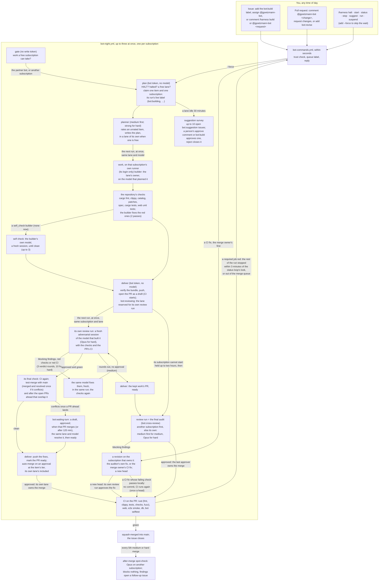

# The JackiOh night bot

`@jgoetzmann-bot` works through the issues you hand it, on whichever of your subscriptions is
free: up to eight Claude accounts (Opus at extra-high effort), ChatGPT through the Codex CLI,
Google through the Antigravity CLI (`agy`) and Meta through Muse Code, each with its own hours
and limits ([Subscriptions](#subscriptions)). Up to eight runs go at once on GitHub's runners
(the Claude accounts', planning runs too, a pool Squishy shares), however many lanes the accounts
have, and, apart from those, up to six on the bot's own machines, the AWS boxes: neither waits on
the other. (The AI's two training
lanes run on a box of their own, outside the harness: [`machine/`](machine/README.md#the-training-box).)
Every model has a tier (medium
or strong; a weak one takes no work) and every item a difficulty (medium or hard), which decides
who may plan, build and review it ([Difficulty and tiers](#difficulty-and-tiers)). A medium model
plans a medium or unrated item first (a strong one only when no medium one can take it now; a
strong one alone for hard items) and rates an item nobody rated, by [how hard it
is](#how-hard-it-is); one subscription owns the item end to end (the one that planned it, or
took it up last; a cut-off item waits for it up to two hours, [Ownership and the
hold](#ownership-and-the-hold)), and one model of it works it from the plan to the merge, on one
lane (#2903): it plans the item in a lane of its own when one is free, and that lane goes straight
on to the build, on the model that planned it, which runs the repository's checks, then opens the
pull request (a draft, so CI starts) and hands its lane to the change's **own review run** on the
same subscription and model, which reviews it in a fresh adversarial session, fixes what it finds
in the same run and reviews again, until its lane's verdict rounds run out or its reviewer approves ([The own
review run](#the-own-review-run), the owner's decision of 2026-11-02). That approval ships it when
it is at the item's tier: a medium or strong model's for a medium item, a strong one's for a hard
item, which on a Claude account is Opus on the same account, so an item normally ships at the end
of its own review run, which test-merges it with `main` and the open pull requests ahead of it,
merges and resolves `main` once if it conflicts, or waits its turn behind one ahead that it
conflicts with (#2948), then marks the pull request ready and turns auto-merge on. When the
rounds run out without an approval, the kept work gets the lane's final audit, a
review run on another subscription of the item's tier when one is free and on its own when none
is; when that finds blocking problems, the auditor's own subscription owns the fix and makes it in
a revision of its own, whose own review run's approval ships it in turn. Three failures of an item's
own raise its difficulty a step and rebuild it from `main`
([Rating, strikes and the step up](#rating-strikes-and-the-step-up)). A change merges itself into
`main` once CI passes and one approval at its tier, from any subscription, approved the same
commit. The last approver owns the merge: a red check or the merge queue's failure comes back to
its subscription first. Opus on another subscription spot-checks every 5th merged medium or hard
change, the independent measure of that self-review, blocking nothing, and opens a follow-up issue
for what it finds ([The after-merge spot-check](#the-after-merge-spot-check)).
When it has nothing to do, it proposes improvements to the game as issues, at most ten open at a
time.

It runs on GitHub Actions. The model sessions run on the bot's own machine on AWS, where each
subscription is a Linux user of its own with its own runner ([`machine/`](machine/README.md));
everything that holds a GitHub write token runs on GitHub's runners. It is modelled on
[bright-bots-harness](https://github.com/jgoetzmann/bright-bots-harness), cut down to one
repository and reshaped around an adversarial review loop and auto-merge.



## Giving it work

Any of these queues an issue for the next run a free subscription can take (the reply says
when that is):

- add the **`bot:build`** label (an issue form's Who does it puts it on for you); `human` hands
  it to people instead ([Triage](#triage)). On one of the bot's suggestions (`bot:suggestion`) any
  of these is your yes to it, and the queue takes `bot:suggestion` off. So is a comment that says
  only **`approve`**, while **`reject`** closes the suggestion unbuilt (as not planned), which
  makes room for the next survey (#760);
- **assign** `@jgoetzmann-bot`;
- comment **`/harness build`**, or **`@jgoetzmann-bot <what you want>`**. Your words become part
  of the request.

An issue with open sub-issues that is queued so is built as [fullsend](#fullsend), its sub-issues
its parts, and the bot says so on it (#2748).

To change one of its pull requests, comment **`@jgoetzmann-bot <what to change>`** or
**`/harness revise <notes>`** on it, submit a review that requests changes, or add **`bot:revise`**.
It also revises its own pull requests without being asked: when CI fails on its head (a required
job red stops the rest of that CI run within three minutes, and the fix runs the failing check
itself first, with no flake re-run: [Stopping red CI early](#stopping-red-ci-early)), and when `main`
moves on and leaves the branch with conflicts (once the reviews approved a change, resolving its
conflicts takes no review run again: [the review rule](#difficulty-and-tiers); `bot:resolving` while
it runs). Before a change goes ready at all, its own review run test-merges it with `main` and the
open pull requests ahead of it, and settles or waits out the conflicts it finds
([The own review run](#the-own-review-run), #2948). A CI fix, and a conflict's resolution, go
first to the subscription whose approval shipped the head (the last approver owns the merge,
#2748), ahead of its new work and held for it a while like any owner's work; its fix is a new commit,
which its own review run's approval at the item's tier ships (2026-11-02), and no test is ever
skipped or disabled to get green (CLAUDE.md rule 12). After three tries at fixing CI on one pull request
it stops and labels it `bot:blocked`. Asking for a revision turns auto-merge off until the
revision lands. It can revise a pull request a person opened too, as long as the branch is in this
repository. It never turns on auto-merge for someone else's pull request.

Every run that changes code, a build, a revision you asked for, an auditor's fix or a CI fix, runs
in two: the first builds and checks it and pushes it (a new pull request opens as a draft, so CI
starts at once), and the second, its [own review run](#the-own-review-run) on the same
subscription, reviews it, fixes what it finds and approves it; the pull request carries
`bot:reviewing` in between. A fullsend part (no review per part) and the resolution of a conflict
on a change the reviews had cleared (its own run's reviewer carries the clearance) stay one run.

A comment you leave while it is working on the thread is not lost: once the run ends, it queues
another pass to answer it. Auto-merge waits for that pass. A revision you ask for while a pull
request waits for its own review run goes first, and chains an own review run of its own.

An item stays with the subscription that owns it, and waits for it a while when only its 5-hour
session keeps it (`bot:waiting`, [Ownership and the hold](#ownership-and-the-hold)). To give it to
another, comment **`/harness handoff`** (anyone may take it), **`/harness handoff medium`** or
**`/harness handoff hard`** (the same, at that difficulty, your label), or **`/harness handoff
human`** (to people, as `human` does).

Add **`--force`** to `build`, `revise` or `suggest` to start now, on a subscription outside its
hours if need be (its usage caps still hold). A forced item stays forced until it is done.

Label an issue **`difficulty:medium`** or **`difficulty:hard`** to say how hard it is
([Difficulty and tiers](#difficulty-and-tiers)); with none, the planner rates it by [how hard it
is](#how-hard-it-is), and it counts as medium until then. `difficulty:hard` keeps it for strong
models: planning, building, every revision and the approval that ships it. A label you set is never
changed by the bot. `difficulty:easy` is retired (#2748): the sweep moves it to
`difficulty:medium` on every open thread before it deletes the label, so a person's easy label
becomes a person's medium label, and a thread, record or rating that still says easy reads as
medium.

### Priority and `human`

Three labels set the order queued work is picked up in: **`priority:high`** first, then
**`priority:medium`**, then work with no priority label, then **`priority:low`**. On a thread with
more than one, the highest counts, and any other `priority:*` label counts as none. Inside a tier
the order is the usual one ([who takes what](#subscriptions)), and a forced item still goes before
every tier. A priority label never makes work eligible or ineligible.

**`human`** takes work away from the bot altogether: people do it. That is a decision, an
account or a secret, repository work the bot may not do (a change to `bot/`, `.harness/` or
`.github/`), or work a person is already building. No model picks it up, whatever else it is
labelled, forced or not, and the bot never touches it: it is never queued, planned or built,
gets no `bot:*` stage label, and a conflicted `human` pull request is not revised. A
`/harness build`, an assignment or a mention gets one reply saying so, and nothing else. Take
the label off to hand it to the bot.

**`tracking`** (#2748) is a type label for trackers, the production countdown (beside `production
merge`) and the status issues (#148 and the usage history). The bot may comment on one and rewrite
its own, but every queue path treats it as `human`: it is never queued, planned, built, split or
adopted as a fullsend tree, however it is labelled, assigned or asked (`queue.IsHuman`), and a
request gets one reply saying so. The dashboard puts it on the status issue when it finds or opens
it, and the sweep on the open `production merge` issue (only the label: the rest is the
workflow's).

**`human required`** is the bot handing an item to people because it found it cannot do it
(#793): it needs a change under `bot/`, `.harness/`, `.squishy/` or `.github/`, a secret or a
token, a setting in a dashboard (GitHub's, Vercel's, Render's, Supabase's, Cloudflare's) or an
account. Instead of asking the same question on every run (#760 spent two runs on one), it lets go
of the item as a person's `human` would make it: its own labels come off (`bot:blocked`,
`bot:build`, its live label, `bot:needs-plan`, the modes), it unassigns itself and assigns both
people, puts on `human required`, and comments naming them (@MaxGoetzmann and @jgoetzmann) with
what a person must do. So an item is always one or the other: `human` or `human required`
(people's, the bot not working on it), or the bot's own labels (the bot working on it).
It does so when its plan's **Files to touch** table lists only paths the bot may not change, or the
planner opens the plan with a `**Human required:**` line (either way the plan still goes into the
description, for the person, and nothing is built); when a builder or reviser stops with
`"human_required": true`; and when the path guard puts back the whole of a build's change. From
then on it is `human`: nothing queues, plans or builds it, and a request gets one reply. A person
may put the label on too, which triage treats as `human`. When the rest is the bot's once a
person has done their part, they take the label off and queue it (`/harness build`); one who
builds it all closes it ([`go/internal/human/`](go/internal/human/)).

**Dependencies.** An issue waits, unless it is forced, while something it waits for is still open:
an issue a line of its description names ("Blocked by #125", "Depends on #12 and #14", "Do not
start until #125 has merged"; the Plan section does not count), an issue GitHub's own issue
dependencies say blocks it, or an earlier part of the same patch (a title such as
`Patch v0.2.X (part 3 of 4): …` waits for parts 1 and 2 of 4 under the same name,
[docs/issues-and-patches.md](../docs/issues-and-patches.md)). Revisions and reviews never wait.

Label names match whatever their case. Labels are read afresh at every pickup, so a change counts
at the next run, and a run already going is never stopped. The pull request the bot opens for an
issue, a draft or not, starts with the issue's difficulty and priority labels, so its revisions and
its reviews follow the same rules. A label changed on the issue after that, `human` included, does
not reliably reach the pull request (a later build of the issue copies added labels again, never
removed ones): change it there too. The `peek` and `plan` steps of a night run log the chosen
item's priority tier and difficulty, the model and tier picked for each role, any step up in tier
and why, and every item passed over because of `human` or a dependency.

The issue is the spec, so write it the way you would for a careful contributor: what should
happen, where, and how you would check it. The builder reads the issue body, every comment from
people on the trust list, `CLAUDE.md` and `SPEC.md`. Comments from anyone else are left out.

## Fullsend

Label an issue **`bot:fullsend`**, or comment **`/harness fullsend`**, to have it built the way
[fullsend](../.claude/skills/fullsend/SKILL.md) builds a project: many builders at once, each
blind to the others, reconciled at the end (#505). It suits a big issue that splits into parts
touching different files. Squishy has the same mode, `squishy:fullsend` ([Squishy](#squishy)).

1. **The split.** A fullsend item counts as `difficulty:hard`, whatever its label says, so a
   strong model (Opus) takes it, and its split goes first among the builds, as a `priority:high`
   item does (#2748; `queue.Candidates`): its parts wait on it. No label changes for that, so a
   person's priority label stays as it is, and the queue (`waiting`) and the status issue show it
   as high. Nothing reviews or revises a split: its one session answers with the parts, not a
   change, and deliver opens them; an answer that cannot be used is a failed run, tried again up
   to `max_failures`. Its first run splits it as Squishy's `split` does (`prompts/split.md`,
   `go/internal/split/`), told also that the parts land on one branch and are reconciled there
   (`split.FullsendNotes`): vertical slices, no file in two parts, `blocked_by` only where one
   part reads another's code, and no "make it green" part. Deliver then makes the issue's own
   branch, `bot/issue-<n>`, from `main`'s head: the integration branch. It opens the parts as
   sub-issues, each queued as `bot:build` with its plan, its difficulty and a record of where it
   lands (`onto`, `part_of`), and labels the parent `bot:tree`.

   **An issue split already.** On an issue whose sub-issues someone opened before (a tracker split
   by hand), `fullsend` takes those as its parts and splits nothing (`queue.Adopt`): it makes the
   integration branch from `main`'s head through the API, writes each open sub-issue's `onto` and
   `part_of`, queues any that was not queued, and labels the parent `bot:tree`. A sub-issue
   labelled `human` or the other bot's, one a run holds, or one with a pull request of the bot's
   open is left to finish on `main`, and the reconcile waits for it to close too.

   **A queued parent** (#2748, `fullsend_adopt` in `.harness/config.json`). An issue queued for
   a plain build (`bot:build` by a label, an issue form, an assignment, `/harness build` or an
   `approve`) that has open sub-issues is adopted the same way by itself (`queue.QueuedParent`,
   `queue.AutoAdopt`), with a comment that says so, and that `/harness stop` stops it and its parts.
   The request paths adopt it when they answer, and the claim of a queued build does when it finds
   one (a form's `bot:build` reaches the queue with no event), before anything is planned or built.
   Never a `human`, `human required` or `tracking` issue, never the other bot's (Squishy's), never
   one that is a sub-issue itself (some tree's part, or a piece of a tracker: trees never nest), and
   never one with a pull request of the bot's open or a run holding it; those are built as asked. To
   have a parent built as one issue, remove its sub-issues before you queue it. Squishy adopts none
   by itself (`fullsend_adopt` off).
2. **The parts.** A part is a queued issue like any other, with its own difficulty and its own
   plan from a model of its plan floor (a strong one for a hard part), which the planning lane writes
   for the parts before the other items ([Who takes what](#subscriptions)). Once its plan is on
   record, the subscriptions whose strongest seat is weakest take it first, and one with no seat
   of its difficulty's tier may build it on a medium seat (`config.PartFloor`): Muse builds a
   hard part from Opus's plan, while a Claude account still builds a hard one on Opus, never on
   Sonnet. The parts build side by side with the parts that do not wait for them. Its run starts from the integration branch, not `main`, and measures every diff against
   it (`work.Worker.Part`): one builder pass and the path guard, and no checks, self check,
   catch-up with `main` or review. Deliver lands the change on the integration branch
   (`deliver.Deliverer.LandPart`): a fast-forward when nothing landed since the part started,
   and otherwise a merge commit made without a worktree (`git merge-tree`); a push that loses a
   race is tried once more. It refuses what `publish` refuses: a bundle that is not the head the
   result names, does not descend from where the work started, changes a forbidden path or holds a
   conflict marker. A part that conflicts with the parts before it, or loses the race twice, is
   kept on its own branch, `bot/issue-<part>`, and listed on the parent's record (`parked`).
   Either way the part closes as completed, with a comment saying where its change is. No part
   ever has a pull request.
3. **The reconcile.** Nothing builds the parent while a part is open: `/harness fullsend`,
   `bot:build` and the queue all leave it alone. When the last part closes, the sweep queues its
   reconcile, an ordinary build of the parent on the integration branch, by a strong model again
   (Opus: it is hard, and a Claude account's switch to Sonnet never goes under that), whose first
   prompt is `prompts/reconcile.md`.

   **It first judges each part** against its sub-issue and the issue's "Done when". Small problems
   (a seam, a name, a missing case, a red test, a collision) it always fixes itself. A part that is
   largely wrong (it built something else, misses most of its sub-issue, or must be rewritten) it
   may send back to the subscription that built it (#2748: Muse rebuilds what Muse built), at most
   `fullsend_send_backs` times per part (1; Squishy's is 0). Its prompt lists the parts that may
   still go back and who built each (`plan.SendBackable`: the part's `built_by`, which deliver
   writes when it lands, or its owner then); past the cap a part is not listed, and the reconcile
   fixes it. It sends them back with a `send_back` line (`{"status": "send_back", "send_back":
   [{"part": 41, "findings": "…"}]}`, `verdicts.BuildReport`) and stops there: the run ends
   `sent_back` with nothing of its own kept (`work.Worker.sendBack`), and deliver
   (`deliver.SendBack`), checking each part against the state again, reopens it, makes the
   subscription that built it its owner (`owner_why`: sent back by the reconcile), keeps the
   findings on its record (`sent_back`) and its count (`send_backs`), and queues it as a part build
   onto the integration branch. The part goes to that subscription first, held for it or handed off
   by [the owner's rules](#ownership-and-the-hold), and its builder reads the findings first, with
   its earlier change already in its worktree. The parent goes back to waiting for its parts
   (`bot:tree` alone), and when they have closed the sweep queues the reconcile again. A reconcile
   that names only parts that may not go back is told so and fixes them in the same run.

   Otherwise it merges the parked branches, follows
   fullsend's Phases 3 to 6 in its one worktree (classify the damage, one winner per collision
   and the losers deleted, green with the code losing to a test by default, then the cull), and
   checks the issue's "Done when". Then it goes through the checks like any build, and deliver
   opens one pull request from the integration branch into `main` (a draft) and hands its lane to
   its [own review run](#the-own-review-run), like any hard build's, which closes the issue under
   [the review rule](#difficulty-and-tiers) and auto-merge. That pull request is hard whatever the
   issue's label says (its record's `difficulty`), so only a strong approval ships it: its own
   review run's reviewer, Opus on the reconcile's own Claude account in a fresh adversarial session
   (2026-11-02), or, should it go to a final audit, a strong review run, on another Claude account
   first.

Why it is built this way:

- **No review or pull request per part.** The reconcile's review and CI read the whole diff, and
  parts that need each other could not pass alone; a pull request per part into the branch would
  pay for review and CI twice.
- **Only deliver writes the integration branch**, by a fast-forward or a merge commit on top of
  it, never with force, so a part that landed is never lost.
- **The parent's own branch is the integration branch**, so the reconcile is an ordinary build:
  it already starts from that branch and merges `main` into it, and its pull request closes the
  parent.
- **One label per bot** (`bot:fullsend`, `squishy:fullsend`), so each issue has one owner
  (`queue.Owner`).
- **A part goes back to its builder, once.** A part that is largely wrong costs the reconcile
  more than its builder, which knows its plan and its slice; small problems are cheaper fixed in
  place, and a cap keeps a part from going round. Nothing of a reconcile that sends parts back
  ships: the next one merges and fixes on the branch as it then is.
- **Medium builders, strong planners and a strong reconcile.** A part is one blind pass whose
  every flaw the reconcile's build, checks and review must clear anyway, so its builder may be a
  tier under its difficulty once a strong model has planned it: the strong models spend their
  hours on the plans and the reconcile, and the medium subscriptions (Muse's lanes) on the
  building.

What to watch: the parent is hard, so three failures of its own block it instead of stepping it
up. `/harness rebuild` on the reconcile's pull request builds the issue again from `main`,
without its parts: their work stays on the old branch, kept as `bot/old/issue-<n>-<date>`. Parked
branches stay on GitHub after the reconcile; delete them once its pull request has merged. A
comment left on a part while it is built gets no pass of its own, since the part closes when it
lands; say it on the parent, whose thread the reconcile reads. The status issue shows a queued
fullsend item without a kind, and the statistics count its runs as splits and builds. A parent
queued for a plain build that has open sub-issues is adopted unasked: `/harness stop` on it stops
its parts too.

## No request is lost

Every way of asking either gets an answer at once, or is found again later:

- **Commands** in a comment, a line comment on a pull request's diff, or an edit that adds a
  command. The bot puts 👀 on the comment, replies, and adds 🚀; a request for model work also gets
  👍, and later reactions follow it to its answer ([what the reactions mean](#what-the-reactions-mean)).
  If a command fails, the reply says so; the other commands in the same comment still run.
- **Naming the bot mid-sentence** ("thanks @jgoetzmann-bot, could you…") gets a reply explaining
  how to phrase a request. The bot does not guess a build from it, and does not ignore it.
- **The sweep** runs every ten minutes (`harness sweep`, and on demand from the Actions tab). It
  reads the last three days back from GitHub and answers anything no handler answered:
  - a trusted command (in a comment, a diff comment or a review) that nobody claimed, and a bare
    `approve` or `reject` vote on a suggestion, which the event job also wakes for at once (#929);
  - an assignment nothing queued;
  - a review asking for changes on a bot pull request, newer than anything the bot acted on;
  - a failed, cancelled or broken CI run (`bot selftest` among its jobs) on a bot pull request's head
    (not one it stopped itself), and a CI run still going there with a required job red, which it
    stops ([Stopping red CI early](#stopping-red-ci-early), #2948);
  - a label the bot uses (`config.Labels`) that the repository does not have. It checks each
    time that list changes, so a new label exists within ten minutes of its merge, without
    `harness setup` (the method labels shipped in #328 without existing); and one it retired
    (`config.RetiredLabels`, #664), which it deletes, so nobody puts on a label that does nothing,
    first moving one whose meaning another carries on every thread that has it (`difficulty:easy`
    to `difficulty:medium`, and `bot:working` to the live label of the run that holds the thread,
    #2748);
  - a `bot:merging` label left on a bot pull request that is merging no more (closed, or auto-merge
    off and out of the merge queue), which it takes off; and the production countdown without
    `tracking`, which it puts on (#2748);
  - an item held for its owner (#2748): `bot:waiting` and its comment go on while only the owner's
    5-hour session keeps it, and come off once the owner can start again or the hold runs out
    ([Ownership and the hold](#ownership-and-the-hold)).

  It leaves anything younger than ten minutes to the handler that may still be running, so
  nothing is answered twice. Last, it starts a night run when one should be going and none is:
  GitHub drops scheduled runs, sometimes a whole night of `bot-night`'s hourly ones, so when the
  gate's own question (`harness peek`) finds work and no `bot-night` run is queued or going, the
  sweep dispatches one. A dropped hourly run costs about ten minutes, not the night.
- **Labels are the queue**, so a `bot:build` or `bot:revise` label is never lost, even if no
  handler ever saw it being added.
- **A request made while the bot is working** on the thread gets another pass once the run
  ends, and auto-merge waits for it. A request means a command, naming the bot, a review asking
  for changes, or a queue label. A plain comment is read as part of the thread, but it does not
  start a pass of its own. This applies to requests on the issue, on its pull request, and on
  the issue a pull request closes. A `/harness stop` holds the thread until the run has stopped,
  so "stop, then do this instead" gets built.
- **Each request runs once.** A comment, edit or review is claimed in the state file before it
  runs, so the event handler and the sweep never both act on it. An edit runs only the lines it
  added, and only when the comment's author made the edit.
- **Commands are read the way people write them**: in a list, in backticks, in bold. A control
  word in plain words ("@jgoetzmann-bot start with option A") is a request, not a command, unless
  a colon follows it ("@jgoetzmann-bot halt: away this week"). One word that is a near miss of a
  verb ("stauts") runs nothing and gets a "did you mean", rather than a build of the typo.
- **A run that dies without a result** goes to the back of the queue and is blocked after two
  in a row. A failure outside any item (the CLI refusing to start, a broken install on `main`)
  charges nothing and pauses that subscription for 50 minutes, longer each time in a row
  ([who takes what](#subscriptions)).
- **A stop or halt said after the last checkpoint** still counts: deliver checks again, so
  nothing merges that you stopped.
- **`--force`** and **`/harness run`** start a run at once. Both are written down first, so if
  GitHub refuses to start one, or a newer run replaces it, the next hourly run picks it up
  (`bot-night` fires every hour, all day).
- **A run that dies** (cancelled, timed out, crashed) leaves its item for the next run, which
  requeues it. A failure outside any item (a missing secret, the CLI refusing to start) is
  never charged to the item.

## Commands

Put one command per line in any issue or PR comment, as `/harness <verb>`, `/harness-<verb>` or
`@jgoetzmann-bot <verb>`; the three read the rest of the line the same way. Quoted lines and fenced
code blocks are ignored, so quoting the bot back at it runs nothing.

| Verb | What it does | Where | Level |
|---|---|---|---|
| `build [notes]` | queue this issue (on a PR, same as `revise`) | issue | 2 |
| `fullsend [notes]` | split this issue into parts that land on its own branch, then reconcile them into one pull request into `main` ([Fullsend](#fullsend)) | issue | 2 |
| `revise <notes>` | queue a revision of this pull request | PR | 2 |
| `review [strong\|medium] [notes]` | queue a review run of this bot pull request's head, by that tier or stronger, and no revision | PR | 2 |
| `rebuild` | close this bot pull request (or the issue's), keep its branch as `bot/old/issue-<n>-<date>`, and build the issue again from `main` | issue or PR | 2 |
| `stop` | take it out of the queue; a running job gives up at its next checkpoint | issue or PR | 2 |
| `handoff [medium\|hard\|human]` | release this item from the subscription that owns it, and from any hold for it (`bot:waiting`): the next subscription that may build it takes it and owns it; with `medium` or `hard`, at that difficulty, as your label, which the bot never changes; with `human`, to people (`human` on, the bot's labels off, the bot unassigned), as a person's `human` label does. On a bot pull request it is its issue's item. A run working on it keeps it, and the handoff follows its delivery ([Ownership and the hold](#ownership-and-the-hold)) | issue or PR | 2 |
| `suggest` | ask for a suggestion survey the next time a lane is free (without waiting out the 30 idle minutes) | anywhere | 2 |
| `approve`, `reject` | alone on a line, no prefix needed, on one of the bot's open suggestions: `approve` queues it to build, `reject` closes it unbuilt (#760) | suggestion | 2 |
| `status` | halt state; which subscriptions are running what, for how long, with each run's link; each subscription's hours and usage; the queue | anywhere | 1 |
| `help [verb]` | the commands, or one of them in detail with an example | anywhere | 1 |
| `halt [reason]` | stop all model work until `start` | anywhere | 3 |
| `start [subscription]` | lift a halt (`start --force` also starts a run); with a subscription (`resume claude-3`), lift that one's suspension and leave a halt as it is | anywhere | 3 |
| `run [#n]` | start a run now, outside a subscription's hours if need be | anywhere | 3 |
| `suspend <subscription> [reason]` | start no new work on one subscription (an id `status` lists: `claude-3`, `gpt`, …) until `resume <subscription>`; a run already going on it stops at its next checkpoint, keeps its work, and its item goes back to the queue for another subscription (a run whose model work is done still hands its change on); `--force` does not lift it | anywhere | 3 |

Aliases: `work` (build), `fix` and `update` (revise), `resume` and `unhalt` (start), `go` (run).

- **Anything else is a request**, after either prefix: a build on an issue, a revision on a PR,
  with your words as the notes. `/harness make the Coin spin` and `@jgoetzmann-bot make the Coin
  spin` are the same request.
- **A misspelt verb runs nothing.** One word that is a letter or two off a verb or alias
  (`stauts`, `biuld --force`, `rnu #5`) gets "did you mean `status`?" instead of a build of the typo.
- **Plain English after the bot's name.** After `@jgoetzmann-bot`, a control verb (`stop`, `status`,
  `start`, `suggest`, `halt`, `run`, `suspend`, `handoff`, `help`) followed by words that do not fit
  it is read as a request: `@jgoetzmann-bot stop using the old sprite` asks for a change, it does
  not stop anything. Write the verb alone for the command, or put a colon after it to make the words
  its own: `@jgoetzmann-bot halt: away this week`. After `/harness` the verb always wins. `start`
  and `suspend` take one word after the bot's name, a subscription: `@jgoetzmann-bot resume
  claude-3` lifts that one's suspension, while `@jgoetzmann-bot start with option A` is still a
  request.

### What the reactions mean

The bot reacts to your comment as your request moves along, so you can see that a model has it
without reading the thread:

| Reaction | Meaning |
|---|---|
| 👀 | seen; the bot is answering |
| 👍 | a model will read it: it is queued, or noted for the next pass of a run already going |
| 🚀 | answered: the bot replied (the sweep reads this as "handled") |
| ❤️ | a run has it: a model is reading it now |
| 🎉 | done: the run that read it finished with an answer (a pull request opened or updated, a revision pushed, a survey done) |
| 😕 | it ended without an answer: blocked, stopped, or given up on after too many failures |

A command that needs no model (`status`, `help`, `halt`, `start`, `run`, `suspend`, `stop`,
`handoff`) gets 👀 and 🚀 only. When a run is interrupted (the time budget, the usage limit, a halt),
its requests go back to waiting and get ❤️ again from the next run. A request left on an issue while
it is being built moves to the pull request the build opens. A review cannot take a reaction, so a
request made in a review's body gets the reply but not the reactions.

**Who may do what** comes from [`.harness/trust.txt`](../.harness/trust.txt): 3 operator,
2 maintainer, 1 asker. A command from anyone else is ignored without a reply. A line with
`id:<number>` counts only for that exact GitHub account; a line without one counts only when
GitHub says the person is an owner, member or collaborator of the repository. `--force` always
needs level 3.

## Labels

`go/internal/config/`'s `Labels` is the one list of the repository's labels, each with its colour and
description (#187): the bot's own below, the type labels (`patch`, `major version`, `architecture`,
`night bot`, `tracking`, [docs/issues-and-patches.md](../docs/issues-and-patches.md#labels)), `production merge`
(written as `scripts/promote-production.sh` writes it) and the rest of this table. The sweep creates
any the repository lacks; `harness setup` creates them too and brings a colour or a
description someone changed by hand back to the list. Squishy's process holds its `squishy:*` labels
in place of the `bot:*` ones.

| Label | Meaning |
|---|---|
| `bot:build` | an issue waiting for a free subscription |
| `bot:needs-plan` | the Needs plan stage, beside `bot:build`: it waits for a plan its difficulty may build from (a medium model's first, else a strong one's, for a medium or unrated item; a strong one's for a hard item), which goes into its description; the planner rates an unrated item |
| `bot:planned` | it has a plan, in its description (the builder starts from it); it stays after the item leaves the queue |
| `bot:fullsend` | beside `bot:build`: build it as [fullsend](#fullsend), in parts that land on its own branch, then one reconcile and one pull request; it counts as `difficulty:hard` |
| `bot:tree` | a fullsend parent whose parts the bot opened or adopted and watches, and again while a part its reconcile sent back is built (#2748); once they have all closed, the sweep queues its reconcile |
| `bot:revise` | a pull request waiting for a revision |
| `bot:cross-review` | a bot pull request waiting for its final audit, a review run, before auto-merge: its own review run's reviewer did not approve it within its rounds, that run could not start in time (or a person asked for one), so one medium or strong model for a medium item, one strong model for a hard one, reviews it, on a subscription other than its builder's when one is free and on its own when none is (2026-11-02). An audit that asks for changes queues `bot:revise` for the auditor's own subscription, which owns the fix (#2748) |
| `bot:planning`, `bot:splitting`, `bot:building`, `bot:revising`, `bot:fixing-ci`, `bot:resolving`, `bot:reviewing`, `bot:reconciling` | the live labels (#2748): a run holds it right now, exactly one of them, by the kind of run: a planning run, a fullsend split (or one of Squishy's splits), a fresh build (a fullsend part or a one-shot too), a revision of a pull request, a revision whose cause is a red CI run or the merge queue (`source` `ci`), a revision that resolves a merge conflict (`source` `conflict`, #2948: it merges `main` and resolves it on the lane that owns the pull request, [below](#ownership-and-the-hold)), a review run (an [after-merge spot-check](#the-after-merge-spot-check)'s too, on the merged pull request it reads), and the build of a fullsend parent whose parts have landed (its reconcile). The claim puts it on (`config.LiveRun`) and keeps it in the item's record (`live`), and deliver takes it off. `bot:reviewing` also goes on a bot pull request as soon as its build delivers, when that build hands its lane to its [own review run](#the-own-review-run): from then until that run delivers, no other run holds it, its lane is reserved for that run (for `own_review_reserve_minutes`, 30), and while that run cannot start it is held for its subscription (`bot:waiting` beside it) or handed off to `bot:cross-review`. They replace `bot:working`, which is retired: a thread that still carries it is held as ever (`config.HeldLabels`, `config.IsLive`), and the sweep moves it to the live label of the run its record names before it deletes the label |
| `bot:waiting` | beside `bot:build` or `bot:revise` (or `bot:reviewing`, for an own review run its subscription cannot start yet): held for its owner (#2748): only the 5-hour session of the subscription that owns it keeps that one from taking it, and it can start again within `hold_minutes` (120), so no other subscription takes it meanwhile. The bot's one comment on the thread says for whom, until when and why, and the commands that release it (`/harness handoff …`); the planner and the sweep take the label off once the owner can start (the owner takes it next) or the hold runs out (anyone may), and so does any step that takes the item out of the queue ([Ownership and the hold](#ownership-and-the-hold)) |
| `bot:waiting-turn` | an approved draft that waits for an overlapping pull request ahead of it to merge before it goes ready (#2948): its own review run approved it, and its final check found it conflicts once a pull request approved before it, and conflict-free, lands ([The own review run](#the-own-review-run)). It stays a draft with auto-merge off, and no lane is held meanwhile; when that pull request merges, or after `hold_minutes` (120) anyway, the same subscription and model take it up again as a conflict revision (`bot:resolving`), with its lane kept for it. A state label: any other state (a revision, a stop, a block) takes it off |
| `bot:merging` | a bot pull request whose auto-merge the bot turned on: approved, and in CI or `main`'s merge queue (#2748). It comes off when auto-merge goes off (a revision, a hold, `/harness stop`, a block after its CI fixes), when it merges or closes, and in the sweep once nothing keeps it merging (closed, or open with auto-merge off and out of the queue). A pull request a person merges (`ready for merge`) never carries it |
| `bot:blocked` | it needs a person: a question, findings the reviewer would not let go of, or repeated failures |
| `bot:stuck` | beside `bot:blocked`: a hard build or revision used every review round (`max_review_cycles`, 10 for hard) without an approval. Its comment says why, round by round (`go/internal/failures/`): the builder's sessions, the checks that were red, the reviewer's verdicts and the findings that kept coming back. A person reads it before anyone tries again; an approval takes the label off |
| `bot:pr-open` | the issue has an open bot pull request |
| `bot:pr` | a pull request the bot opened |
| `bot:suggestion` | an improvement the bot proposes; comment `approve` (or add `bot:build`, assign the bot, or `/harness build`) to have it built, which takes this label off and leaves its `priority:*` label on; comment `reject` (or close it) to say no. It opens with the priority its class sets ([One night](#one-night-step-by-step), step 1) |
| `ready for merge` | the reviews approved the pull request's head, but auto-merge could not turn on (a review-only path, `main`'s protection, GitHub refusing it, or `auto_merge` off), so the bot @-mentions the operator to merge it. It comes off when the pull request goes back into the queue (a revision, a review run, a run that holds it, `bot:blocked`); triage never adds it |
| `tracking` | a tracker or status issue, a type label: the bot comments on it and rewrites its own, but never queues, plans, builds or splits it ([above](#priority-and-human)) |
| `difficulty:medium`, `difficulty:hard` | the weakest tier that may plan, build and approve it: medium, strong. A person may set one; otherwise the planner rates the item, by [how hard it is](#how-hard-it-is), and the bot labels it; three failures of its own raise it a step ([below](#rating-strikes-and-the-step-up)). With none it counts as medium, and with several the hardest counts. `difficulty:easy` is retired (#2748): the sweep moves it to `difficulty:medium` on every open thread, then deletes it (`config.Relabelled`), and until then it reads as medium |
| `priority:high`, `priority:medium`, `priority:low` | the pickup order: high, medium, none, low ([above](#priority-and-human)) |
| `human` | people do it; the bot never queues, plans, builds or labels it. A person who puts it on hands the issue to both people ([Triage](#triage)) |
| `person merges` | the bot builds and reviews it, but a person merges its pull request: the pull request carries the label from its issue, and the reviews' approval labels it `ready for merge` instead of turning auto-merge on (#839; the weekly hygiene issue carries it) |
| `human required` | the bot's hand-over: it found only a person can do this (a change to `bot/` or `.github/`, a secret, a dashboard, an account), took its own labels off, unassigned itself and assigned both people, and its comment names them and says what. People's from then on, like `human` ([above](#priority-and-human)) |

## Triage

`triage.yml` gives a new issue or pull request what it needs from fixed rules, with no model, in
one job on GitHub's runner (`go/internal/triage/`, #664). To run it on a thread again: `gh workflow run
triage.yml -f number=<n>` (or **Run workflow** on the triage workflow's Actions page).

- **A new issue** a trusted person opens (an owner, member or collaborator, or someone on
  `.harness/trust.txt`; the bot and apps label their own) gets:
  - **its form's answers** (`.github/ISSUE_TEMPLATE/`, `triage.FormLabels`): Difficulty and
    Priority become `difficulty:*` and `priority:*`, and Who does it becomes `bot:build` (the bot
    queues it) or `human`. "Decide later" leaves that to you. The labels the job's own token puts
    on start no workflow, but the queue reads `bot:build` by label, so the next run sees it;
  - **its type label** from its title's prefix (`triage.TypeLabel`), when it has none: `Patch v…`
    is `patch`, `vX.Y.0` `major version`, `Night bot:` `night bot`, `Architecture:` and `CI:`
    `architecture`. A `Patch:` title, every form's since #1360, names none: its form's own label
    types it, and its pull request's kind and tier are the classifier's (`kind:*`, `tier:*`, put on
    by CI's `rust (classify)`);
  - **an issue type**, Task, Bug or Feature, when it has none (`triage.FallbackType`, read from
    the title and labels: a failure is a Bug; tooling, CI, the bot and trackers a Task; something
    new a Feature). GitHub drops a type it won't take without an error, so triage reads it back.
- **`human`**, put on by a person (on any issue, whoever opened it; or chosen in a form), hands the
  issue to people: both MaxGoetzmann and jgoetzmann are assigned, the bot is unassigned, and the
  bot's queue labels (`bot:build`, `bot:needs-plan`) come off. A run's live label (`bot:building`
  and the rest) and an open pull request's `bot:pr-open` stay.
- **A new pull request** a trusted person opens gets its type label from its title. It keeps its
  title, which becomes the squash commit's subject: the `pr title` check (`pr-title.yml`, #187)
  holds it to `Convention`, plus the titles tools give their own (`AutomatedPull`,
  `PullTitleOK`), and the bots' pull requests take their builder's title when it passes, else
  their issue's, else `Patch: <what it does>` with the old prefix dropped, as a workflow's
  `CI: …` alert's fix takes (`PullTitle`).
- **It adds, and moves only what `human` moves.** A person's labels, assignees and type stay. It
  links nothing: the queue holds a build that waits for another issue by itself, from a "Blocked
  by #n" line, GitHub's own blocked-by links and the earlier parts of a patch, the sub-issues of
  the same parent with a lower `(part n of m)` (`queue.PatchOf`, #1370)
  ([Dependencies](#priority-and-human)). It retitles nothing either, so the bot's suggestions are
  asked for titles that follow the conventions (`prompts/suggest.md`).
- **Issues triage never types.** The sweep (every ten minutes, in the status loop) types every
  open issue still without one, with the same `triage.FallbackType`: a bot's (the CI-duration
  alerts, the status issue), which never reaches triage, and any triage missed.
- **When it can't:** a failure skips quietly. It leaves no comment.

**Locked conversations.** `lock-conversations.yml` locks every issue and pull request as it opens,
and an hourly sweep locks the rest, so only collaborators can comment: the people, the night bot
and Squishy, whose tokens have write access. The threads `github-actions[bot]` opened (the CI
alerts, the production issue, the hygiene issues) stay unlocked, since the workflow's own
token cannot comment on a locked thread; `patches ship`'s "Shipped as" comment unlocks a locked
thread, comments and locks it again (`titles.RetitleShipped`).

## Subscriptions

The bot spends whichever of your subscriptions is free. They are listed in
[`.harness/providers.json`](../.harness/providers.json), the file to edit:

| Provider | CLI and model | Login | Hours | Limits |
|---|---|---|---|---|
| `claude-1` | Claude Code, `opus` at `xhigh` (fix passes at `high`), and `sonnet` at `xhigh` (medium) | the secret `CLAUDE_CODE_OAUTH_TOKEN` (the one the bot always had) | 21:00–07:00, and outside it while under 40% of 5 hours (`off_hours`) | all of 5 hours (100%) in its hours, no weekly cap |
| `claude-2` | the same as claude-1 | the secret `CLAUDE_CODE_OAUTH_TOKEN_2` | any time | 90% of 5 hours, 90% of the week |
| `claude-3` | the same as claude-1 | the secret `CLAUDE_CODE_OAUTH_TOKEN_3` | any time | none: until it refuses |
| `claude-4` | the same as claude-1 | the secret `CLAUDE_CODE_OAUTH_TOKEN_4` | any time: 03:00–15:00 up to its cap, and outside it while under 50% of 5 hours (`off_hours`) | 70% of 5 hours, no weekly cap |
| `claude-5` | the same as claude-1 | the secret `CLAUDE_CODE_OAUTH_TOKEN_5` | any time | 40% of 5 hours, 60% of the week; from Sunday 17:00 until its week resets on Monday at 09:00 UTC, 80% of 5 hours, 90% of the week and its sessions' last hours up to 90% (`late_week`); never past 90% of either (`hard_cap`) |
| `claude-6` | the same as claude-1 | the secret `CLAUDE_CODE_OAUTH_TOKEN_6` | any time: 03:00–15:00 up to its cap, and outside it while under 50% of 5 hours (`off_hours`) | 70% of 5 hours, no weekly cap |
| `claude-7` | the same as claude-1 | the secret `CLAUDE_CODE_OAUTH_TOKEN_7` | any time: 01:00–10:00 up to its cap, and outside it (10:00–01:00) while under 50% of 5 hours (`off_hours`) | 70% of 5 hours, no weekly cap |
| `claude-8` | the same as claude-1 | the secret `CLAUDE_CODE_OAUTH_TOKEN_8` | any time | 85% of 5 hours, no weekly cap |
| `gpt` | Codex (`codex exec`), `gpt-5.6-sol` at `xhigh` (`gpt-5.6-terra` until 2026-10-20); medium, and weak only from 2026-10-11 to 2026-10-20, on Terra | on the machine, as `agent-gpt` | any time | all of 5 hours (100%), all of the week (Codex reports both; #798) |
| `agy` | Antigravity (`agy`), `gemini-3.8-flash-high` (Gemini 3.8 Flash) at `high`, medium in every role (plans, builds, reviews); Gemini 4 Argon was tried in #2748 and is not on the owner's Google account (checked on the box on 2026-11-02, agy CLI 1.4.12): a newer model is set only once `agy models` lists it and a headless `agy -p` call answers on it | on the machine, as `agent-agy` | any time | all of 5 hours (100%), all of the week (its own `agy -p /usage`, the Gemini pool's row; #798) |
| `muse` | Muse Code (`muse exec`), `muse-spark-1.3-contributor` at `xhigh`, on four lanes of its own (three on the Muse box, one on the night box), and in gpt's or agy's lane on the night box while that one cannot start work, six at most (`fill_in`; [`machine/README.md`](machine/README.md#the-muse-box)); Meta's $50 plan since 2026-10-11, four times the usage of the one before | on the machine, as `agent-muse` | any time | all of 5 hours (100%), all of the week (its TUI's `/usage` panel; #798) |

The Claude accounts' model jobs run on GitHub's runners (`ubuntu-latest`), which install their
CLI each time; every other subscription's runs on its own runner on the machine, `night-vm-<id>`.
A Claude account
works only once its secret is set (Settings → Secrets and variables → Actions), so the ones you
have not set up yet sit out. A login on the machine has no secret to check, so the bot counts it
as set up; turn one off with `enabled: false`, or for a while, without a pull request, with
`/harness suspend <id>` (until `/harness resume <id>`). `harness providers` in `bot/`
prints each one and whether it could start now, and `/harness status` does the same on GitHub.

**The wake.** `claude-wake.yml` starts each Claude account's 5-hour session at 06:00
America/Chicago and every four hours around it (`go/internal/wake/`'s `WakeAt` and `Every`), Squishy's
included, so it resets five hours later rather than at whatever hour its next run lands. An account
whose session the state file shows running, one whose usage limit refused a call or has a window
(the week's, say) full, one suspended, and every account of a halted bot are left alone; each other
one gets one turn of `claude-haiku-5-5` at low effort, with no tools, skills or commands and a
one-line system prompt (a few hundred tokens), in a job of its own holding only its secret, all at
once. A ping its limit refuses is reported, not failed, and the next wake time tries it again.
GitHub starts schedules late, so it fires every hour, and a run in the hour before a wake time
sleeps until it; run it by hand with `now` to wake them at any hour. A new Claude account is woken
once its secret is in `providers.SecretNames` and the workflow's `HARNESS_SECRETS_SET`, which
`go/tests/workflows_test.go` holds to it.

**What each entry says.**
- `cli`, `model` and `effort`: the reasoning effort, where the CLI takes one. agy's model names
  carry their effort (`gemini-3.8-flash-high`; `agy models` lists them), and `effort` matches it.
  agy's usage is the row of `agy -p /usage` for the pool its model draws on, found by the pool's
  name, not the model's: a Gemini model reads the rows whose pool starts with "Gemini"; with
  several Gemini pools for a window, the one naming the model's line ("Flash"), else the fullest
  (`runner.ParseAgyUsage`). A newer model's quota must show on such a row too before it is set.
- `tier`: `weak`, `medium` or `strong`, the tier of `model` ([below](#difficulty-and-tiers)). A
  weak seat takes no work since #2748: no difficulty is built at weak.
- `extra_models`: other models the subscription runs for a role, each with its `model`, `effort`
  and `tier`. Every Claude account runs Sonnet at `xhigh` (medium, #317) beside Opus, and
  switches between them as the work needs ([below](#switching-between-opus-and-sonnet)). (The
  stand-ins, `takes_over`, and `easy_first` built only easy items and went with them in #2748.)
- `fix_effort`: the effort a fix pass runs at (`high` on the Claude accounts), which answers named
  findings and needs less thought than the build; empty runs it at the seat's own.
- `self_check: true`: its builds check themselves before any review
  ([the self-check loop](#the-self-check-loop)). No subscription sets it now.
- `login`: `secret`, a GitHub secret named by `secret` and handed to that run's model job alone,
  or `machine`, a login made once on the machine in that subscription's own home, which never
  leaves it. agy logs in only on the machine.
- `runs_on`: the runner its model job runs on. `night-vm-<id>` is its own runner on the machine;
  a secret login may also run on GitHub's `ubuntu-latest`, which installs its CLI each time. Two
  subscriptions never share a runner on the machine, since a runner is one user's home.
- `schedule`: `{"mode": "always"}`, or `{"mode": "window", "start": "21:00", "end": "07:00"}` in
  `America/Chicago`.
- `limits`: `{"mode": "none"}` uses whatever there is, and a refusal parks the subscription
  until its reset. `{"mode": "caps", ...}` takes any of these:
  - `five_hour` and `seven_day`: a fraction of the allowance, for the CLIs whose usage the bot
    can read: Claude (its stream), Codex (its session log), agy (`agy -p /usage`, no model call:
    the row for the pool its model draws on, Gemini or the Claude and GPT models it also serves)
    and Muse (its TUI's `/usage` panel, read in a pseudo-terminal, since `muse exec` runs no slash
    commands and neither its JSON events nor its session files carry the subscription's usage);
  - `five_hour_minutes` and `seven_day_minutes`: minutes of model time the bot counts itself, for
    a CLI that reports none.

  How the caps hold:
  - **The last hour and the late week** lift or raise a cap only on a reading that shows them
    (`last_hour`, `late_week`, below): the planner decides on the stored one, the run again on
    its fresh one.
  - **A fresh reading before the run.** A capped Claude account is pinged (one Haiku turn)
    before any model work, since the stored reading is the last run's, or nothing once its
    window has reset; agy and Muse read their own `/usage`.
  - **Watched during each call.** Claude streams its usage as it works; a call stops once the
    reading crosses a cap. A call may run 150 minutes, so checking only between steps let runs
    go to 100%. agy's and Muse's calls stream none, so their `/usage` is read every ten minutes
    during a call (`PollSeconds`) and once after it.
  - **Headroom to start.** A build, a revision or a plan starts only `start_headroom` under
    each cap (top level: 5 points of the 5-hour window, 5 of the week); a review, which is
    short, goes up to the cap. A subscription's own `start_headroom` replaces the top level's
    for the windows it names: Muse's week has none, and neither has Squishy's (#682), so their
    builds and plans start right up to the weekly cap. A run the cap cuts off keeps its work,
    and the subscription waits for its reset. A plan went up to the cap too until #37, whose planner on
    `claude-4` started just under its 70% cap and was stopped four minutes in. A subscription
    under a cap but within its headroom takes reviews only, and the status issue, `status` and
    the planner's summary say so (⏸️, "starts under 45%; reviews only") with the time it can
    start a build or a plan again: its reset, or its window opening if that comes first
    (`providers.StartReason`, `providers.FreesAt`).
  - **Lanes by the 5-hour cap in force** (`lanes_by_cap`, #2748): a Claude account's lanes are
    decided when a run starts, from the 5-hour cap in force at that moment (its hours' cap or its
    `off_hours` one, raised in its late week, lifted in its session's last hour): above 50% it
    holds up to 2 runs, at 50% or under 1, and with no 5-hour cap 2; a session's last hour, while
    `last_hour` lifts the cap, counts as above 50%. So claude-1 has 2 in its hours (100%) and 1
    outside them (40%); claude-2 2 (90%); claude-3 2 (no cap); claude-4 and claude-6 2 from 03:00
    to 15:00 (70%) and 1 outside (50%); claude-5 1 (40%) and 2 in its late week (80%); claude-7 2
    from 01:00 to 10:00 (70%) and 1 outside (50%); claude-8 2 (85%). Every other subscription
    has its own `lanes` (Muse four, on one login), and Squishy's `providers.json` has no rule, so
    its account keeps its two. A capped subscription's planning runs count among its lanes. Losing
    a lane never stops a run already going: the second run finishes, and the account starts
    nothing more until its runs fit the lanes in force. Each run takes its own reading before it
    starts and watches it during every call, so two of them pass a cap by at most one reading's
    worth. The status issue's lanes table, `/harness status` and the queue show the lanes in force
    now (`plan.LanesInForce`, `Pool.LanesAt`). This replaced one run at a time on a capped
    subscription (#695).
  - **A hard cap** (`hard_cap`, below) is the one cap nothing lifts or raises, and a run going on
    stops a point under it, so even the call it stops ends at it at most.
  - **A refusal** parks the subscription until the reset its message names ("resets in
    1h44m44s", "try again in 5 days 2 hours"). One that names none waits for the window the
    last reading had nearly full (85% or more), else an hour. A failed agy or Muse call whose
    reading after it has a window full is that window's refusal, whatever the CLI said: their
    caps are 100% (#798), so their own limit ends such a call.
- `last_hour: true` (claude-1, claude-4, claude-6, claude-7 and claude-8; not claude-2, and claude-5
  only in its late week, below): what is left of a
  5-hour session is lost at its reset, so in the hour before it (`providers.LastHour`) the 5-hour
  cap that holds then is lifted, as long as the reading is still at that cap or under it (a point
  over, `LastHourSlack`, is the bot's own call stopping late). A reading further over means
  somebody else is spending the session, and the cap holds. The account has two lanes then
  (`lanes_by_cap`, above), and a run that starts there goes on past the cap until the session resets
  (`work.Worker.LastHour`), then under the new session's cap. The weekly cap still holds.
  The status issue says "cap 100% now (its last hour)", and a capped account's "starts again"
  time is its last hour's start when that comes before its reset.
- `late_week` (`{"from": "Sun 17:00", "seven_day": 0.9, "five_hour": 0.8, "last_hour": true}`,
  claude-5's): from that weekday and time in the bot's time zone until the week resets, the weekly
  cap is `seven_day`, the 5-hour one `five_hour`, and with `last_hour` a session's last hour lifts
  that (as `last_hour: true` does, there alone; claude-5's to its 90% `hard_cap`). It holds only
  while the reset is at most a day after its start (`LateWeekSpan`; claude-5's is ten hours), so a
  week whose reset moved never has its caps raised for days.
- `hard_cap` (`0.9`, claude-5's): a share no cap on either window goes past, whatever `late_week`
  or a last hour would make it (a lifted 5-hour cap goes up to it, not to 100%), and a window with
  no cap of its own is held to it too. A run going on stops a point under it
  (`providers.HardCapMargin`), since a call the cap stops can end a point past where it stopped,
  so no call takes the reading past the hard cap. It needs a `five_hour` or `seven_day` cap in
  `limits`, since only those are watched during a call.
- `quiet_check`: no subscription sets it. When one did (`true`), the gate waited until
  nobody else was spending it ([below](#it-no-longer-waits-for-the-subscription-to-be-quiet)).
- `roles`: what it may do (`plan`, `build`, `fix`, `revise`, `review`, `suggest`).
- `env`: non-secret environment for its CLI.
- `off_hours` (`{"five_hour": 0.4}`, say): with a `window` schedule, it may also work outside the
  window, but only under these tighter caps; a run there stops once past them.
- `enabled: false`: turns it off.
- `off_from` (a date) and `off_reason`: from that day, in the bot's time zone, it takes no new
  work, and the planner opens one issue with the reason, asking a person what it should do now.
  No subscription sets it now.
- `usage_since` (a UTC time): when its plan last changed. A usage reading taken before it is the
  old plan's, so no cap holds on it, and the next run reads the new plan's usage afresh. Without
  it, a subscription the old plan had used up keeps waiting for that plan's reset, and since only
  a run reads its usage again, nothing refreshes the reading first. Muse's is 2026-10-11, when it
  moved to the $50 plan (its last reading, from the $15 plan, said 100% of the week).

At the top level, `max_parallel` is how many run at once on GitHub's runners, planning runs
included (8: the organization runs 20 hosted jobs at once, so CI keeps 12; #1455). It is one pool
the two bots share, first come first served: Squishy's `providers.json` names the same 8, and each
bot counts the other's live runs against it (`plan.OthersOnGithub`, by the workflow its identity
names), so a free slot goes to whichever bot asks first. `machine_parallel` how
many run at once on the bot's machine (6; its two vCPUs run each job's checks; GitHub's runners have
four each), each apart from the other, so Claude runs never wait for the night box's slots nor its
runs for GitHub's lanes; `plan_lanes` is how many planning runs may go at once beside the
subscriptions' own lanes (the planning lane, below; 6), each still on a runner of its own: a machine
slot, or one of `max_parallel`; `priority` the usage order within a tier (below), `balance` the load balancer
that comes before it (below; on), and `tiers` each tier's models, which the router tries
weakest-first inside the subscription. A subscription's own `lanes`
(default 1) is how many items it may work on at once, each on its own runner: Muse's is 4; a Claude account names none, since `lanes_by_cap` (`{"cli": "claude", "line": 0.5, "low": 1, "high": 2}`, its numbers named there) decides its lanes by its 5-hour cap in force when a run starts ([How the caps hold](#subscriptions)), and refuses one that names its own; the code sets no top on it, but `max_parallel` holds every run on GitHub's runners, so the Claude accounts' lanes past it only let work go to an account with room while others are capped or outside their hours. The status issue's lanes table counts them for each subscription, Squishy's too, with the totals and these limits (`dashboard.LanesTable`). A `secret` must be one of the names the workflows hand over (the eight Claude ones,
`CODEX_AUTH_JSON` and `MUSE_AUTH`; `providers.SecretNames`), because they hand over no other.

**Who takes what.** Each run takes one item on one subscription, and a subscription works on as
many items at a time as the lanes in force for it. Items go in this order: forced, the priority tier, reviews,
revisions, then builds, the harder difficulty first and then the oldest, so work already begun
finishes before new work starts. Which subscription and model take each role
is [Difficulty and tiers](#difficulty-and-tiers); on top of that, a subscription must be free, set
up, inside its hours (unless the item is forced) and under its limits. A run that claims an item
starts another run while a lane and more work are free, and a run that finishes starts the next,
so the lanes fill up. A run that could not work at all (its login refused, its CLI would not
install or start) leaves its subscription alone for 50 minutes, and the item goes to another one
meanwhile. Each such failure in a row waits longer (50 minutes, 2 hours, then 8 hours each time),
and after the third the bot opens an issue labelled `night bot` and `human` asking a person to
renew the login or switch the subscription off; it closes that issue itself once a run there gets
a model call through. A failure that was not the subscription's own (an install red on untouched
`main`, a push GitHub refused, the machine's disk too full to start) waits 50 minutes without
lengthening the streak. On the machine a job reads the disk before it starts, cleans it when short
and does no work under 3 GB free, and a disk that fills up during the work pauses the item and
keeps what it built; neither counts against the item. While the disk is 80% full or has under
3 GB free, the bot keeps one issue open about it, labelled `night bot` and `human`, and closes it
at 70% ([`go/internal/disk/`](go/internal/disk/), [`machine/`](machine/README.md), Disk).
Each job there also reads the machine's memory (stall time, swapping, memory available), and
the status issue says whether the last 24 hours ran it short ([`go/internal/memory/`](go/internal/memory/),
[`machine/`](machine/README.md), Memory).

### Difficulty and tiers

Every model is a tier, set by `tier` in providers.json and nothing else (a model's name means
nothing):

| Tier | Models |
|---|---|
| strong | Claude Opus, on every Claude account |
| medium | Muse, Gemini 3.8 Flash through agy (#2748 tried Gemini 4 Argon, which is not on the owner's Google account), Codex (`gpt`, on GPT-5.6 Sol; weak from 2026-10-11 to 2026-10-20, on Terra), Claude Sonnet at `xhigh` (on every Claude account, beside its Opus) |
| weak | none since #2129, and since #2748 a weak seat takes no work: nothing is built at weak |

Every item has a difficulty, from its labels: `difficulty:medium` or `difficulty:hard`
(`difficulty:easy` is retired and reads as medium, #2748). A person may set one; otherwise the
planner rates the item when it plans it ([below](#rating-strikes-and-the-step-up)), and until then
it counts as medium. With several, the hardest counts. A bot pull request keeps its issue's. The
difficulty sets the weakest tier that may build it, and the weakest whose plan it builds from
(`config.PlanFloor`, #317):

| Difficulty | Plan written by | Builds it | Approvals it needs |
|---|---|---|---|
| medium | a medium model first (any of them), a strong one only when no medium one can take it now | medium or stronger: its planner first, on the model that planned it (#2903) | one medium or strong, from any subscription: its own review run's reviewer (the model that built it), or else its final audit |
| hard | strong only | strong only, planner and builder the same (Opus, on the same account) | one strong, from any account: its own review run's Opus reviewer on the same account, or else its final audit |
| (unrated) | as medium, who rates it | as medium | as medium |

**The usage order** (`priority`) is the owner's, and it is the tie-break inside a tier, not
across tiers: each difficulty has its own lane, and the weakest tier that may build the item
takes it first (medium items go to the medium models first; hard items go only to strong
models). One lane, one owner (#725, #2748): an item stays with the subscription that owns it, the
one that planned it or took it up last, when that one can build it ([Ownership and the
hold](#ownership-and-the-hold)). Inside a tier, after the
load balancer (below), the owner's order holds: spend claude-3 (any hour, no caps), claude-7
(held to half its 5-hour session from 10:00 to 01:00 and to 70% of it from 01:00 to 10:00, with
no weekly cap), claude-8 (any hour, up to 85% of its 5-hour session, no weekly cap) and
claude-1 first, up to their caps; then claude-4, claude-6 and
then claude-5, last of the Claude accounts (claude-4 and claude-6 held to half their 5-hour session outside 03:00–15:00 and to 70% of it inside it, with
no weekly cap, claude-5 to 40% of its 5-hour session and 60% of its week, 80% and all of it from Sunday 17:00 until its week resets); then the medium models,
Muse first (the most reliable builder, #305), then agy and Codex; then claude-2, kept back
mostly for planning and reviewing, last. For building alone, claude-2 is `build_last`: it
builds only when no other subscription that may is free. A fullsend part, once
planned, goes first to the medium subscriptions (Muse first), which may build it whatever its
difficulty ([Fullsend](#fullsend)). (There is no training
lane in the harness any more, and no `training` label: the AI's training lanes ran as services on
the training box, [`machine/`](machine/README.md#the-training-box), until #1677 stopped the two LLM
ones; the AI now improves through the `learn` lane, a script on the owner's PC.)

**The load balancer** (`balance: true`, `plan.Balance_`) spreads a tier's work over its
subscriptions instead of spending the first in the usage order up to its cap while the rest sit
idle: claude-3, first, took 168 runs in a week to claude-5's 13, and ran into its limit while
the others read 0%. Where the router would otherwise go by the usage order alone (between
subscriptions whose seat is the same model, the eight Claude accounts' Sonnet or Opus; between
the reviewers and the planners of a tier), it puts first the one with the most **room**: the
share of its allowance its last reading leaves free under the caps that hold now (a window with
no cap counts the whole allowance), its tightest window counting, a window reset since the
reading all free, a refusal not yet over none (`providers.Room`). Room goes in steps of 10%
(`providers.BalanceStep`), since a reading is only as fresh as its subscription's last run; level
ones go by the runs they hold now, the fewest first, and only then by the usage order. So with
nothing read yet each account gets one run before claude-3 gets its second, and an account at
80% of its week waits behind one at 10%. The tier order (Muse before agy before Codex before
Sonnet), `build_last` and one lane, one owner all come before it, and it
starts nothing the caps would not: it only orders the subscriptions that may start now.
`"balance": false` puts the usage order back on its own.

- **Planning: the Needs plan stage.** Every build starts from a plan its difficulty may build
  from. A queued item without one carries `bot:needs-plan`: one with no plan, and one whose plan
  came from a model under its plan floor (a medium model's plan of a hard item). **One lane, one
  model** (#2903, the owner's decision of 2026-11-03): a plan of an item that will be built takes
  a lane of its planner's own subscription when that one has usage room and a free lane of its own
  (`plan.InLanePlanners`, `start_headroom` under each cap, as a build; not a fill-in lane): the
  weakest seat that meets both its plan floor and the tier that builds it, by the tier order and
  the load balancer, its owner's first; its record says so (`in_lane`), and it holds that lane as
  a build does (`plan.ReadLanes`). When the plan delivers, that lane stays **reserved for its
  build** (`build_next` on the issue's record: the subscription, the model, until when, for
  `own_review_reserve_minutes`, as run 1 reserves its lane for run 2; `Lanes.Reserved`), and the
  build starts at once (`Chain_`, or the status loop's tick) on the model that planned it
  (`planned_model`), in a fresh session, as its subscription's own work; it then hands the lane to
  its own review run on the same model. A plan its rating puts beyond its planner's model (a
  medium planner rating it hard) reserves nothing, and a strong model plans it next. When the
  planner's subscription cannot start the build (a 5-hour cap, its hours, a weekly cap) the
  [hold and the handoff](#ownership-and-the-hold) apply as to any owned item: a hold keeps no lane,
  and a handoff drops the reservation, so the item builds on whoever takes it. Fullsend parts, a
  split and items planned in their description keep their routing, and so do Squishy
  (`own_review_run` off) and a `build_last` subscription (claude-2), which plans on the planning
  lane. A subscription with no lane of its own free plans on the **planning lane**, as before
  #2903, and its build goes to it first, on the model that planned it, when it has a lane free:
  `plan_lanes` runs, which take none of a subscription's own lanes, so it plans while it builds,
  up to as many items at once as the lanes in force for it. (With `plan_lanes` 0, as in most of
  the tests, a builder plans in its own run, as below.) Each still holds a runner: a slot
  on the machine, or one of `max_parallel`'s lanes on GitHub's runners (#1455). The planning lane
  takes fullsend parts first (Muse builds those, [Fullsend](#fullsend)), then the rest in the
  usual order, ahead of every build. Each subscription offers every free seat of at least medium
  (a Claude account its Sonnet and its Opus), and an item takes the weakest that meets its floor
  (#2748): a medium or unrated item a medium planner first, Muse, agy, Codex, then the Claude
  accounts' Sonnet, by the tier order and the load balancer, and a strong one (Opus) only when no
  medium planner can take it now, so nothing stalls; a hard item a strong planner only. A medium
  planner that rates the item hard hands it on: the item goes back to the Needs plan stage for a
  strong planner. A subscription with usage caps counts its planning runs against its own lanes,
  as its builds do: with one lane in force (a Claude account at 50% or under) it plans only while
  it holds nothing else, and builds nothing while it plans; with two it plans beside one build;
  Muse plans while a lane of its four is free. The planner reads the task and the
  code, writes nothing but its draft ([handing work over](#the-self-check-loop)), and must leave a
  weaker builder no gap to fill (`bot/prompts/plan.md`): the files to touch by path (the
  **Files to touch** table, which the harness reads), the steps in order, the tests and commands,
  and a checklist for done, in under 2,500 words (`issueplan.PlanWords`; the harness keeps the
  first 30,000 characters, `PlanChars`, #208). Its plan goes into the issue's description, in a
  **Plan** section (`go/internal/issueplan/`), and into the handoff. The builder starts from that
  section as it stands then, so a person can correct the plan in the description before anyone
  builds it. A person (or a session they run) can also write the plan: put it in the description
  between `<!-- jackioh-bot:plan -->` and `<!-- /jackioh-bot:plan -->`. With no planning run of the
  bot's on record, that section counts as a strong plan, so the item leaves the Needs plan stage
  and the bot does not plan over it (`queue.PlanOf`). A builder builds only from a plan that meets
  its item's floor. When no planner is free on the lane and a builder whose own
  strongest seat meets the floor takes an unplanned item, it plans it first in its own run; that
  plan goes into the description too, and when its rating puts the item beyond that run's
  builder or planner, the run stops after planning and the item goes back to the queue, rated. A
  revision is not planned again. The ten-minute sweep keeps `bot:needs-plan` in step, so an
  unrated issue is in the stage within one pass.
- **Building, fixing, revising.** The lane's owner builds it end to end: a medium item stays with
  its owner when that one can build it (and waits for it while [held](#ownership-and-the-hold)),
  else takes the first free medium seat; a hard item takes a strong seat only. Its planner builds
  it on the model that planned it (`planned_model`, #2903: Muse what Muse planned, agy what agy
  planned, Sonnet what Sonnet planned, and Opus a medium item Opus planned); handed off, it builds
  on the new owner's seat. Its revisions and continuations go to its owner first too. Every Claude
  account builds a medium item with Sonnet (unless Opus planned it) and a hard one with Opus, and
  its run may switch between the two
  ([below](#switching-between-opus-and-sonnet)). When that is above the item's tier (none of that
  tier is free), the run's log says so and why, and claude-2 only builds when everyone
  else is busy. A revision that
  resolves a conflict with `main` goes only to a builder with a real reviewer in the run (#317):
  SPEC §11 and the rulings index conflict on nearly every merge, and a weak builder (before
  #2129) committed markers there again and again (#203, #214, #287). A fix pass runs at `fix_effort`.
- **Conflicts the harness resolves itself.** Before any builder sees a merge of `main`, the
  work job settles what it can mechanically (#2948, section 3,
  [`go/internal/resolve/`](go/internal/resolve/)). First **Mergiraf**, a syntax-aware merge driver,
  merges the TypeScript, TSX, JavaScript, JSON and YAML files the root `.gitattributes` gives it
  (`merge=mergiraf`; lockfiles and generated files keep git's own merge) during the merge itself:
  when a test-merge shows such a file would conflict, the work job registers the pinned release in
  that worktree's own config (the one on PATH at that version, else the one in the machine user's
  cache, else built now from its source on crates.io, its checksum held to the pinned one;
  `resolve.MergirafVersion`, `MergirafSHA256`), and anything that fails is logged in the run's steps
  and the merge is git's own. On GitHub's runners that cache is restored from the entry
  `bot-cache.yml` builds once from main (`harness mergiraf --install`, keyed on the version), which
  the model jobs never save, as with the Rust cache; on the machine an earlier job's build stays in
  its user's cache. A person's clone has no such driver, so git merges those files
  as it always did. Then the conflicted files `resolvers` in the config names: `spec/INDEX.md`
  takes `main`'s version (the daily spec fold rewrites it), and the golden traces are blessed again
  from the merged tree (`cargo jackioh golden bless`) once nothing else is conflicted, since that
  builds the tree. A `take: union` resolver keeps both sides' lines, as git's union merge does, for
  a file that is truly an append-only list; none is configured, as no file here is one (the bots'
  conflicts are in code, the READMEs and the polish notes, whose paragraphs union would mangle). No
  `git rerere`: the runners are thrown away after each run, and its record with them. A
  command that fails, runs out of time or leaves a marker puts the file back exactly as git left
  it, for the builder. The builder is told what the harness resolved and gets only the rest. A
  conflict revision with nothing left, and nothing else asked of it (no new trusted comment, no
  earlier findings, no cut-off work), spends no builder session: the harness commits the merge,
  the run's checks and its reviewer judge it, and a cleared change's clearance carries over it as
  over a builder's resolution. In the two weeks to 2026-10-28, 169 of the 328 merges the bots
  left conflicted held only `spec/INDEX.md` and `spec/11-rulings.md` (which the daily fold now
  keeps branches off), and 27 more only those and the golden traces.
  A revision that answers a final audit is the auditor's own fix (#2748): the audit made the
  auditor's subscription the item's owner, which fixes it on its seat of the audit's tier, ahead of
  its new work; handed off (its owner cannot take it and no hold keeps it), it goes to the item's
  own tier or above, as any owner's work does.
- **The own review run** ([below](#the-own-review-run)). Every change is reviewed in a fresh
  adversarial session of its lane's reviewer, never an approval from its builder's context: the
  model that built it, on the same subscription, reads the change cold in a new instance (#2903,
  not the subscription's strongest seat: Sonnet what Sonnet built; on a Claude account, Opus for a
  hard item). On the night bot that review is a run of its own, the
  second of the two runs every code change takes, on the same subscription and lane; on Squishy
  it is in the build's own run, as it was before (`own_review_run`). Its findings count, its
  builder fixes them, and its approval at the item's tier ships the change (the owner's decision
  of 2026-11-02, #2748): a medium or strong one a medium item, a strong one a hard item, so an item
  normally ships at the end of its own review run, with no final audit. A medium item gets up to 3
  such verdict rounds (`max_review_cycles`), then its kept work goes to its final audit; a hard
  item stays with Opus for up to 10, then the [strikes](#rating-strikes-and-the-step-up). Only
  rounds that end in a readable verdict count: usage pauses, infra failures, halts and stops keep
  the work and pause the count, across runs too. Before a review in a one-run flow (Squishy's),
  the run merges `main` again when it moved and merges cleanly, and runs the checks on the merged
  head, so what is approved still merges; an own review run never merges a `main` that merges
  cleanly (the merge queue tests the two together), and its final check merges one that conflicts
  ([The own review run](#the-own-review-run), #2948).
- **Review runs.** They are the lane's final audit, for a head its own review run did not
  approve or could not start for in time (or one a person asked to have reviewed), and they go before every build and revision,
  whatever their priority, since they unblock merges, but for a subscription's own work, which goes
  first ([Ownership and the hold](#ownership-and-the-hold)). Within a tier, every other
  subscription goes before the one whose run built the head, which may still give it when none
  other is free (2026-11-02, #2748; another of Muse's lanes is Muse). A medium item takes the
  weakest seat that ships it, a medium one first, by the tier order (Muse, agy, Codex, then the
  Claude accounts' Sonnet, the load balancer among those), then a strong one; a hard item waits for
  a strong seat (Opus), another account's first. No weak review runs go out. A family that has not
  approved the commit yet goes before one that has (the same model may review it twice).
  `/harness review strong` (or `medium`) asks for a review run of a bot pull request's head at that
  tier or stronger, and no revision. A medium or strong approval ships a medium item, a strong one
  a hard item, from any subscription. **The auditor fixes its own findings** (#2748): a review
  run installs and runs nothing, since it holds another subscription's login ([Safety](#safety)),
  so when it asks for changes, deliver makes the auditor's subscription the owner of the fix
  (`plan.Own`, its `owner_why` says so) and queues the revision, which that subscription makes in
  a normal revision run of its own, ahead of its new work ([Ownership and the
  hold](#ownership-and-the-hold)); a capped auditor's fix is held for it or handed off as any
  owner's work. The fix is a new head built on the auditor's subscription, and its own review
  run's approval at the item's tier ships it, as any build's does (2026-11-02). **The last
  approver owns the merge**: the subscription whose approval shipped the head is recorded on the
  pull request (`merge_owner`, and `cleared`'s `approver`), and while the pull request waits for CI
  and the merge queue (`bot:merging`) no lane is held: the harness watches by events. A red check
  or the merge queue's failure on that head queues the CI fix with the merge owner as its owner
  (`events.fixCI`), and its fix is another new head, which its own review run's approval ships.
  An [after-merge spot-check](#the-after-merge-spot-check) goes after every other review run, since
  it unblocks nothing.

### The own review run

The owner's decision of 2026-11-02 (#2748): after a model finishes building, it frees its own lane
and passes it to itself, to review its change adversarially, revise it, and track its CI to the
merge. Muse builds and Muse reviews, in two runs on the same subscription and lane; a hard item's
are Opus on the same Claude account. Since #2903 (the owner's decision of 2026-11-03) the plan
before them takes that lane too, when it is free, and the model that planned the item builds it
and reviews it: plan, run 1 and run 2, one lane and one model, each a fresh session
([Planning](#difficulty-and-tiers)). `own_review_run` in `.harness/config.json` switches it on
(Squishy's is off: its build reviews itself in the same run, as before).

1. **Run 1, the build** (`bot:building`, or `bot:revising` or `bot:fixing-ci` for a revision). It
   plans when it must, builds, runs the repository's checks and gives its builder up to two fix
   passes for the ones it turned red (`work.CheckFixRounds`), and reviews nothing: no verdict
   round is spent (`plan.Chains` marks its plan `own_review_next`; its result says `review_next`).
   Its deliver pushes the branch and opens the pull request as a **draft**: `ci.yml` runs on every
   `pull_request` event with no draft filter, so CI starts on the draft while the review runs, and
   GitHub turns auto-merge on only for a pull request that is ready. A revision's push goes onto
   its pull request as it is, with auto-merge off. Then deliver **reserves the lane** for run 2:
   the pull request's record holds `own_review` (the subscription, the model that built the head,
   since when, until when the lane is kept, `own_review_reserve_minutes` (30), the head it pushed,
   the checks it ran on it, and where its verdict rounds are counted), `bot:reviewing` goes on, and the next run starts at once,
   the way every next run starts (`Chain_` from a deliver job; the status loop's same tick, which
   delivers before it plans, for a run the loop started). Until the reservation runs out the lane
   counts as held for that subscription (`plan.ReadLanes`, `Lanes.Reserved`), so no other item
   takes it in between; the own review run itself takes it (`Lanes.Without`), as its subscription's
   own work, first (`plan.Pairs`). Its handoff, and its Claude session, go on on the pull request
   (for the item's later runs there; run 2 resumes neither).
2. **Run 2, its own review** (`bot:reviewing`), on the same subscription and the same model
   (`plan.ownReviewer`, #2903: the model that built the head, its reservation's `model`, reviews
   and fixes, Sonnet what Sonnet built, Opus a hard item; a reservation from before names no model,
   and its weakest seat at the item's tier does both, as builds go). Every review and every fix is
   a new instance: run 2 resumes no kept session (`work.Worker`'s `resumes`), and its plan carries
   none. Its first round builds nothing
   (`work.Worker.OwnReview`): a fresh adversarial session reviews the head run 1 pushed, with the
   checks run 1 ran on it and the pull request's CI on that head, which the job reads with its own
   read-only token (`actions: read`: the CI workflow's runs and jobs, `work/ci.go`); a required
   check red there is a blocking finding of its own, with the failed job's log tail. On blocking
   findings the same model fixes them in the same run, the checks run again (installing first,
   as this run runs on the builder's own login: running the builder's code here is as safe as run
   1), and a fresh session reviews again, up to `max_review_cycles` (3 medium, 10 hard), its rounds
   counted across runs where its build counted them (a build's on its issue, a revision's on its
   pull request). Approved, and past its final check (3, below): deliver pushes its fixes, records
   the votes (its subscription built and approved the head, which [the review
   rule](#rating-strikes-and-the-step-up) ships), marks the pull request ready and turns auto-merge
   on (`bot:merging`); its subscription owns the merge.
   Rounds out: a medium item's pull request is marked ready and goes to its final audit
   (`bot:cross-review`, another subscription first); a hard item's is a strike, as before. A run
   cut off on the way keeps its fixes on the branch and its review goes back to its lane (three in
   a row before any verdict send it to its final audit); a run that dies is requeued there by the
   housekeeping pass; `/harness stop` drops the reservation; a revision asked for meanwhile goes
   first and chains its own.
3. **Its final check, before it goes ready** (#2948, the owner's decision of 2026-11-03;
   [`go/internal/work/settle.go`](go/internal/work/settle.go),
   [`go/internal/deliver/settle.go`](go/internal/deliver/settle.go)). Conflicts came while a pull
   request waited (22 of the bots' last 60 merged ones hit one), and each cost a run, so once its
   reviewer approves the draft, run 2 looks at three things, once each, before deliver marks it
   ready:
   - **Its CI again.** Round one read the draft's CI on the head its build pushed; when that reading
     was not CI's last word (still running, or not run yet), it is read again. A required job red now
     is fixed in the same run, the checks and a fresh review again, and that counts toward
     `max_failures` as a CI fix does (the record's `ci_fixes`; none is made in the run once they are
     used up). Still running, it goes ready anyway, and red CI later comes back to this lane.
   - **`main`**, test-merged with `git merge-tree --write-tree` (no checkout, no model). **Clean**,
     it is not merged: the merge queue tests `main` with the pull request anyway, and a merge would
     only start CI again. **Conflicted**, `main` is merged into it, once: Mergiraf and the resolvers
     settle what they can, a fix pass of the same model resolves the rest, the checks run again, and
     the reviewer reviews the merge only (`git show --remerge-diff`).
   - **The open pull requests whose changed files overlap it**: each is fetched
     (`refs/pull/<n>/head`, with the job's read-only token) and it is test-merged after that one has
     landed (`main` with it merged, as a commit with no ref). Deliver decides which are **ahead**:
     approved before it at the head they have (their `cleared`'s `at`), conflict-free with `main`
     (one that conflicts with `main` itself drops out of the order until it is resolved), open, not
     blocked, and not waiting for a person with its CI green (a pull request a person merges gives
     up its precedence then). The one approved longest goes first. When the job could not read the
     open pull requests, deliver test-merges them itself, with its write token's client. One ahead
     that it conflicts with keeps it **waiting its turn** (`bot:waiting-turn`): approved (its votes
     and clearance recorded), still a draft, auto-merge off, and its record's `waiting_turn` holds
     the subscription and model that approved it, the pull requests it waits behind and until when
     at most (`hold_minutes`, 120). No lane is held meanwhile. When those have closed (the pull
     request ahead merges: `events.OnPullClosed`, the sweep, or the next plan's housekeeping), or
     when the wait runs out, it goes ahead anyway: it is taken up again (`plan.TakeTurn`) as a
     conflict revision owned by the same subscription, on the same model, in a fresh session, its
     lane kept for it from then (`turn`, `own_review_reserve_minutes`), which merges `main`
     (`bot:resolving`), resolves it (the harness first; a clean merge, or one the harness settled,
     spends no builder session), and its reviewer reviews the resolution. As that changes only the
     conflicted files, the clearance carries over it ([the review rule](#rating-strikes-and-the-step-up)),
     so it goes ready and auto-merges with no further review run.

   What it found is the run's result's `settle`, and the approval's comment says it.
4. **Tracking CI** stays the harness's, by events and the status loop's look at the runs going
   ([Stopping red CI early](#stopping-red-ci-early)): a model job cannot push, so nothing waits on
   CI in a lane. The merge owner is the own review run's subscription, so a red check or the merge
   queue's failure on the head it approved comes back to that same lane first, ahead of its new
   work (`events.fixCI`), and that CI fix resumes the Claude session the own review run kept (its
   last fix pass's, or else its build's, both kept on the pull request,
   [handing work over](#the-self-check-loop)). The CI fix is a code change, so it chains its own
   review run in turn. A conflict with `main` on that head goes back to the same lane first as well
   (`bot:resolving`, [Ownership and the hold](#ownership-and-the-hold)).
5. **When run 2 cannot start** (the build left its subscription at a cap, a lane rule): the item's
   owner is that subscription, so the [hold](#ownership-and-the-hold) applies (`bot:waiting`, its
   comment, no lane kept meanwhile); when the hold runs out, or nothing may hold it (a weekly cap,
   Muse), or a person says `/harness handoff`, the review is handed off as a final audit
   (`plan.HandOffOwnReview`: `bot:cross-review`, the pull request marked ready), on another
   subscription of the item's tier first.
6. **What chains** (`plan.Chains`): every run that changes code, a fresh build, a revision a person
   asked for, an auditor's fix and a CI fix, a fullsend tree's reconcile among them (a hard build:
   Opus on its own account). Not a fullsend part (no review per part), a conflict on a cleared
   change (its own run's reviewer carries the clearance, [the review
   rule](#rating-strikes-and-the-step-up)), a person's pull request (its reviewer must be in its
   run) or a build on a subscription with no reviewer of its own.

### Stopping red CI early

CI's `workflow_run: completed` comes once the whole run is over, often twenty minutes after a
required job went red in its third, so the harness does not wait for it on a bot pull request
(#2948, section 4; [`go/internal/events/early.go`](go/internal/events/early.go)):

- **Spotting it.** At each tick of the status loop (its runners refresh every two minutes, which
  reads the runs going anyway, `dashboard.StopRed`; and its sweep every five, `events.StopRedRuns`)
  the harness looks at the CI runs still going on the pull requests of its own branches (`bot/…`:
  never a person's branch, `main` or the merge queue's `gh-readonly-queue/…`, and only on the head
  the pull request has now). A job counts when it is one of the required checks, a piece named after
  one (`rust (test engine)`), or a job one needs that carries no check's name (`config.CINeeded`:
  `what the change touches`, `e2e component`); a test holds that to `ci.yml`'s `needs`. When one
  has failed, the harness notes when it first saw it (the state file's `ci_red_seen`) and lets the
  run's other early jobs report for up to three minutes from when the job failed
  (`events.CIEarlyMinutes`), or less when nothing else of the run is still going.
- **Stopping it.** It records the run's attempt, head and time in the state file's `ci_stopped`
  first (the last 100, for seven days), turns auto-merge off when it was on (a run cancelled before
  its summary jobs leaves those required checks skipped, which counts as passing), and cancels the
  rest of the run. Then it queues the CI fix (`bot:revise`, `bot:fixing-ci` while it runs) with the
  run's failed jobs and their log tails, the cancelled ones left out, on the lane that owns the pull
  request (`events.fixCI`, `plan.MergeOwner`), held and handed off as any owner's work. When a run
  holds the pull request already (a live label: its own review run, say) or a revision is queued,
  it only cancels: that run reads the head's CI as it ends, and the CI reader takes the cancelled
  run's failed pieces for red ([the own review run](#the-own-review-run)'s final check).
- **Its own cancellations** are never a red run: `events.OnCI` ignores the completed event of a
  run (that attempt of it) in `ci_stopped`, whatever its conclusion, so it re-runs nothing and
  queues no second fix. A blocked or stopped pull request, and one handed to people, is left alone,
  as `OnCI` leaves it.
- **No flake re-run first**, for any red CI on a bot pull request's head (stopped early or
  completed red): the fix run judges. Its builder runs the failing check locally first, the failed
  jobs' steps as `ci.yml` runs them (the harness knows its own checks, `gates`, not each CI job's
  command, so the model runs it, told so in its feedback, `plan.CILocalNote`). When that passes and
  nothing needs changing, it says so (`"ci_local": "passed"`), the run makes no commit (a merge of
  `main` it made is dropped) and runs no checks or review, and its delivery runs the whole CI run
  again (every job, the cancelled and skipped ones too), with no commit; that costs none of the
  item's CI fixes (`max_failures`), and auto-merge goes back on for a head the reviews had cleared
  (`deliver.localPass`). A head runs again so at most `ci_reruns` times (1): red again after that,
  a local pass is no answer (the fix is told so), and a CI fix counts toward `max_failures` as
  ever, so the model fixes it or the pull request goes `bot:blocked`. Otherwise the fix changes the
  code, and the harness runs the full local checks before it pushes, as any CI fix.
- **No jobs are skipped on the fix commit**: no path filter or `[skip ci]`; every required check
  runs in full on every head, and the merge queue runs them again.
- **The merge queue's own CI** is left as it was: ci.yml's `queue-cancel-*` jobs stop a failed
  build there, and `events.OnQueueCI` queues its fix at once.

Squishy runs the same code under its own labels (`squishy:revise`, `squishy:fixing-ci`) and branches
(`squishy/…`), with no status loop of its own: its sweep, which the night bot's loop runs for it
each tick (`--companions`, every five minutes), is where its red CI is stopped, and
`squishy-commands.yml` delivers its CI events to `OnCI`.

### Ownership and the hold

Work stays with its owner unless a person hands it off (#2748, section 1;
[`go/internal/plan/hold.go`](go/internal/plan/hold.go)). The bot's own records showed why: a
Claude run cut off at its 5-hour cap was continued by a different subscription 92% of the time,
and items that went round several accounts took several times the build minutes of those one
subscription built.

- **The owner** of an item is the subscription that planned it, or took it up last: each claim of
  a planning run, a build or a revision records it on the item's record (`owner`, `owner_since`,
  `owner_why`; a bot pull request's revisions answer to its issue's, `queue.OwnerItem`), and a
  record from before reads its planner (`planned_by_id`). A review run's claim never changes it,
  and a fullsend part keeps its own routing ([Fullsend](#fullsend)) until its reconcile sends it
  back. Three deliveries do (#2748, `plan.Own`): a final audit that asks for changes makes the
  auditor's subscription the owner of its fix, a red check or the merge queue's failure on a head
  the reviews cleared makes the subscription whose approval shipped it (the merge owner) the owner
  of the CI fix (section 4), and a fullsend reconcile that sends a part back makes the subscription
  that built the part its owner (section 2); a conflict with `main` on such a head makes its merge
  owner the owner of the resolution, as the housekeeping queues it (#2948). Its builds,
  continuations and revisions go to it first (`plan.BuilderSeat`, the auditor's fix on its seat of
  the audit's tier; its planner's build on the model that planned it, #2903), and so does a plan
  it was cut off in, in a lane of its own or on the planning lane. A
  `build_last` owner (claude-2) keeps nothing: it builds only after every other.
- **The hold.** When the owner cannot take its item now only because of its 5-hour session (its
  reading over or within `start_headroom` of the 5-hour cap in force, or a refusal on that window,
  `providers.FiveHourWait`) and it can start again within `hold_minutes` (120,
  `.harness/config.json`) of when the hold began, the item is held: no other subscription takes it,
  it gets `bot:waiting`, and the bot leaves one comment on the thread naming the owner, when it can
  start again, why, and the commands that release it; a later hold edits the same comment. When it
  can start again is the first of its 5-hour reset and the start of its session's last hour where
  `last_hour` lifts the cap then (`providers.FreesAt`).
- **Handed off at once** in every other case, and the subscription that takes it owns it from then
  on (its `owner_why` says why it changed hands): a weekly cap or a refusal on the week (a
  refusal whose end matches the week's reset, or ends later than any session could), its hours, a
  suspension, switched off, its lanes all busy, a start further away than `hold_minutes`, an
  owner in `hold_exempt` (Muse, whose 5-hour headroom rule does not apply), and an item queued with
  `--force`, which is to start now. Squishy holds nothing (`hold_minutes: 0`).
- **The hold ends** as the planner and the sweep find it (`plan.SyncHolds`, each plan and every
  sweep): as soon as the owner can start, `bot:waiting` comes off, the comment says so, and the
  owner takes the item at its next run, ahead of its new work; when the hold runs out, or the
  owner's state turns to one that is not waited for (a weekly refusal, a suspension, …), it is
  released to anyone, and the comment says why. A held item shows in the status issue's queue,
  in `status` and in the plan's reason as "held for `<owner>` until <time> (<why>)".
- **A change's own review run is its builder's** ([The own review run](#the-own-review-run)): the
  subscription whose run built it owns it, it goes to no other, and while that one cannot start it
  is held for it as any owner's work, or handed off, but as a final audit on another subscription
  rather than a review on its lane (`plan.HandOffOwnReview`). `/harness handoff` on a pull request
  waiting for its own review run does the same at once.
- **The lane owns its pull request until it merges** (#2948). A conflict with `main` on a bot pull
  request whose head the reviews cleared goes to the subscription whose approval shipped that head
  (its merge owner, `merge_owner`) first, ahead of its new work, as a red check or the merge queue's
  failure does (`events.fixCI`): the housekeeping that queues the conflict revision makes that one its
  owner (`plan.Own`), and it is held for it a while or handed off by the same rules as any owner's
  work. While it runs it carries `bot:resolving`. A pull request waiting its turn behind another is
  taken up the same way, on the model that approved it, with its lane kept for it.
- **Waiting on a person** gives that up. A pull request a person merges (`ready for merge`, `person
  merges`, the paths a person reviews) waits for that person once the reviews cleared its head and
  CI passed on it, not for a lane: the sweep then drops its merge owner (`merge_owner`; its record's
  `merge_owner_gave_up` keeps whose it was, and for which head), so a later conflict or red check
  goes to whoever takes it, and no other pull request waits its turn behind it.
- **A plan's build is its planner's** (#2903): a plan delivered in its subscription's own lane
  keeps that lane for the build (`build_next`), as a build keeps its lane for its own review run,
  and while the planner cannot start it (a 5-hour cap within `hold_minutes`) it is held for it as
  any owner's work, with no lane kept meanwhile (`queue.BuildReserved`); anything else (a weekly
  cap, its hours, a hold that runs out, `/harness handoff`) hands it off, and the reservation goes
  (`plan.Release`, or the claim of the subscription that takes it).
- **A freed lane takes its own work first.** The planner gives each subscription its own items
  (a continuation of an item paused or cut off, a revision of its pull request, its own review run
  of a change it just built, the build its plan kept its lane for, an item that was held for it)
  before review runs, new plans and new builds, after forced plans only
  (`plan.Pairs`), so a lane that a run just freed goes on with its own work while its session can
  still be resumed ([below](#the-self-check-loop)), and the item does not change hands because a
  review took the lane first. A run the job's time budget stopped (`job_budget_minutes`) is
  continued so, at once, on the same subscription when it is free.
- **`/harness handoff`** (level 2, on an issue or a bot pull request, whose issue's item it is)
  releases the item from its owner and any hold: the next subscription that may build it at its
  difficulty takes it and owns it. `/harness handoff medium` and `/harness handoff hard` do the same
  and set that difficulty as the person's label (any other difficulty label off, the bot's rating
  dropped from the record), which the bot never changes. `/harness handoff human` hands it to
  people as a person's `human` label does: `human` on, the bot's labels off (`bot:waiting` among
  them), the bot unassigned and both people assigned. Each answers in a short reply. A run holding
  the item keeps it: the reply says so, and deliver applies the handoff once that run has
  delivered (`handoff_requested` on its record), with a comment. A handoff, a person's or the
  hold's running out, means the item changed hands, so a kept Claude session is dropped once the
  new subscription's run delivers.

### Switching between Opus and Sonnet

Every Claude account runs two models, Opus (strong) and Sonnet at `xhigh` (medium). The router
starts a run on the weaker one that meets the item's difficulty, and the run moves its builder
between them as the work needs (`work.Worker.Switch`), never below the item's difficulty: a hard
item stays on Opus.

- **The builder chooses.** A builder on such a lane is told both models and which one it runs on.
  Its report's header may carry `"next_model": "opus"` when the work needs more than it can give,
  or `"next_model": "sonnet"` when what is left is plain work; the run's next pass runs on that one,
  taken once the round is reviewed, so the review counts against the model that built it.
- **Sent back twice on Sonnet.** Two rounds in a row that the reviewer sends back while the builder
  runs on Sonnet move it to Opus for the next pass (`work.SwitchUpAfter`).
- **The planner's rating.** When a run's planner rates an unrated item, or rates higher one the bot
  rated before, the builder moves to the weaker model that meets the rating, up or down (never
  below the bot's earlier rating), and the run goes on, rather than sending the item back to the
  queue for another builder.

Review runs take the lane's final auditor, and the router no longer fixes the reviewer
beyond that. Each round's
record names the model that built it, the result lists every switch (`switches`), and the comment
the run leaves says when and why it switched. A lane with one model (Muse, agy, Codex) never
switches.

### How hard it is

The difficulties are medium and hard (#2748 retired `difficulty:easy`, once the only difficulty a
weak model might build; there have been no weak models since #2129, and only 4 of the last 250
planned items were rated easy). The planner rates by this rule, which its prompt holds word for
word (`work.DifficultyRule`, its number `work.HardFiles`):

An item is **hard** if any of these holds, and **medium** otherwise:

1. **Engine rules:** the rules or the resolution loop (`crates/engine/src/`).
2. **The AI:** its decisions or its search (`crates/ai/src/`).
3. **Design across crates:** a change several crates or apps must agree on.
4. **A migration:** a database migration, or moving data or state between shapes.
5. **Big:** about 40 files or more changed in all, the tests included.

Torn between the two, take the harder. A medium item is planned, built and approved by a medium
model (Muse, Gemini, GPT or Sonnet; the approval may be its own lane's, 2026-11-02); a hard one by
Opus alone. The harness still reads the plan's **Files to touch** table
(`issueplan.FilesToTouch`): a plan that lists only paths the bot may not change goes to the people
([`human required`](#priority-and-human)).

### Rating, strikes and the step up

- **Rating** (#317 part 8). The planner of an item no person rated starts its answer with
  `<!-- bot: {"difficulty": "medium|hard", "why": "…"} -->`, judged by [how hard it
  is](#how-hard-it-is). Deliver labels the item, records `difficulty_by`, and comments, for
  example "Rated `difficulty:medium` by `muse` (medium): …. Cleared and queued to build" or
  "… A strong model plans `difficulty:hard` work, so one plans it next". A rating is never
  lowered (a strong planner may raise one, never lower it), and a person's label is never
  replaced (the planner is told not to rate it). A rating of `easy` (a planner that still gives
  one, or a run planned before #2748) is medium. A plan with no rating line is medium, the bot's
  own rating, so a later planner may raise it (#735). Triage gives no difficulty beyond its
  form's answer; the sweep labels what is left bare (`sweep.difficultyLabels`): a planned issue
  with none gets medium, and a bot pull request its issue's label, or medium. An issue still
  waiting for its plan is left to the planner, which rates it.
- **Strikes** (`go/internal/stepup/`). A run that failed for the item's own sake is a strike: a
  failed run, a build or revision its reviewer would not approve, a review run that rejected its
  head, a head a CI fix pushed that CI still fails, a run that died. Infra, a usage pause, a halt or a stop is
  none. Strikes count on the issue (a bot pull request's on the issue it closes), and no request
  resets them: a head that meets the review rule and is green in CI (the ten-minute sweep checks,
  and a merge counts), or a step up, does.
- **The step up.** At three strikes (`config.StepUpAfter`) the bot raises the item one step
  (medium to hard), comments why, sends it back to the Needs plan stage when its plan's
  tier no longer meets the new floor, and, when a pull request is open, rebuilds it: the pull
  request closes, its branch is kept as `bot/old/issue-<n>-<date>`, and the issue is queued to
  build again from `main`, with the old pull request and what went wrong named in the new build's
  prompt. A difficulty a person set is never changed: the bot asks instead and blocks it; so it does
  at hard, where there is no step left. `/harness rebuild` on a bot pull request or its issue
  rebuilds at once, at the same difficulty. A run whose builder never worked opens no pull
  request.

**The review rule** (`go/internal/reviewrule/`). A commit ships when no model's rejection of it
stands and an approval at its item's tier approved it (#725, #2748): one medium or strong model's
for a medium item (no Opus audit, no size limit), one strong model's (Opus) for a hard item. Since
the owner's decision of 2026-11-02 that approval may come from any subscription, the builder's own
included: its own adversarial reviewer, a fresh session on the builder's lane (Opus on the same
Claude account for a hard item), ships what it approves, so a medium or hard item normally ships at
the end of its [own review run](#the-own-review-run) (on Squishy, of its own build or revision
run). Phase E's fullsend reconciles are hard, so they ship on a strong approval, their own lane's
Opus included. A weak approval never ships anything,
and no weak review runs go out. The [after-merge spot-check](#the-after-merge-spot-check) is the
independent measure of this self-review.
- Votes are kept per commit, one per review (each review run, and each run's own reviewer, is
  one; a deliver job run again does not count its review twice), with the tier of the model that
  cast them and its subscription (`provider`), and the subscription whose run built the commit
  (`built_by`, "" when no run of the bot's did, a person's push say), from the plan job's own
  record of who ran, never from the model job. A cleared commit's record keeps `built_by` beside
  its `approver` (provider, family, model, tier), so the statistics and the spot-check tell a head
  its own lane approved from one another subscription did. Votes recorded before #2748 name no
  `built_by` and keep the rule they were cast under: one strong approval, from any subscription
  (`reviewrule.Counted`, `reviewrule.Tiers`).
- A change still short of the rule (its own review run did not approve it within its rounds or
  could not start in time, or no model on its subscription could review it) is labelled
  `bot:cross-review`, and a review run reads it from scratch, on another subscription of the
  item's tier when one is free and on its own when none is. That final audit reads the change but
  installs and runs nothing: it holds another subscription's login, which the builder's code must
  never run beside (an own review run, on the builder's own login, installs and runs the checks
  as its build did). CI runs every check.
- When the rule holds, auto-merge turns on, pinned to that commit: GitHub will not merge a head
  that moved after the approval.
- **The merge queue.** Auto-merge puts the pull request in `main`'s merge queue
  ([`infra/github.tf`](../infra/github.tf)) once its checks pass, and the queue lands it after CI
  passes on `main` with it on top. Once one of the five checks fails there, the rest of that run
  is cancelled (ci.yml's `queue-cancel-*`), and when the queue took a cleared head out
  (`events.OnQueueCI`, on `gh-readonly-queue/main/pr-<n>-<sha>`) it gets a CI fix with that
  run's logs at once, with no re-run: its own CI passed, so what failed is nearly always what it
  and the newer `main` do together. The last approver owns the merge (#2748): this CI fix, like one
  for a red check on the pull request, goes first to the subscription whose approval shipped the
  head (`merge_owner`), ahead of its new work and with the hold's rules; nothing holds a lane while
  CI and the queue run, since the harness watches them by events and the status loop
  (`events.OnQueueCI`, `events.OnCI`, the early stop, the sweep). The fix merges `main` first and
  is reviewed like any revision (its own review run's approval at the item's tier ships it, and it
  resumes the session that run kept), under the same cap as any CI fix (three,
  `max_failures`, then `bot:blocked`), with no test skipped or disabled to get green, and its
  auto-merge queues it again at the back. One still in
  the queue was built again without a failing pull request ahead of it, and a held pull request or
  a head that moved is left alone. One the queue took out with no failed build (a conflict with a
  pull request ahead, the queue's timeout) goes back in from the housekeeping pass, once for each
  commit `main` is at (`queue.RequeueCleared`), unless a person took it out. Every hold
  (`queue.HoldMerge`: a revision asked for, `/harness stop`) also takes it out of the queue, where
  it has no auto-merge left to turn off.
- **A conflict does not undo the reviews.** A commit that meets the rule is recorded as cleared
  (`cleared` on its pull request's record). When `main` then leaves it with conflicts, while CI
  runs or before, the revision that resolves them needs no review run: its builder resolves the
  conflicts, its own run's reviewer (medium or strong) reviews the resolution adversarially,
  told that its approval is the only one the resolution gets, and if it approves, auto-merge
  turns on for the new commit, which is cleared in turn. That holds only when the revision
  started from the cleared commit and changed nothing but the files the merge left conflicted.
  The deliver job checks that itself: it redoes the merge of the cleared commit and `main` with
  git and compares the new commit with it, trusting nothing the model job says. This path is
  unchanged by #2748: the resolution's own run's reviewer carries the clearance, whichever
  subscription built it (a medium reviewer's approval carries a hard item's clearance, which it
  could not give by itself). A builder with its own reviewer in the run takes such a revision first.
  A revision that
  changes anything more, a branch someone pushed to after the reviews, or a change still short of
  the rule when the conflict came goes back under the rule, and the comment on the pull request
  says why.
- Blocking findings make the auditor's subscription the owner of the fix (#2748): it makes the
  fix itself, in a revision run of its own, on its seat of the audit's tier (through the self-check
  loop again if that builder checks itself), ahead of its new work, and held for it or handed off at
  the item's own tier like any owner's work. The fix is a new commit its own run built, and its own
  review run's approval at the item's tier ships it (2026-11-02); without one it goes round
  the same way, to another final audit. A rejection stands
  against that commit until the same model approves it or the commit changes. Each rejection is a
  strike, so after three the item steps up and is rebuilt ([above](#rating-strikes-and-the-step-up)).
- Whenever the rule is not met, auto-merge is off, even if an earlier approval had turned
  it on for an older commit. A review of a commit that moved in the meantime does not count.
- If no subscription that could give the missing review is set up (a hard item a person asked a
  medium model to audit, with no Opus set up, say), the change waits in `bot:cross-review` until
  one is, or until you merge it yourself.

### The after-merge spot-check

An item ships on one approval at its tier, with no audit by another model first (#2748, section 5),
and since the owner's decision of 2026-11-02 that approval is most often its own lane's: the
adversarial reviewer of its [own review run](#the-own-review-run), on the subscription that built
it, a medium model's for a medium item, Opus on the same account for a hard one. What that self-review misses is measured after the fact, by a model of
another subscription ([`go/internal/spotcheck/`](go/internal/spotcheck/)): this check is the
independent measure of medium and hard self-approval. Before the change, Opus asked for changes on
25% of the commits a medium model had approved.

- **The sample.** Every 5th medium or hard bot pull request merged into `main` (`spot_check_every`
  in `.harness/config.json`; 0 checks none, and Squishy's is 0) is queued for one. It is a counter
  in the state file (`spot_checks`' `count`, counted when GitHub reports the merge,
  `events.SpotCheckMerge`), never a draw. A fullsend reconcile's pull request is not counted, nor
  is a follow-up issue's own (its record's `spot_check_of`, or the marker its body opens with), so
  a follow-up never samples itself.
- **The review.** A review run by a strong model (Opus), on a subscription other than the one whose
  run built the head, and other than the one whose approval shipped it while another is free
  (`plan.ReviewSeat`). It reads the change as it merged: the worktree is the commit that merged the
  pull request, against its first parent (`work.Worker.SecondReview`'s `prepareMerged`), with a
  prompt of its own (`bot/prompts/spotcheck.md`), and like any review run it installs and runs
  nothing. Review runs still go before builds, but a spot-check after every other review run, since
  it unblocks nothing. While it runs, the merged pull request carries `bot:reviewing`, so its lane
  counts; a run that dies puts the check back in the queue, and the third failed try records it
  `failed`.
- **The verdict blocks nothing and reverts nothing.** An approval records `clean`. Blocking
  findings open one follow-up issue, `Patch: follow-up to #<pr> from the after-merge spot-check`,
  with the findings and their evidence in its body, labelled `bot:build` and the merged change's
  difficulty, `difficulty:medium` or `difficulty:hard` (the bot's own rating, so a planner may
  raise a medium one), and a comment on the pull request links it; the check records `findings`.
- **The record.** Every check stays in the state file (`spot_checks`' `checks`, the newest 100
  finished): the pull request and its issue, its difficulty, the merged commit, who built it and
  who approved it with their subscriptions and model families (the same subscription for a head
  its own lane approved), the reviewer, the verdict, how many findings and the follow-up issue, for
  the usage history (#2749) to chart the miss rate per family, self-approved against
  cross-approved.

### The self-check loop

A builder with `self_check` (none now; the weak builder was one until #2129) checks its own change before any reviewer sees it: build,
the repository's checks, then a **self check**, a fresh session of the same model allowed to read
and run things but not edit, told to find every reason its own change should not ship, in the
review's prompt and verdict format. If it flags anything (or a check this change turned red), the
same model fixes it, the checks run, and the self check goes again, until one comes back clean.
`max_self_check_rounds` in `.harness/config.json` (3) caps it; at the cap the change goes to its
final audit
anyway, with the self check's open findings attached for the auditor, except for conflict markers
(#317): a change still holding one gets one more fix pass, and if a marker is left it ends not
approved and nothing is pushed. Deliver greps the bundle's changed files for markers itself too,
and refuses a push that holds one. A clean self check is never an approval and never counts toward
the review rule: it was the weak lane's substitute for an in-run reviewer. Every other builder's
change is reviewed in a fresh session of its lane's reviewer: in its [own review
run](#the-own-review-run) on the night bot, whose pull request opens as a draft while that run
reviews it and is marked ready once it approves, and in the build's own run on Squishy, whose
pull request opens ready.

**Handing work over.** A run can stop half-way: its subscription runs out, the clock runs out, its
login breaks, or the bot is halted. A build's work so far is pushed to its branch; a revision's to
`bot/wip/<pr>` (#317: before that a revision cut off kept nothing, and #143 lost 16 Opus runs so),
never to the pull request's branch, which would start CI. The next revision starts its worktree
from `bot/wip/<pr>` when the pull request has not moved since, and is told so; the wip branch goes
once a revision delivers or the pull request closes. Every builder also keeps notes in an ignored
`.bot-notes.md`, in two parts: a `## State` it rewrites in place (the plan, what is done, what is
next, decisions and why, dead ends), and a `## Log` it adds a line to before each long step,
saying what it is about to do and why, and after it, saying what came of it. The harness keeps
the end of its session too. Both are saved on the item, cut to the State whole and the end of the
Log (`journal.Compact`), never to the last 8,000 characters, which lost the plan at the top. The
next run, on any subscription, starts with a "Picking up from another agent" section in its
prompt. That next run is the item's owner's when it can take it, or the item waits for its owner
while only its 5-hour session keeps it, up to `hold_minutes` ([Ownership and the
hold](#ownership-and-the-hold)); otherwise a task agy started when its quota ran out can be
finished by Codex the same hour.

**A person's Claude session hands over too** (CLAUDE.md rule 14, #2748 section 10,
[`.claude/skills/handoff/`](../.claude/skills/handoff/SKILL.md)). A Claude session outside the
harness (Claude Code on the web, the desktop app, a cloud session a person started) cannot write
`bot-journal`: it pushes only its own branch. So it leaves its handoff as one comment of its own on
the issue (or its pull request), edited in place at the end of each turn that pushes or leaves the
work unfinished, marked `<!-- jackioh-session:handoff -->` (`config.SessionHandoffMarker`), in the
bots' shape: asked, done, left, tried and failed, and the checks still red. Before it starts, it
reads the item's journal and the handoffs already there. A claim puts the newest
`journal.SessionHandoffKeep` (3) handoffs of trusted people (level 1 or more in `trust.txt`) from the
issue and its pull request under the journal the work job gives the agent, each cut to
`journal.SessionHandoffChars` (6,000), so the bot's next run reads what a person's session did. No
command, vote or mention is ever read from a handoff (`commands.CommandLines`): the `/harness` lines
it quotes do nothing.

**A Claude run resumes its own session** (#2748, [`go/internal/sessions/`](go/internal/sessions/)).
On a Claude account the next run of an item on the **same subscription** goes on in the Claude
Code session the last one left (`claude -p --resume <id>`), instead of a fresh session that reads
the handoff. What is kept: the last builder's session (its first pass, a fix or a revision, an
[own review run](#the-own-review-run)'s fix passes too, which run on the builder's own
subscription), or a cut-off planner's; reviews and self checks run fresh by design and are never
kept. The plan, run 1 and run 2 of a change each start a fresh session (#2903): a finished plan
keeps none, so its build starts fresh, and an own review run resumes none, its build's included;
what goes on in a kept session is a run that continues one cut off part-way (a build, a revision
or a plan that hit a cap or the time budget) and the item's next run on its pull request, a CI
fix after the merge queue took it out or a revision. After each
such call the work job notes the session id the CLI's stream-json names; whenever it writes
`result.json` (its end, and every checkpoint, so a killed job keeps it too) it packs the
session's file (`$CLAUDE_CONFIG_DIR/projects/<the worktree's path, every character but a letter
or digit made ->/<id>.jsonl`, and what Claude Code keeps beside it but its subagents'
transcripts), redacted, gzipped and encrypted with that subscription's vault key (the Codex
logins' cipher, under a key derived from its own secret, with an HMAC that tells it from a
login's), into `session.enc` beside the result. It holds every tool output of the run, so it
never leaves the job readable. A sealed session over `sessions.MaxBytes` (4,000,000 characters)
is not kept, and the run's log and journal say so. **The run's `work` artifact is the store**:
the upload that already carries the result and the bundle carries `session.enc` too, for its
retention (14 days in `bot-night.yml`), and nothing session-sized is ever committed to
`bot-state`. Deliver, which cannot open it and checks only its shape, records a pointer in the
item's state (`session`: the run and the artifact that hold it, found among the run's artifacts by
name, and its id, subscription, model, kind, worktree, the commit it stopped at, size, when and
how the run ended) while the item's own next run could take it up: a revision's or an own review
run's pull request, or an unfinished build or plan; a build that handed its lane to its own review
run keeps its session on that pull request (its issue's pointer goes), so the item's next run
there, a CI fix or a revision, resumes the own review run's last fix pass's session, or else the
build's; a build that opened its pull request any other way (or split, or landed as a part) and a
finished plan clear it. Dropping a session is clearing its pointer, and the artifact expires
by itself. It is dropped when a run of the item on **another subscription** delivers having made
a model call (the work changed hands; a review run takes nothing over), when the item closes
(deliver, a bot pull request's close or merge, which drops its issue's too, and the daily prune of
the state file, which also deletes any `sessions/*.bin` an earlier draft of this left on
`bot-state`; no run reads one), and when a newer session of the item could not be kept. State from
before has no pointer, and its items simply start fresh.

The next run's plan carries the pointer; the work job downloads that run's `work` artifact
itself (`GET /actions/artifacts/<id>/zip`, following the redirect, with the job's own token, which
has `actions: read` for this and `contents: read`, and writes nothing) and takes `session.enc`
alone out of it: any other entry stays in the zip, and a zip with a path outside it, or a
`session.enc` over the cap, is refused. Squishy's `squishy-run.yml` work job has no `actions:
read`, which it would need before its `resume_sessions` goes on. Its first builder pass (or its
planner, for a planner's session) resumes it only when the
record is this subscription's, of the same kind and model family (`opus`, `sonnet`), and the
worktree still holds the commit it stopped at (a branch built again from `main`, or a revision
whose pull request moved past its unfinished work, does not). The file is restored where Claude
Code looks for it from the worktree (the same path on GitHub's runners,
`$RUNNER_TEMP/work/item-<n>`; elsewhere the session is told its old path), and the call is told
only what it lacks: a "Resuming your own session" section with why the last run stopped and what
changed since (the new feedback, the merge of `main`, the last findings, an answer to its
question, the branch now). Anything that fails on the way (an artifact expired or deleted, a 404
or 410, a download that fails, a key that will not open it, the CLI refusing the id, the resumed
call failing before it did anything) leaves the call to a
fresh session with the whole first prompt and the handoff, as before, as a step of its own.
`result.json`'s `session` records `resumed` (true or false), the `fallback` reason, whether a
kept one was `tried`, and the resumed call's minutes, tokens and cost (`call`), so the usage
history (#2749) can set resumed sessions against fresh ones; the run's journal section has a
`Session:` line saying the same and what became of the run's own session. `resume_sessions` in
`config.json` turns it all off: on for the night bot, off for Squishy until the night bot's
numbers say it pays. Only Claude resumes for now: Codex (`codex exec resume`), Muse and agy start
fresh every call, and `work.NewSessions` and each backend's `Argv` are where theirs would go.

A plan is handed over the same way. The planner keeps its plan as it stands in an ignored
`.bot-plan.md` (`work.PlanDraftFile`, the one file it may write): what it has found, the files
to touch so far, and the sections as far as it has got. A planning session cut off before its
plan is done leaves that draft and the end of its session as a `draft` handoff, and in its run's
journal section; the "Planning was cut short" comment says the draft is kept. The next planner,
on any subscription, finds the draft in its worktree and an "An unfinished plan from an earlier
run" section in its prompt, and goes on from it. A finished plan supersedes the draft, a plan a
person writes into the description replaces it, and no builder is ever given one. Before this a
cut-off plan kept nothing: #37 lost 20 Opus minutes on `claude-1` and 4 more on `claude-4` in
one morning, and every planner started from scratch.

**The journal** (#342). The handoff is one slot, which the next run overwrites, so every run also
leaves a section in its item's **journal**: `<issue>.md` on the unprotected, orphan `bot-journal`
branch ([`go/internal/journal/`](go/internal/journal/)), where a pull request's runs join the issue it
closes. Deliver appends it whatever the run did and however it ended: the run, its subscription
and models, how it ended, a line per step the harness took (each model call, why it ran, its
minutes and what came of it; each check run and what was red; each merge of `main`; the stop),
and the builder's notes. The pull request's description and every "Paused" comment link it. The
plan job reads the end of the file into the plan, and the work job puts it in the worktree as
`.bot-journal.md`, ignored like the notes, so the machine needs no GitHub credential to read it.
The first prompt lists the earlier runs and asks the builder to bring its `## State` up to date
from the journal before it goes on: that rewrite is the compression, with no model call of its
own. A headless CLI resumes a session only where the session's files are, and the next run is
often another job, subscription and CLI, so the journal is the handover; a Claude run on the same
subscription resumes its own session as well (above), and the journal and the handoff stay its
fallback. Each section has a `Session:` line for a Claude run (whether it resumed, or why not,
and what the resumed call took). A file over 300,000
characters drops its oldest runs' notes first (the branch's history keeps them). The branch
starts with a `vercel.json` that switches Vercel off for it, as `bot-state`'s does.

**A job that is killed** keeps its work too (#342). After every builder pass, check run and review
the work job rewrites `result.json` as a pause of kind `died`, with its head, a bundle of its
commits, the handoff and the steps so far; the upload step and deliver run whatever happens to the
job (`if: always()`), and the run's own end writes over it. A cancel (GitHub sends SIGINT, then
SIGTERM, a person's or the job's time limit) stops the run as a pause, which commits, bundles and
hands on what it has; before #342 a cancelled job wrote `failed`, kept nothing and took a strike.
Deliver treats `died` as a pause: the work is kept, the item queued again, and a died run that
moved nothing on counts toward the three-in-a-row block. A runner that vanishes outright leaves
nothing to upload, and the item goes back as a run that died. A cut-off run that moved its work on counts for
nothing; one that made no progress after a model call counts, whatever cut it off (a halt, the
machine's disk and a stop before any call aside), and three in a row block the item. Since a pause
loses nothing now, a build or revision starts only 5 points under a 5-hour cap
(`start_headroom`).

### Setting up each subscription

None of these is an API key: each is the login of one account.

- **Claude** (`claude-1` to `claude-8`), a GitHub secret each.
  1. Log in to the account with `claude`.
  2. Run `claude setup-token` and paste the token it prints (good for a year) into the secret.

  `claude-1` is the existing `CLAUDE_CODE_OAUTH_TOKEN`; each further account gets its own secret.
  The token reaches only that account's model job, which runs on GitHub's runners, and is
  written only into a private directory for that job.
- **ChatGPT, Google and Meta** (`gpt`, `agy`, `muse`), once, on the machine, as each one's own
  user. Open a shell with `aws ssm start-session --target <instance>` and run:
  - `sudo -iu agent-gpt codex login --device-auth`, then Sign in with ChatGPT;
  - `sudo -iu agent-agy agy`, then sign in with the Google account and quit;
  - `sudo -iu agent-muse muse login`;

  Each CLI refreshes its own login in that home from then on, so don't copy those files
  anywhere else. [`machine/README.md`](machine/README.md) has the rest: building the machine,
  registering the runners, and the starter that wakes it.

Codex and Muse can also log in from a secret on GitHub's runners: set `"login": "secret"`,
`"runs_on": "ubuntu-latest"` and a `secret` (`CODEX_AUTH_JSON`: the whole of `~/.codex/auth.json`
after `codex login`; `MUSE_AUTH`: `~/.config/muse/auth.json` after `muse login` on Linux, or a
Meta API key, which Meta bills per token). Codex replaces its refresh token every time it
refreshes, so after each such run the bot keeps the refreshed file encrypted on the `bot-state`
branch (**the vault**), under a key derived from that subscription's own secret; pasting a fresh
login makes the old vault unreadable, so the fresh one wins.

**Provider policies.** Each provider has its own policy on scripted use of a personal
subscription:
- OpenAI recommends API keys for CI and advises against this setup on public repositories.
- Google steers headless use towards API keys.
- Anthropic's limits assume ordinary individual use per account.

## It no longer waits for the subscription to be quiet

`claude-1` is shared with you and with
[bright-bots-harness](https://github.com/jgoetzmann/bright-bots-harness), but the bot spends it
like any other subscription now: no subscription sets `quiet_check` in `providers.json`, so the
`gate` job asks only the one question it always asked first:

1. **Is there work a free subscription can take?** (`harness peek`, which reads and changes
   nothing). If not, the run ends here and spends nothing. Otherwise the run goes ahead at
   once, on the cheapest subscription the work allows.

The quiet machinery (`harness quiet`, the gate's "Wait until the subscription is quiet" step,
`quiet_check`, the `quiet` settings in `.harness/config.json`) stays in place but never fires.
A run on `claude-1` still names its model step "Build, check and review", as before: that name
is what bright-bots-harness reads as this bot spending the shared subscription, so it keeps
excusing the rise and the two bots still run at the same time. A run on any other subscription
names its step "Work on another subscription", so it never excuses a rise on the shared
account.

## One night, step by step

**Who plans (#1455).** With `"controller": true` in `.harness/config.json`, the status loop
(`bot-status.yml`, `harness dashboard --controller`) is the planner while it goes. Each tick its
sweep asks the gate's question (`plan.Peek_`), and when there is work it plans as the plan job
below does, under a planning lock in the state file that the plan job also takes. For each run it
claims the item with `pending:<ref>` for the run id, writes the plan to the state branch
(`plans/<ref>.json`), starts `bot-night` with `plan_ref` and the plan's runner, CLI, secret name and
shared flag, and puts the new run's id on the claim once GitHub lists the run under its title
(`bot-night <ref> on <runner>`). It plans again until nothing more can start. Such a run skips the
gate, the plan job and deliver, so it waits in GitHub's queue once, for its model job. The model
job's first step (`harness plan-fetch --check`) holds the runner, CLI, secret name and shared flag
it was given to the plan and to `providers.json`, and stops the job before any step is handed a
secret when one does not match. On 2026-10-20 a night run's gate, plan and deliver each waited 6
to 25 minutes for a runner, for jobs that ran under a minute.

**Who delivers (#1537).** The loop delivers the runs it started. Each tick, before it plans, its
sweep takes every such run that has ended: it reads the run's plan from the state branch (where
the model job cannot write), downloads the model job's `work` upload through the Actions API,
clones the default branch afresh into the runner's scratch directory, and delivers as the deliver
job does, as the run (its links and records name the night run). Each try is recorded in the state
file first (`loop_deliveries`), so one that fails is tried again on the next tick, three times at
most; until then the run counts as going, so housekeeping leaves its item alone and its lane stays
held. After the third try, or 30 minutes after the run ended (the loop was gone, say), the item is
housekeeping's, as a dead run's is. A failure is a note in the sweep, never the end of the loop.

While the loop goes (its run is in progress and its sweep ticked in the last 15 minutes), nothing
else starts a plain run: another sweep leaves the work to it, a delivery does not chain the next
run, and a run started by the schedule stops at its gate. A run that gated and planned itself
delivers itself, in its own deliver job. A run a person starts for an item, a
mode or by force still gates and plans itself, under the lock. When the loop is gone, everything
works as below, so the schedule (rule 13) and the commands keep the bot going. The plans are
pruned after a week ([`go/internal/controller/`](go/internal/controller/)).

1. **plan** (seconds, no model; one at a time across all runs). It runs only after the gate says
   go. It stops at once if `.harness/HALT` is on `main` or someone said `/harness halt`. It
   requeues anything a dead run left with its live label and queues a revision for any bot pull request
   that conflicts with `main`. It keeps the holds for owners: an item whose owner only its 5-hour
   session keeps gets `bot:waiting` and goes to nobody else, and one whose owner can start again,
   or whose hour ran out, loses it ([Ownership and the hold](#ownership-and-the-hold)). Then, if a
   lane is free, it claims one item and the subscription that takes it ([who takes
   what](#subscriptions)): each subscription's own work first (a cut-off or paused item of its, a
   revision of its pull request, the own review run of a change it just built, in the lane its
   build reserved, an item held for it), and an item's owner first, and starts
   another run if another lane and more work are free. (One run at a time: the plan job's
   concurrency group keeps one running and one waiting, so runs started together would be
   cancelled; each claim starts the next, and six lanes fill in a few minutes.) Once a lane has
   been free for 30 minutes with nothing in the queue it can start (`suggestions.idle_minutes`;
   work held back behind a dependency or waiting for another subscription does not count), it
   runs a suggestion survey, while fewer than ten are open (#797). The sweep keeps that clock
   (`suggest.idle_since`), and each survey starts it again. Every survey also reads the log of
   suggestions that came to nothing (`suggest.declined`:
   rejected by a vote, closed unbuilt, or approved and then handed to people or failed for good,
   [`go/internal/declined/`](go/internal/declined/)) and never offers one again; one it offers anyway,
   by the same title, is not opened. The survey files each suggestion under one class
   (`prompts/suggest.md`: `fuzz`, `checks`, `telemetry`, `refactor`, `ai`, `fairness`,
   `security`, `data`, `polish`, `feature`, the one picked up first when two fit), and
   `suggestions.priorities` in `.harness/config.json` maps a class to the `priority:*` label it
   opens with (#1409): `data` high, `security` and `polish` medium, the internal work (`fuzz`,
   `checks`, `telemetry`, `refactor`, `ai`, `fairness`) low, so an approved one waits behind
   everything not labelled low. A `feature`, an unknown class or none opens with no priority, and the
   footer names the class and the label it set; relabel it to change it. Once a day it prunes the
   state file: an item's record goes 7 days after its thread closed, and a closed thread's bulky
   parts at once (`plan.Prune`; GitHub's Contents API stops returning a file past 1 MB).
2. **work** (up to about five and a half hours, holding only the chosen subscription's secret).
   It runs on that subscription's own runner, where the CLI is installed and a machine login
   already sits in its user's home; a Claude token is written only into a private directory for
   the job ([setting up](#setting-up-each-subscription)). After the job, the runner deletes its
   working files and package store. A worktree on `bot/issue-<n>` (or the pull
   request's own branch, with `main` merged in), then the install (`rustup toolchain install`,
   which installs the toolchain `rust-toolchain.toml` pins when it is missing, and `pnpm
   install). A build with no plan yet
   starts with a planning session on the planner's model. A build or revision that hands its lane
   to its [own review run](#the-own-review-run) (the night bot's, `own_review_run`) runs the builder
   session and the checks below, gives the builder up to two fix passes for the checks it turned
   red, and stops there, reviewing nothing; that own review run, the next run on the same
   subscription, starts from the head it pushed, its first round a review with no builder session,
   reading the checks the build ran and the pull request's CI, and goes round as below. A run that
   reviews itself (Squishy's) does both in one run. Up to ten rounds:
   - a builder session on the builder's model (`claude --model sonnet --effort xhigh`, say) that
     can read, edit and run commands;
   - the repository's checks from `.harness/config.json`, with any check that is also red on
     untouched `main` marked as not this change's fault: `cargo fmt --check`, `cargo clippy`,
     the `cargo jackioh` catalog, patches and spec checks, the cargo tests, and the web's unit
     tests the change can affect (`vitest run --project web --changed origin/main`, after the
     WASM module is built, without the audio, fx and asset tests, which run daily). A check that
     runs out of time is inconclusive: it neither blocks the change nor runs again on `main`, and
     CI decides. On the bot's machine a run skips the checks marked `"machine": false` (clippy and
     the tests), which CI on the pull request runs anyway, and its builder and reviewer are told
     to check only what they changed: every job there shares two vCPUs, so the heavy suites run
     on GitHub's runners instead;
   - for a self-checking builder, [the self-check loop](#the-self-check-loop);
   - when `main` moved since the run merged it and merges cleanly, it is merged again and the
     checks run on the merged head;
   - a reviewer session on the run's reviewing model, allowed to read and run things but not to
     edit, told to find every reason the change should not ship (or, with none, the change goes to
     a review run); in an own review run, a required check red in the pull request's CI on the
     head it reviews is a blocking finding too;
   - on blocking findings, red checks or red CI, a **fresh** builder gets them and fixes them.

   A planning run of its own plans and builds nothing; its plan goes back as the item's handoff.

   The harness also puts back anything the builder changed under `.github/`, `.harness/` or
   `bot/`, and records that as a blocking finding; a build whose whole change was there ends at
   once, asking a person, since nothing of it could be delivered. A run whose issue or pull
   request is closed stops at its next checkpoint. Between steps it checks for a halt, a `stop`,
   the usage stop and the clock. When any of those says stop, it commits what it has as work in
   progress so the next run can pick it up ([handing work over](#the-self-check-loop)): its
   owner's next run when it is free, as for a run the clock stopped, or held for its owner up to
   two hours when only its 5-hour session stopped it; after
   every builder pass, check run and review it leaves a checkpoint a killed job hands on, and a
   cancel stops it the same way. An item
   cut off three runs in a row without its work moving on is blocked. A failure that is not the
   item's fault (an expired Claude token, the CLI refusing to start, a call that fails within a
   minute with nothing to show, dependencies that will not install on untouched `main`) leaves the
   item queued without counting against it, and starts no further run that night; the weak
   builder's calls failed in seconds from 2026-10-05, and each was charged to its item before #317. A builder
   session that failed and changed nothing ends the run failed, rather than being checked as a
   pass.
   Anything the model's session leaves running is killed when it ends. An approved change is
   delivered exactly as the reviewer saw it: a commit that appears after the review is dropped.
3. **deliver** (seconds, no model). It trusts nothing the model job wrote. The bundle's branch
   must be the head the result names and descend from where the work started, the branch on
   GitHub must not have moved meanwhile, no forbidden path may change, and no changed file may hold
   a conflict marker. Only then does it push
   (never with force) and open or update the pull request. A build or revision that hands its lane
   to its own review run opens its pull request as a draft (CI starts on it), keeps auto-merge off,
   reserves its lane for that run (`own_review` on the pull request's record, `bot:reviewing`) and
   starts it at once ([The own review run](#the-own-review-run)). The own review run's deliver pushes
   its fixes and, when it approved, marks the pull request ready, unless its final check found a pull
   request ahead of it that it conflicts with: then it waits its turn as a draft (`bot:waiting-turn`,
   #2948). It turns on auto-merge only when the
   review rule holds, no review-only path changed and `main`'s protection requires every CI
   check, with the pull request's title (and number) as the squash commit's title, and records
   the approving subscription as the merge owner; otherwise the change waits for a review run
   (`bot:cross-review`) or for you. A review run that asks for changes makes its own subscription
   the owner of the fix and queues the revision; an after-merge spot-check records its verdict and
   opens its follow-up issue ([The after-merge spot-check](#the-after-merge-spot-check)). A change
   the reviewer never approved becomes a draft PR labelled `bot:blocked`, with the findings, the
   rounds it really took and why it stopped, and never merges by itself. It records the subscription's usage, minutes and model tokens (each run's input, output and cached tokens and USD cost, #695), keeps a refreshed
   login and a handoff, appends the run to its item's journal ([handing work
   over](#the-self-check-loop)), applies a `/harness handoff` that came while the run held the
   item, and starts the next run if a lane is free and there is work.

## Safety

- **Two gates before `main`.** An adversarial reviewer approves the change: the builder's own
  lane's reviewer in the change's [own review run](#the-own-review-run), a fresh session at the
  item's tier (one medium or strong model for a medium item, one strong model, Opus on the same
  account, for a hard item), whose approval ships it (the owner's decision of 2026-11-02, #2748),
  or, when that never approves, its final audit, a review run on another subscription when one is
  free. The own review run runs on the builder's own subscription and login, so it installs and
  runs the branch's code as its build did; an audit's findings are fixed by the auditor's own
  subscription in a revision run of its own (a final audit installs and runs nothing, as it holds
  another subscription's login), and that fix's own review run must approve it in turn. Opus on another subscription [spot-checks](#the-after-merge-spot-check) every 5th merged
  medium or hard change after the fact. Then
  every CI check must pass before auto-merge merges anything. The deliver job turns auto-merge on
  only after reading `main`'s branch protection and finding every check in `required_checks`
  there. If protection is missing, it leaves the pull request for a person.
- **Some changes always wait for a person.** A change that touches a review-only path
  (`review_paths`) still becomes a pull request, but you are asked to review it and auto-merge
  stays off. Once the reviews approve it, it is labelled `ready for merge`, and the bot
  @-mentions you to merge it. The review-only paths are the files that define
  what the checks do or how the game deploys: every `package.json` and `Cargo.toml`, the
  lockfiles, `rust-toolchain.toml`, `rustfmt.toml` and `.cargo/`, the crates' `clippy.toml`
  (the pure crates' purity) and build scripts, the vitest, vite, eslint, TypeScript and Cypress configs, `scripts/`,
  `wrangler.jsonc`, the server's `Dockerfile` and the database migrations.
- **It cannot change its own rules.** `.github/`, `.harness/`, `bot/`, `.claude/`, `.mcp.json`,
  editor and devcontainer config, git hooks, `.gitattributes` and `.gitmodules` are forbidden
  paths (`forbidden_paths`). They are enforced twice: in the work job, which puts such a change
  back and tells the next builder, and in the deliver job, which refuses to push a bundle that
  has one. Untracked Claude settings and `.mcp.json` are deleted before every model call, and the
  calls run with `--strict-mcp-config`.
- **The model never holds a GitHub write token.** The `work` job has one model secret, the
  chosen subscription's (picked by name, `secrets[...]`), and a read-only Actions token, and the
  model's own environment has neither GitHub token nor any other subscription's login. Pushing,
  commenting and labelling happen in `plan` and `deliver`, which run no model, run on GitHub's
  runners and see only whether each model secret is set.
- **Each subscription is walled off on the machine.** It is a Linux user of its own whose home,
  with its login, no other user can read; none of them has `sudo` or Docker; and its runner,
  labelled `night-vm-<id>` alone, takes only its own jobs. The machine accepts no inbound
  connection, and the repository makes outside contributors' pull requests wait for approval
  before any workflow runs, so a stranger's pull request cannot reach these runners.
- **Text from GitHub is data.** Issue text (the title included), comments, reviews and CI logs
  reach the model fenced and labelled as data. Comments from people outside the trust list are
  left out, and their commands never start a runner.
- **Four off switches.** `/harness halt` (with `start` to undo it), `/harness stop` for one item,
  `/harness suspend <subscription>` for one subscription (with `resume <subscription>` to undo
  it), and a committed `.harness/HALT` file, which only someone who can push to `main` can lift.
  A halt and a suspension are separate: neither lifts the other.
- **Usage.** Claude and Codex report each subscription's 5-hour and 7-day usage; the bot counts
  minutes for the others. Past a subscription's caps no new call starts on it, and a refused call
  parks it until the limit resets while the item moves to another subscription.
- **Refreshed logins** from a secret (Codex rotates its own) are kept on `bot-state` only
  encrypted (AES-256 with an HMAC, through `openssl`), under a key derived from that
  subscription's secret. A login on the machine never leaves it.
- **A Claude run's own session** ([resumed sessions](#the-self-check-loop)) holds every tool
  output of the run. It is kept in that run's `work` artifact, which anyone who can read the
  repository's Actions can download, so it is redacted first and sealed with the subscription's
  vault key (the cipher and key of the refreshed logins); only a pointer to it goes on
  `bot-state`. The model that wrote it could also have written what the next session reads, and
  that run is held to the same checks.

**What it cannot rule out.** The model has a shell and its subscription's login, because it
needs the login to run. Network tools such as `curl`, `wget` and `ssh` are denied, but that only slows a
determined model down. And anything the model writes into a pull request is public once it is
pushed. So a prompt injection that fools the model could, in principle, leak that login, or, on
the machine, leave something in its user's home for that subscription's next run (never
another's).
The defences are upstream of that: only people on the trust list can start work, text from
anyone else is left out, and each login is one you can revoke and replace at any time. Read an issue from a stranger before you label it `bot:build`.

Transcripts of the model's sessions stay on the runner unless `upload_transcripts` is on. The
repository is public, so an uploaded artifact is readable by anyone. `result.json` (the builder's
report, the review findings and the check output) and the git bundle are always uploaded, for 14
days.

## Setting it up

1. **The machine** ([`machine/README.md`](machine/README.md)): build it, log each machine
   subscription in, register the runners, and deploy the starter.
2. **Secrets** (Settings → Secrets and variables → Actions):
   - The Claude accounts' tokens, one secret each
     ([setting up each subscription](#setting-up-each-subscription)). `CLAUDE_CODE_OAUTH_TOKEN`
     alone is enough to start.
   - `BOT_GITHUB_TOKEN`: a classic token for the `jgoetzmann-bot` account, which must be a
     collaborator with write access. It needs the `public_repo` and `workflow` scopes, and
     nothing else. It needs `workflow` because merging `main` into a branch can carry a
     workflow change along. A fine-grained token will not do: it cannot reach a repository its
     account only collaborates on. Starting runs, and stopping and re-running CI runs, use the
     job's own Actions token, so the bot's token needs no `repo` scope. Without this token the bot falls
     back to the Actions token: its comments come from `github-actions[bot]`, and its pull
     requests do not start CI, so auto-merge never fires.
3. **Labels, the state branch and the repository settings**, once, with an admin token (a
   logged-in `gh` works), and the `harness` binary (`cd bot/go && go build -o ~/.local/bin/harness
   ./cmd/harness`, or `go run ./cmd/harness …` in `bot/go`; [Working on the bot](#working-on-the-bot)):

   ```sh
   cd bot
   harness setup --repo-settings   # labels (created, or brought back to config.Labels), bot-state branch, auto-merge, branch protection
   harness doctor                  # says what is still missing
   ```

   `--repo-settings` allows auto-merge, deletes merged branches, and protects `main` so that
   every check in `required_checks` must pass before anything merges. Admins can still push to
   `main` directly.
4. **Try it**: open an issue, comment `/harness build --force`, and watch the `bot-night` run in
   the Actions tab. `workflow_dispatch` on `bot-night` also takes `dry_run`, which records every
   GitHub write instead of sending it.

## Operating it

| I want to | Do this |
|---|---|
| see what it is doing | the pinned issue **Night bot status** (#148, labelled `night bot` and `tracking`, which the dashboard puts back on when one is missing), which `bot-status.yml` rewrites every five minutes (one job loops for five and a half hours, then starts the next loop; an hourly schedule restarts it if it stops, since GitHub fires schedules here only every few hours; each tick also runs the sweep, so a broken chain of night runs restarts within five minutes; each tick also reads `.harness/providers.json` from `main` again and takes which secrets are set from the newest plan job's record, `secrets` in the state file, since GitHub fixes a run's secrets when the run is created, hours before a queued loop starts, so a subscription added or changed shows within five minutes; one the loop's checkout is too old to read, such as a new account's secret, ends the loop, and the next loop shows it on `main`'s code). It opens with its date and a bar chart of how far the owner's PC's two local jobs have played, in percent (the learn lane's export, as the game it is at of 100,000, its shard's games, and gather's games, over grey bars to 100, with the shard's range, gather's patch and when the PC was heard under it, from the PC's heartbeat; `dashboard.Progress`, redrawn every two minutes with the runners), then a headline (how many runs go, what the queue waits on, which subscriptions can start work now), then what each lane is doing and when it started (a clock time linking to its run; hover it for how long it had run) and a timeline of the runs going now (the owner's PC's jobs among them, each bar's name in colours that read in GitHub's light and dark themes, `dashboard.TimelineStyle`); then the lanes (`dashboard.LanesTable`): each subscription, the Claude accounts first by number, then agy, gpt and Muse, then Squishy's (from a comment its section carries, `dashboard.LanesMark_`), with how many lanes it has now (the lanes in force for a run that starts now: a Claude account's by its 5-hour cap, `lanes_by_cap`), how many its runs hold and how many are open, the totals for the Claude accounts and for all of them, and the limits on the lanes (`dashboard.LaneLimits`: the rule for the Claude accounts' lanes, and any other account's `lanes`, which the code sets no top on; the Claude secrets the workflows hand over, one an account, and which are free; the runs GitHub's runners, the planning lane and the AWS boxes take at once; usage and hours; and how many more Claude runs there is room for now); every runner and what it is doing, low in the issue below the statistics and Squishy's section: as boxes, the way the subscriptions are drawn (GitHub's runners; each AWS box as its slots, `dashboard.BoxSlots`: the night box's gpt's, agy's and one of Muse's lanes, with a Muse fill-in in a free one of the first two, and the Muse box's three of Muse's; the owner's PC with whether it is working, its CPU and memory in use as percentages and gather's job from the PC's heartbeat, `bot/machine/README.md`, The local runner, and the jobs queued for a runner, by label), and as a table (each job a runner holds, with the step it is on, what it is for and how long it has run, linked to the job), each folding away, with a link to the issue's one comment on what each runner and each workflow is for, which the bot rewrites only when that changes, `dashboard.Explain`; every section of the issue folds away under its heading, `dashboard.Fold`; redrawn alone every two minutes between the rewrites (`dashboard.RefreshRunners`, from the runs going and queued and their jobs, by conditional requests that cost no rate limit while a job is unchanged); every subscription as a box, the Claude accounts and the night box's, then the training box, which shows `gather` alone since #1677 stopped its two LLM lanes (a lane named in `dashboard.TrainingLanes` shows its pull request again, #1272), each saying what it does or why not (working, takes queued work at the next run, idle with nothing queued for it, capped and when it can start again, outside its hours, backing off, off, or no lane free where it runs) and its usage, always; the queue in the planner's order, each item with what the next run does to it (plan, build, revise, review run), its difficulty and the tier that needs (a hard item or a revision that answers a strong audit needs a strong model; a build needs a medium or strong planner first), and either who takes it at the next run or what it waits for and which subscription frees up first, with the items held back (a `human` label, an earlier part or a blocker still open) and why ([`go/internal/waiting/`](go/internal/waiting/) works it out with the planner's own rules on the lanes held now, so a subscription is never called free when the planner would give it nothing); each subscription's usage as bars and charts against its cap now (and the one in or outside its hours), the line a build or a plan must start under, when the window resets, a window that reset since its reading said as such, and how old the reading is, with one line linking the usage issue, which holds it over time (its number from the state file's `usage_issue`; [The usage issue](#the-usage-issue)); the last runs; the learn lane, which runs on the owner's PC with no model and no harness (the generation on `main`, the lane's pull request, its next scheduled run, the owner's PC from its heartbeat: whether it is working and on which job, and its CPU and memory in use as percentages, with and without its runners, and how each of its last runs ended, read from GitHub alone: `dashboard.LearnLane`, [`training/learn.md`](../training/learn.md)); the statistics (below); and the full status folded. Or `/harness status` anywhere, or `harness status` in `bot/`: its "Running now" lists each subscription at work, on what, for how long, and its run |
| see what it has done | the same issue's statistics (`bot/go/internal/stats/`; they had an issue of their own, #190, until they were folded in), counted afresh every 30 minutes by the same loop (`dashboard --stats`) and kept in the issue between counts, since a count reads every bot comment and pull request; `harness stats --force` in `bot/` rewrites the issue with them counted now. One table sets the last 6 hours, the last 24 hours, the last 7 days and all time side by side: runs by kind, outcomes, pull requests opened and merged, issues closed, lines added and removed, files, commits, time to merge, model hours, tokens and cost; then the last two weeks day by day. Each window then has a folded section of its own: per subscription and model, its runs by kind, outcomes, pull requests opened and merged, lines merged, pauses, failures and model time; model tokens (in, out and cached) and USD cost per subscription (#695); bar charts of runs and lines by subscription (all time adds model hours and outcomes). Between the last two weeks and the windows sits which set's cards win most ([`go/internal/cardsets/`](go/internal/cardsets/)): the last three patches with 1,000 games or more (each a patch with its micros, read at its newest version; its live games once it has 1,000 of them, else its live and AI games), each set's cards, card-games, pooled win rate with its standard error, mean and median, its pooled rate per patch, which set is highest by each, and the cards 3 or more standard errors from 50% (the 20 furthest listed, `cardsets.OutliersShown`), read from production's public `/api/stats/cards` once a day at a count (an hour after a failed read, which keeps the last figures and says it failed). Then every pull request merged, newest first, folded, with when it merged and who planned, built, revised and approved it (when the issue would pass GitHub's limit on an issue's body, the full status folded at its foot is left out first, since it is the sections' facts again and `/harness status` gives it, then fewer are listed, or none, then fewer busy runners, and the statistics last of all; a rewrite without `--stats`, bot-commands.yml's after a sweep, keeps the block the issue holds). Charts are bars and lines, never pies. Runs and builders come from the bot's own comments; a pull request from before its comments named a builder takes the last build started on its issue before it was opened, and shows as "not recorded" when there was none |
| stop everything now | `/harness halt`; for a lock nobody can lift by comment, commit `.harness/HALT` |
| start again | `/harness start` (and delete `.harness/HALT` if you committed it) |
| stop spending one subscription for a while | `/harness suspend <subscription> [reason]`, with its id as `/harness status` lists it; `/harness resume <subscription>` lifts it. For good, set `"enabled": false` in `.harness/providers.json` |
| run now, outside a subscription's hours | `/harness run`, `/harness build --force`, or Actions → bot-night → Run workflow |
| see each subscription | `/harness status`, or `harness providers` in `bot/` |
| add a subscription, or change its hours, limits or model | set its secret or log it in on the machine, and edit `.harness/providers.json` in a pull request; a new one on the machine also needs `setup.sh` and `register-runners.sh` ([`machine/`](machine/README.md)) |
| look at the machine | `aws ssm start-session --target <instance>`; it powers off after 30 idle minutes and the starter wakes it within five minutes of a job |
| set how hard an item is | label it `difficulty:medium` or `difficulty:hard` (Opus only), or leave it to the planner's rating ([how hard it is](#how-hard-it-is)) |
| hand an issue to people or to the bot | label it `human` or `bot:build` ([Triage](#triage)) |
| build one of the bot's suggestions | comment `approve` on it, or label it `bot:build`, as any issue; `reject` closes it |
| start a failing pull request over from `main` | `/harness rebuild` on it or its issue; three strikes do it by themselves, a step up ([below](#rating-strikes-and-the-step-up)) |
| ask for a review only | `/harness review [strong\|medium] [notes]` on the bot's pull request |
| keep the bot off an item altogether | label it `human` |
| give the bot back an item it handed you (`human required`) | do the person's part its comment names, take the label off, then `/harness build` |
| change which subscription is spent first | reorder `priority` in `.harness/providers.json`; with `balance` on, it orders only subscriptions with the same room and runs held ([the load balancer](#difficulty-and-tiers)) |
| have an item picked up sooner or later | label it `priority:high`, `priority:medium` or `priority:low` |
| stop one item | `/harness stop` on its issue or pull request |
| drop an item it is working on | close the issue or pull request: the run goes on until it ends, holding its lane, but nothing it made is delivered or queued again |
| retry something it gave up on | fix what it asked about, then `/harness build`; `harness forget <n>` clears the failure count |
| read what the model did | the `work` artifact of the run: `result.json` and the bundle (set `upload_transcripts` to keep the full sessions too) |
| change the rounds, budgets or checks | edit `.harness/config.json` in a pull request |
| let someone else command it | add a line to `.harness/trust.txt` |
| see how each subscription's usage works out over time | the pinned issue **Night bot usage** ([The usage issue](#the-usage-issue)), which the same loop redraws every 30 minutes with its charts and tuning suggestions; under it, the CSV files on the `bot-usage` branch ([The usage history](#the-usage-history)), which any spreadsheet opens; `harness usage backfill` in `bot/` reads the journal into them again |

## The usage history

The limits in `.harness/providers.json` (each subscription's caps, hours, lanes and headroom) were
set by hand from a few readings, and the state file keeps only each subscription's newest one. So
the status loop records every subscription's usage over time (#2749), as CSV files any
spreadsheet opens, on the unprotected orphan branch **`bot-usage`**
([`go/internal/usage/`](go/internal/usage/)): the identity's `usage_branch`, turned on by
`usage_history` in `.harness/config.json`. Squishy keeps none: its config leaves the key off and
its identity names no usage branch. The branch starts with a `vercel.json` that switches Vercel
off for it, as `bot-state`'s and `bot-journal`'s do; Cloudflare needs nothing, since its own Git
builds are disconnected and only `promote-production.yml` deploys there
([docs/deploy-cloudflare.md](../docs/deploy-cloudflare.md), step 3). A record, never a gate: a
failed read or write is a warning, and the loop, the run and the delivery go on.

**The files**, under `usage/`: `readings-YYYY-MM.csv`, `ticks-YYYY-MM.csv`, `pools-YYYY-MM.csv`,
`sessions-YYYY-MM.csv` and `runs-YYYY-MM.csv` by the month (UTC) of each row's own time, and
`weeks.csv` whole, with `backfill.json`, the backfill's marker. Times are UTC in RFC3339
(`2026-11-02T03:04:05Z`), numbers plain decimals, utilizations percent from 0 to 100 with at most
one decimal, flags 1 or 0, and anything unknown an empty cell. The issue's columns come first, in
its order; the ones the history adds come last, and a column only ever joins at the end of its
header (a file written under an older header is rewritten under the new one before rows are added
to it). No file holds a row twice: a reading is one per subscription and `observed_at`, a run one
per `run_id`, a tick one per subscription and `at`, a session or a week one per subscription and
reset.

**Where the rows come from.** A run keeps every reading it takes in its `result.json`
(`readings`, numbers and times only): the start ping, what each call streams (every 15 seconds,
`work.Worker.noteReading`), Muse's and agy's `/usage` before, every ten minutes during and after
each call, and a refusal, each with the caps in force on it as the run holds them (its hours, late
week, last hour and hard cap). It keeps a reading only when a window moved a point or more, a
reset, status, cap or refusal changed, or ten minutes passed (`ThinPoints`, `ThinEvery`), at most
400 a run (`MaxRunReadings`). Its delivery, wherever it runs (inside the loop, `controller.Deliver`,
or a night run's deliver job), puts those readings, in the same write as its usage
(`providers.NoteUsage`), and then the run's own row in a small spool in the state file
(`usage_spool`, at most 2,000 lines of each kind, `SpoolMax`), so no delivery pushes the branch.
Its claim leaves in the plan what that row reads (`usage_facts`: when it was queued and claimed,
the thread's last subscription, and why its item changed hands). The loop, at every five-minute
tick, takes from what the status issue already read, with no GitHub call of its own
(`dashboard.Looked`): the spool's rows, the state file's newest reading of each subscription when
no run handed it on (one equal to the subscription's newest reading the history holds is the one
its delivery re-dated, and adds nothing), a tick row per subscription when anything in it changed
(and at least hourly, `TickEvery`), and the pools' row. Every 30 minutes (`FlushEvery`, the
statistics' cadence), and once more when the loop ends, it writes them to a clone of the branch it
keeps in `RUNNER_TEMP` for its lifetime (shallow, its tip alone), derives the sessions and weeks
that closed, commits and pushes, with the job's own token, whose pushes start no workflow; it then
takes what it pushed out of the spool. A push the branch's moving refused is fetched and written
again on its new tip, up to three times (`PushAttempts`); any other failure keeps the rows, in
memory and in the spool, for the next flush. That flush also draws the usage issue from these
files ([The usage issue](#the-usage-issue), `usage.Draw`), after the rows are written and before
the push.

**Sessions and weeks** are derived once a window's reset is six hours past (`SettleAfter`, longer
than a run's job budget, so its readings have been delivered): a loop's first flush looks 40 days
back for them (`DeriveLookback`, the backfill's among them), each later one two days
(`DeriveRecent`), so a flush reads days of rows, not weeks. Each is derived once: a window is its subscription and the reset its readings name, within
10 minutes for a session and 3 hours for a week (`ResetSlack`, `WeekSlack`: Muse's and agy's
`/usage` give "resets in 2h 13m"), so deriving again adds nothing. `unused_at_reset` is 100 minus
the last reading before the reset, the share of the whole window never spent, whatever cap held
it; the share under the cap left unspent is `cap_max - util_last_read`.

**The backfill.** The first flush that finds the branch without `usage/backfill.json` reads the
journal by itself, from a shallow fetch of `bot-journal` (not file by file): a runs row for every
run whose section is dated 2026-10-06 or later (`BackfillSince`), and a readings row for each cut-off
whose line names the reading and its reset (or a refusal and its end), then derives what it can.
An older section lacks some lines (tokens, steps, the session): their cells stay empty. A run's
previous subscription is the one of the section before it in the same file; a cut-off's reading is
dated by its stop step's clock, else the section's heading. `harness usage backfill
[--since YYYY-MM-DD]` reads it again whenever a person asks, and adds only the rows the branch
lacks.

**What it never records:** a prompt, the model's text, tool output, a reason's or a note's words,
a token or a secret. A run's words are the history's own (`source`, `during`, `stop_reason`,
`state`, …); a status, outcome or model that is not a short id is left empty, since the model job's
`result.json` is not trusted. No model call is made to read usage: a Claude account is read only
by its runs (each tick says how old its newest reading is), and so are Muse and agy.

`usage/readings-YYYY-MM.csv`, one row per real reading:

| Column | Meaning | Unit | From |
|---|---|---|---|
| `observed_at` | when it was read | time | the run's clock; the state file's `observed_at` (a delivery's time) for the loop's |
| `subscription` | whose | id | the run's subscription |
| `source` | `ping` (a Claude account's Haiku turn before a run), `stream` (what a call streamed: Claude's, Codex's), `usage-command` (Muse's and agy's `/usage`), `refusal`; empty for one the loop found in the state file that no run handed on | word | the run's CLI |
| `during` | `before` (the run's start), `call` (during a call, or its end), `after` (Muse's and agy's reading after a call), `tick` (the loop's) | word | |
| `run_id` | the night run that took it | id | deliver's run id; empty for the loop's |
| `util_5h`, `util_7d` | the 5-hour session's and the week's usage | percent | the reading |
| `resets_5h`, `resets_7d` | when each window resets | time | the reading |
| `status` | the reading's status (`allowed`, `allowed_warning`, `rejected`, …) | word | the reading |
| `cap_5h_in_force`, `cap_7d_in_force` | the cap the run held the reading to then; empty for none of its own | percent | `providers.Provider.CapsAt`, with the run's last hour |
| `refused_until` | added: a refusal's end | time | the runner's reset |

`usage/ticks-YYYY-MM.csv`, one row per subscription per tick when anything in it changed, and at
least hourly; a row stands until the next one (at most 75 minutes, `TickCovers`):

| Column | Meaning | Unit | From |
|---|---|---|---|
| `at`, `subscription` | the tick, and whose | time, id | the loop |
| `enabled`, `suspended`, `in_hours` | switched on (and not past `off_from`), suspended, inside its `schedule` | flag | providers.json, the state file |
| `last_hour_now`, `late_week_now` | its session's last hour lifts its 5-hour cap now; its late week holds | flag | `providers.LastHourOf`, `LateWeekHolds` |
| `cap_5h_now`, `cap_7d_now`, `hard_cap`, `start_headroom_5h` | the caps in force now, its hard cap, the 5-hour start headroom | percent | `CapsAt`, providers.json |
| `util_5h`, `util_7d`, `reading_at`, `reading_age_min`, `resets_5h`, `resets_7d` | its newest reading, when it was taken and how old it is (a reset before `at` means the window reset since) | percent, time, minutes | the state file |
| `refused_until` | a refusal not over yet | time | the state file |
| `lanes_allowed`, `lanes_held`, `runs_held`, `planning_held` | the lanes in force for a run starting now (`lanes_by_cap`), its own lanes its runs hold, all its runs, its planning runs | count | the lanes the status issue read |
| `state` | `working` (a run of it is going), `ready` (the planner gives it an item at the next run), `idle` (it may start, nothing queued is for it), `capped` (its usage holds it, reviews-only included), `outside-hours`, `backing-off` (its last run could not work), `off` (switched off, suspended, no secret, or halted), `no-runner` (it may start, no runner slot is free where it runs) | word | the status issue's subscription boxes (`waiting.Subscriptions`), `usage.States` |
| `queued_for_it`, `waiting_for_it` | queued items it has a seat to take, and of them those no run takes at the next run | count | the status issue's queue |
| `held_for_it` | added: items held for it (`bot:waiting`) | count | the holds |
| `runs_plan`, `runs_build`, `runs_revise`, `runs_review` | added: its runs by kind | count | the state file's records |

`usage/pools-YYYY-MM.csv`, the pools at a tick, when anything changed and at least hourly (a file
of its own, so the ticks file keeps one row shape):

| Column | Meaning | Unit | From |
|---|---|---|---|
| `at` | the tick | time | |
| `github_slots_used`, `aws_slots_used`, `plan_lanes_used` | this bot's runs on GitHub's runners and the AWS boxes, and its planning runs | count | the lanes |
| `queued_<kind>_<difficulty>` | the queue by what its next run does (`plan`, `build`, `revise`, `review`) and difficulty (`medium`, `hard`, `unrated`): twelve columns | count | the queue |
| `oldest_wait_min` | how long the longest-queued item has waited | minutes | its `queued_at` |
| `github_slots`, `aws_slots`, `plan_lanes` | added: their limits (`max_parallel`, `machine_parallel`, `plan_lanes`) | count | providers.json |
| `queued`, `held_for_owner` | added: the whole queue, and the items held for their owner | count | the queue |

`usage/sessions-YYYY-MM.csv`, one row per closed 5-hour session (by its reset's month):

| Column | Meaning | Unit | From |
|---|---|---|---|
| `subscription`, `started_at`, `reset_at` | whose, and its five hours (`started_at` is the reset less five hours) | id, time | the readings' `resets_5h` |
| `cap_min`, `cap_max` | the lowest and highest 5-hour cap in force in it | percent | its readings and ticks |
| `peak_util`, `util_last_read`, `unused_at_reset` | its highest reading, its last, and 100 minus the last | percent | its readings |
| `hit_cap_at` | its first reading at or over the cap in force then (100 where it had none), refusal, or tick at or over its cap | time | |
| `minutes_capped`, `minutes_capped_with_work_queued` | its ticks' minutes in `capped`, and of them those with work queued that it may take | minutes | its ticks |
| `last_hour_used` | how many points its usage rose in its last hour | points | its readings |
| `runs`, `model_minutes`, `cut_offs`, `refusals` | the runs that ended in it, their model minutes, and those stopped at a 5-hour cap or by a refusal | count, minutes | the runs |
| `overshoot_max` | its highest reading minus the cap in force then (negative: it stayed under) | points | its readings |
| `readings` | added: how many readings it was derived from | count | |

`usage/weeks.csv`, one row per closed week:

| Column | Meaning | Unit | From |
|---|---|---|---|
| `subscription`, `reset_at` | whose, and its reset | id, time | the readings' `resets_7d` |
| `peak_util`, `util_at_reset`, `unused_at_reset` | its highest reading, its last, and 100 minus the last | percent | its readings |
| `first_capped_at` | its first reading at or over its weekly cap (100 where it had none), or tick at or over it | time | |
| `days_refused` | the days, to a tenth, between a refusal and its end, within the week | days | its readings and ticks |
| `runs`, `model_hours`, `tokens`, `usd_reported` | the runs that ended in it, their model hours, tokens in and out, and reported USD | count, hours, tokens, USD | the runs |
| `readings` | added: how many readings it was derived from | count | |

`usage/runs-YYYY-MM.csv`, one row per delivered run, its journal section's numbers:

| Column | Meaning | Unit | From |
|---|---|---|---|
| `ended_at`, `run_id`, `subscription` | when it ended, its night run, whose | time, id | the result's `finished_at` (the delivery's time when it names none, and the journal heading's in the backfill) |
| `models`, `kind`, `item`, `difficulty` | its seats' models (joined with `+`), what it did (`plan`, `build`, `revise`, `review`, `suggest`), its thread, its difficulty | ids | the plan |
| `outcome`, `stop_reason` | how it ended; why it stopped short: `5-hour cap`, `weekly cap`, `refusal`, `time budget`, `halt`, `stop`, `infra`, `died`, empty when it was not cut off | words | the result (`usage.StopReason`) |
| `model_minutes`, `tokens_in`, `tokens_out`, `tokens_cached`, `usd_reported` | as its journal section says them (USD is the Claude CLI's API-price figure, not a bill) | minutes, tokens, USD | the result |
| `util_5h_start`, `util_5h_end`, `util_7d_start`, `util_7d_end` | its first and last readings of each window | percent | its readings |
| `queue_wait_min` | how long it was queued before its claim | minutes | `usage_facts` |
| `previous_subscription` | the subscription the thread's last run was on | id | `usage_facts`; the section before it in the backfill |
| `session` | added: `resumed` (its Claude call went on in the item's kept session), `fresh`, `none` | word | the result's `session` |
| `handed_off` | added: why its item came to it from another subscription: `cap` (the owner's usage held it, a hold that ran out), `time budget`, `person` (`/harness handoff`), `other` (its hours, its lanes, …), empty when it did not change hands | word | the claim's `owner_why` |
| `model_calls` | added | count | the result |

## The usage issue

The usage history's files say everything, but nobody reads 95,000 rows a month. So the same status
loop draws them, every 30 minutes, into a pinned issue of their own, **Night bot usage** (#2749,
[`go/internal/usage/issue.go`](go/internal/usage/issue.go)), as charts and a table of tuning
suggestions, so the limits in `.harness/providers.json` can be set from evidence rather than a few
readings. It is drawn at each flush of the history (the loop's first tick and every
`FlushEvery`, 30 minutes, with the statistics; never on the five-minute ticks between), from the
clone of `bot-usage` the loop holds, with no Contents API read: after the rows are written and the
sessions and weeks derived, before the push. A failed drawing is a warning, and the history is
pushed all the same.

The first time, the loop opens the issue, labels it `night bot` and `tracking` (as #148 is,
`dashboard.Labels`, which keeps every queue path off it) and pins it; the state file keeps its
number and whether it is pinned (`usage_issue`: `{"issue": 2751, "pinned": true}`). A pin that
fails (GitHub pins three issues at most) is said in the loop's log, never fatal, and tried again at
the next drawing, so the issue is pinned once a person frees a pin. When the state file loses the
number, or the issue was closed, an open issue with its title and its marker
(`<!-- jackioh-bot:usage -->`) opened by the bot or someone on the trust list is adopted
(`dashboard.Trusted`, as #148 is found, `dashboard.Find`), or a new one is opened; a label a person
took off is put back. Squishy keeps no usage history, so it draws none. #148 gains one line in its
subscriptions section linking the usage issue, and nothing else of it changes.

Every section folds away under its heading (`dashboard.Fold`), charts are mermaid `xychart-beta`
bars and lines as #148's statistics draw them, never pies, and hours are the bot's time zone's
(`timezone`). A section whose data cannot exist yet (no week closed, no tick recorded) says so in a
line. The subscriptions come in the order of #148's lanes table: the Claude accounts by number,
then agy, gpt and Muse.

| Section | What it shows | From |
|---|---|---|
| 1. Headline | each subscription over the last 7 days: its sessions that hit their cap and the median unused at reset; minutes capped per day with work queued for it; its weekly peak and when it reached its weekly cap; cut-offs by reason; model hours, tokens and reported USD; and the first suggestion for it, linked to its row in section 15 | `sessions` (`hit_cap_at`, `unused_at_reset`), `ticks` (`state`, `queued_for_it`), `readings` (`util_7d`, `cap_7d_in_force`), `runs` |
| 2. 5-hour usage, last 48 hours | a line chart per Claude account: its readings (the highest in each hour, else what the last one left, 0 once its session reset) and the cap in force, with its resets named under it (mermaid's charts have no marks); the accounts not read in the 48 hours named in a line | `readings` (`util_5h`, `resets_5h`, `cap_5h_in_force`), `ticks` (`cap_5h_now`) |
| 3. Weekly usage, last 4 weeks | a line chart per subscription with a weekly window, day by day: its readings and its weekly cap in force, with its resets | `readings` (`util_7d`, `resets_7d`, `cap_7d_in_force`), `ticks` (`cap_7d_now`) |
| 4. Hour of day, last 14 days | three tables, a row per subscription and 24 columns of `▁▂▃▄▅▆▇█` (`·` for nothing): the mean 5-hour usage at that hour, the cut-offs at that hour (a 5-hour cap, a weekly cap or a refusal, `CutReasons`), and the share of the hour spent capped | `readings`, `runs` (`stop_reason`), `ticks` (`state`) |
| 5. Left on the table | per account per day, the mean unused share of its sessions at their resets as bars, and as a line the points its readings rose while none of its runs went, so a reserve someone uses reads differently from one nobody does | `sessions` (`unused_at_reset`), `readings` against `runs` (`RisesOutside`, below) |
| 6. Time capped | per account per day, the minutes in state `capped` while work it may take was queued: the cost of a cap | `ticks` (`state`, `queued_for_it`) |
| 7. Idle with room | per account per day, minutes neither capped nor outside its hours with no run held, stacked by why (`IdleReasons`): nothing queued it may take (`idle`), no lane or runner slot free (`no-runner`), backing off, suspended | `ticks` (`state`, `runs_held`, `suspended`) |
| 8. Lanes and runners | per hour of the last 7 days, each account's lanes held and allowed, and the GitHub runner slots, the AWS slots and the planning lanes used against their limits | `ticks` (`lanes_held`, `lanes_allowed`), `pools` |
| 9. The queue | per hour of the last 7 days, the items queued to plan, build, revise and review by difficulty, and the items held for their owner; the holds' count and median length; the median wait to start by kind | `pools` (`queued_<kind>_<difficulty>`, `held_for_owner`), `ticks` (`held_for_it`), `runs` (`queue_wait_min`) |
| 10. Cost | per account per day, model minutes, tokens (in, out and cached) and reported USD, the last 14 days' totals, and per item approved (an `approved` run turns auto-merge on; the files do not see the merge) by the account that built it, its runs' median minutes and USD | `runs` |
| 11. Overshoot | per account, the runs stopped at their 5-hour or weekly cap, the highest and the 90th-percentile points past the cap in force on each one's last reading (`OvershootShare`): what tunes `LastHourSlack`, `HardCapMargin` and `start_headroom` | `runs` (`stop_reason`), `readings` by `run_id` |
| 12. The shared account | per day, the points the shared account's readings rose while no run of the bot's went: its owner's or bright-bots-harness's use (`SharedAccounts`: claude-1) | `readings` against `runs` |
| 13. Weekly walls | for each medium subscription (Muse, agy and gpt by `tier`), each of its last 4 closed weeks and this one: its peak, the day and time it reached its weekly cap, and the days it was refused | `weeks` (`first_capped_at`, `days_refused`), `readings` for this week |
| 14. Holds and handoffs | the holds for each subscription (a stretch of ticks with an item held for it; one that lasted `hold_minutes`, less a tick, `HoldTick`, ran out), their median and longest; handoffs by reason with their median wait; resumed sessions against fresh ones, by model minutes | `ticks` (`held_for_it`), `runs` (`handed_off`, `queue_wait_min`, `session`) |
| 15. Tuning suggestions | `subscription \| providers.json key \| now \| suggested \| the evidence` (below) | everything above |
| 16. The raw data | this month's files, `weeks.csv` and `backfill.json`, each linked on the branch and raw, the branch's folder for older months, and how to open one: `=IMPORTDATA("https://raw.githubusercontent.com/<repo>/bot-usage/usage/sessions-YYYY-MM.csv")` in a Google Sheet if the repository is public (the loop does not read its visibility, so both lines are printed), else download it and use File → Import | the branch's files |

A rise outside the bot's runs (sections 5, 12 and 15, `usage.RisesOutside`) is a rise of at least
a point (`RisePoints`) between two of a subscription's readings in one session (or from 0 after a
reset) while none of its runs went: a run goes from its first reading (its start ping) to its last
(its last call's end), or, with fewer than two readings of its own, for its model minutes before its
end (`RunSpans`). The bot reads a Claude account only in its runs, so someone else's use shows at
its next run's first reading.

**The tuning suggestions** are computed, never applied: no code path writes `providers.json` or any
file, and a person edits it. "Now" is the config as the loop loaded it. Each rule is one function
in [`go/internal/usage/suggest.go`](go/internal/usage/suggest.go), its thresholds named there once
(CLAUDE.md rule 9); a rule over sessions reads at least `SuggestMinSessions` (4):

| Rule | Key | When | Constants |
|---|---|---|---|
| a 5-hour cap may go up | `limits.five_hour`, or `off_hours.five_hour` when most of the sessions held that | it was hit with work queued in at least half its sessions over 14 days and no reading rose outside the bot's runs (the reserve went unused); 10 points up, no higher than its hard cap or 100% | `CapRaisePoints` 10, `CapHitShare` 0.5, `ReserveUnusedPoints` 0, `SuggestDays` 14 |
| a 5-hour cap, or its lanes, should come down | its own `lanes` when it has more than one, else `limits.five_hour` (rounded down to 5 points), or `limits.five_hour_minutes` for one with no 5-hour reading (agy, gpt) | the least-squares trend of this week's readings over the last 3 days (at least 12 hours of them), projected to the reset, passes its weekly cap in force or 100%; scaled by the share of that pace the cap leaves room for | `ProjectSpan` 3 days, `ProjectMinSpan` 12 hours, `CapStep` 5 |
| two lanes may be too many | `lanes_by_cap.high` (every Claude account's) or `lanes` | 3 or more sessions within a week went more than `providers.LastHourSlack` past the cap (`overshoot_max`) with two of its runs going | `LaneSessions` 3, `LaneWeek` 7 days |
| `start_headroom` may be too small | `start_headroom.five_hour` | of the runs (at least 4) that started inside it over 14 days, more than half were cut off at the 5-hour cap within 10 minutes; 5 points up | `HeadroomMinRuns` 4, `HeadroomCutShare` 0.5, `HeadroomCutMinutes` 10, `HeadroomStep` 5 |
| `last_hour` is being wasted | `last_hour` | in 3 or more sessions over 14 days its last hour lifted the cap with work queued and no run of it, and its usage rose less than a point there: a routing problem, not a cap | `LastHourWastedSessions` 3 |
| `hold_minutes` needs moving | `hold_minutes` (config.json) | over at least 4 holds in 14 days, the median hold lasted longer than a handed-off item's median wait to start (down to that), or more than half ran out (down to the median of the ones lifted); rounded up to 5 minutes | `HoldMinHolds` 4, `HoldRanOutShare` 0.5, `HoldStep` 5 |
| the plan load may move | `roles` | a medium subscription reached its weekly cap before day 6 of its week in its last 2 closed weeks (its plans back to Opus), or, planning nothing, left at least 50% of each unused (plans to it) | `PlanLoadDay` 6, `PlanLoadWeeks` 2, `PlanLoadSpare` 50 |

**Under GitHub's limit.** An issue's body holds 65,536 characters; the issue keeps under #148's
`dashboard.MaxBody` (65,000). It is drawn at full detail, and while it would not fit it shrinks in
named steps (`usage.Shrinks`), saying under its title which it took: the hourly charts (sections 2,
8 and 9) draw 2-hour, then 3-hour, then 6-hour points; then the daily charts (3, 5, 6, 7, 10 and
12) 2-day points; then section 4 holds the Claude accounts alone. Past the last step, whole sections
are cut from the bottom, 14 first, the suggestions and the raw data always kept (`usage.Cuts`), and a
line under its title names them. A month of ticks for eleven subscriptions fits at the 2-day step.

## Squishy

`@squishy-squooby` is a second bot (#60): this harness again, run from `.squishy/` instead of
`.harness/` (each of its workflows sets `HARNESS_HOME=.squishy`, `go/internal/identity/`). It works
like the night bot, under its own names, on its own Claude Max account, and it makes no
suggestions. On top of a plain build it has four modes.

| | Night bot | Squishy |
|---|---|---|
| Account | `@jgoetzmann-bot`, token `BOT_GITHUB_TOKEN` | `@squishy-squooby`, token `SQUISHY_GITHUB_TOKEN` |
| Commands | `/harness <verb>`, `@jgoetzmann-bot <verb>` | `/squishy <verb>`, `@squishy-squooby <verb>` |
| Labels | `bot:build`, `bot:building`, … | `squishy:build`, `squishy:building`, …: the same live labels (`squishy:resolving` among them), `squishy:merging`, `squishy:waiting` and `squishy:waiting-turn` (which its one-run flow, with no own review run and so no final check, never puts on, #2948), and a thread still labelled the retired `squishy:working` reads as held |
| Lanes | a Claude account's by its 5-hour cap in force (`lanes_by_cap`) | its account's own `lanes` (2): its `providers.json` has no `lanes_by_cap` |
| Branches, state, journal, usage | `bot/issue-<n>`, `bot-state`, `bot-journal`, `bot-usage` | `squishy/issue-<n>`, `squishy-state`, `squishy-journal`, and no usage history |
| Switches | `.harness/` (`config.json`, `providers.json`, `HALT`) | `.squishy/` (the same; the trust list is `.harness/trust.txt`) |
| Workflows | `bot-night.yml`, `bot-commands.yml` | `squishy-run.yml`, `squishy-commands.yml` |
| Subscriptions | the pool above | `claude-squishy` only (`CLAUDE_CODE_OAUTH_TOKEN_SQUISHY`): Opus for every role, always on GitHub's runners |

Everything else is the night bot's: the review loop and the review rule, CI fixes, handoffs, the
rules about `human` and priorities, and the paths no change may touch. The run's shape differs in
one way: Squishy builds, checks and reviews a change in one run (`own_review_run: false` in
`.squishy/config.json`), with no [own review run](#the-own-review-run) after it, and opens its pull
request ready. An
item's own lane's approval ships it, on both bots (2026-11-02), so Squishy's own reviewer's
approval ships what it built, as it always did ([the review rule](#difficulty-and-tiers)), and with
one subscription its final audit, when it needs one, is its own account's too. Nor is there
another to hold an item from, so Squishy holds nothing for an owner (`hold_minutes: 0` in
`.squishy/config.json`, [Ownership and the hold](#ownership-and-the-hold)), and its item waits in
the queue for its account as it always did; `/squishy handoff [medium|hard|human]` works as the
night bot's does. Its one account audits and fixes its own changes, as the auditor's subscription
does on the night bot, and it spot-checks nothing after a merge (`spot_check_every: 0`).

**Its modes.** Each is a command, or a label beside its queue label:

| Label | Command | What it does |
|---|---|---|
| `squishy:build` | `/squishy build` | a plain build, as the night bot's (an explicit `build` takes a mode label off) |
| `squishy:oneshot` | `/squishy oneshot` | the whole issue in one run with [fullsend](../.claude/skills/fullsend/SKILL.md): a spec first, then builders and spec-testers at once, each in its own git worktree and branch (`squishy/oneshot-<n>/<slice>`), merged back and reconciled against the tests, then the checks and the review as for any build (`prompts/oneshot.md`). Every phase is a commit, so a run that is cut off resumes from its last phase on the issue's branch. It builds the ordinary way, and says why, when fullsend does not fit. `.fullsend/` never ships |
| `squishy:split` | `/squishy split` | one Opus session reads the issue and the code and answers with sub-issues (`prompts/split.md`, `go/internal/split/`); deliver opens them as GitHub sub-issues of the issue, linked by "blocked by", each with its plan as its **Plan** section, its difficulty and the parent's priority, queued as `squishy:build` |
| `squishy:split-bot` | `/squishy split bot` | the same, queued for the night bot as `bot:build`; a Plan section counts as a strong plan, so the night bot builds them without planning again |
| `squishy:fullsend` | `/squishy fullsend` | the night bot's [fullsend](#fullsend), under Squishy's names: parts Squishy builds onto `squishy/issue-<n>`, each a run of its own with no pull request, then one reconcile run and one pull request into `main`. It adopts no queued parent by itself and its reconcile sends no part back (`fullsend_adopt` off, `fullsend_send_backs` 0, #2748), though its split goes first among its builds too. Where `oneshot` runs fullsend's builders as agents inside one run, here each part is a run, so no single run has to hold the whole issue |

A split leaves the parent labelled `squishy:tree` with a checklist. When every sub-issue has
closed, the sweep queues its close-out: the same session checks the parent's "Done when" against
`main`, and closes it or opens what is missing. `/squishy stop` on a tree stops its open
sub-issues too (for the night bot's, Squishy comments `@jgoetzmann-bot stop`).

**One owner per issue.** Neither bot takes an issue that is the other's: the other's queue,
state, pull request, mode or tree labels on it, or assigned to the other's account
(`queue.Owner`). Take those off to hand it over. A bot acts on the other's comment only when the
line is a bare `stop`, and never answers it with a hint, so the two never talk for ever.

**The weekly hygiene run.** Every Tuesday at 22:07 UTC, just after Squishy's weekly reset,
`.github/workflows/hygiene.yml` (#839, #888) opens two issues for Squishy (`squishy:build`,
`difficulty:hard`, `person merges`), each unless its own last one is still open, so each cleanup
is a pull request a person merges or closes on its own:
`Architecture: weekly hygiene, dead files and archives, <date>` and `…, agent instructions, <date>`. The
second carries a digest of Anthropic's current guidance that the workflow's model reads (on Squishy's
subscription, with no GitHub token), since a builder has no web access. The first lists the stale
branches as checkboxes for a person: tick some and comment `/delete-branches`, and
`hygiene-delete.yml` (an owner's, member's or collaborator's comment, no model) surveys again with the
rule in `.github/hygiene/branches.py`, deletes the ticked ones it does not keep, strikes them and replies
with each sha. For that, Squishy alone may change
`.claude/skills/` (`!.claude/skills/` in `.squishy/config.json`; `git.Matches` reads a leading `!` as
an exception), and `go/tests/skills_test.go` holds every skill to Markdown and to frontmatter that grants
no tool and adds no hook.

**The code audit.** Every three days at 22:17 UTC, `.github/workflows/code-audit.yml` (#2142) opens
`Patch: audit the codebase for dead code, duplicates and zombie routes, <date>` for the night bot
(`bot:build`, `difficulty:hard`, `person merges`) through the same `branches.py issue`, unless the last
one is still open: #900's three passes again, from `.github/hygiene/code.md`.

**Status.** Squishy has a section of its own in the pinned **Night bot status** issue: the
`bot-status` loop runs Squishy in a process of its own each tick (`harness dashboard --companions`),
which sweeps for it with its token and draws its lanes, its account, its queue, its trees and its
runs (not its full `/squishy status` report, which the issue has no room for); that section sits
after the night bot's facts. The issue's statistics fold in Squishy's record too, drawn the same way each time they
are counted (`harness stats --section-only` in its own process): its four windows, its modes
(one-shot builds, splits, the sub-issues they opened, the trees closed) and its merged pull
requests.
`/squishy status` gives what it is doing now on demand.

**Setting it up.** The account `squishy-squooby` has write access and is on `.harness/trust.txt`.
Two secrets: `SQUISHY_GITHUB_TOKEN`, a classic token of that account with `public_repo` and
`workflow` (as the night bot's), and `CLAUDE_CODE_OAUTH_TOKEN_SQUISHY` from `claude setup-token`
on its Max account. Its labels and `squishy-state` are made by its first sweep, or by
`HARNESS_HOME=.squishy harness setup`. `HARNESS_HOME=.squishy harness doctor`
checks the token belongs to `@squishy-squooby`.

## Working on the bot

The harness is Go, with the standard library only: one module, [`go/`](go/README.md), built into one
binary, `harness` (#467: it was Python until then, and the port changed nothing it does). The tests
use fakes for GitHub and the model, and real git. [`go/README.md`](go/README.md) is the module's
contract: its layout, the rules a change keeps and why it is built the way it is.

```sh
cd bot/go
go test ./...                                    # the suite, Squishy's cases in a Squishy process
gofmt -l .                                       # prints nothing
go vet ./...
go build -o ~/.local/bin/harness ./cmd/harness   # the binary (or `go run ./cmd/harness …`)
harness --help                                   # every command, from bot/ or anywhere in the checkout
```

`bot selftest`, a job of `ci.yml`, runs `gofmt -l`, `go vet` and `go test` in `bot/go`, starts the
binary under both bots' configs, runs the Python suites of what stays Python (`machine/`'s Lambdas
and scripts, `tests/test_machine.py`, and `.github/hygiene/`'s branch rule, `tests/test_hygiene.py`)
on Python 3.12 and 3.13, and runs actionlint over
every workflow. It runs when a pull request touches what the suite reads (the bot, its
switches, `.github/`, `.claude/`, the scripts, the training lanes' prompts and loop, the issue and patch
conventions, the toolchain), on every push to `main`, and whenever the job that decides fails (#1455). The prompts are in `bot/prompts/`, one per role: `system`, `plan`, `build`, `fix`, `revise`,
`review`, `spotcheck` (the after-merge spot-check's review) and `suggest` (the self check runs
`review` with a header saying it is a self check),
Squishy's `oneshot` and `split` (which both bots' fullsend splits with too), and `reconcile`, the
first prompt of a fullsend reconcile. The bots cannot edit anything in `bot/`, `.harness/`, `.squishy/` or
`.github/workflows/`, so changes there come from people. Squishy's own cases run in a process
started as Squishy (`go/tests/squishy_cases_test.go`, from `go/tests/squishy_test.go`).

| Package | Job |
|---|---|
| `go/internal/config/` | `<home>/config.json` and the environment; with `go/internal/identity/`, the only reader of the environment (`os.Getenv`) |
| `go/internal/identity/` | which bot this process is (`HARNESS_HOME`): the night bot's or Squishy's labels, command, branches, state, workflow, marker and modes |
| `go/internal/split/` | the splits, Squishy's and both bots' fullsend: the tree a split session answers with, checked, ordered and worded |
| `go/internal/gh/` | the GitHub client; the only package that sends a token or writes to GitHub |
| `go/internal/trust/`, `go/internal/commands/` | who may command it, and how a comment is read |
| `go/internal/events/`, `go/internal/queue/` | the event workflow: commands, labels, assignment, reviews, CI |
| `go/internal/asks/` | the reactions that follow a request from its comment to its answer |
| `go/internal/plan/`, `go/internal/work/`, `go/internal/deliver/` | the jobs of a night run (`plan.Peek_` is the gate's first question); `plan/hold.go` is an item's owner, the hold for it and `/harness handoff` (#2748); the [own review run](#the-own-review-run) is `plan.Chains` and `plan.ownReviewer`, `work.Worker.OwnReview` with `work/ci.go` (its reading of the pull request's CI), `deliver/ownreview.go` (`handOn` and `OwnReview`) and `queue/ownreview.go` (the reservation) |
| `go/internal/quiet/` | the retired gate wait: is anyone else spending the subscription (no subscription waits now) |
| `go/internal/wake/` | the wake (`claude-wake.yml`): each Claude session not running gets one turn of Haiku at 06:00 Chicago and every four hours around it |
| `go/internal/providers/` | `.harness/providers.json`: the subscriptions, their hours and limits, whether each is free |
| `go/internal/runner/` | one backend per CLI (`claude`, `codex`, `agy`, `muse`): run it, read its answer, usage and refusals; plus the test fake |
| `go/internal/logins/`, `go/internal/vault/` | a subscription's secret written as its CLI's login, or its login on the machine left where it is; a refreshed login kept encrypted |
| `go/internal/sessions/` | a Claude run's own session (#2748): packed, redacted and sealed with the vault's key, kept in its run's `work` artifact with a pointer in the item's state, taken out of that artifact and restored for the next run there, and dropped (the pointer cleared) when the item closes or changes hands |
| `machine/` | the machine: its setup, its runners, and the starter that wakes it (not part of the Go module) |
| `go/internal/git/`, `go/internal/gates/` | worktrees, commits, bundles, pushes; the repository's checks |
| `go/internal/triage/` | labels, types and assigns a new issue or pull request, an issue a person labels `human`, or one a person calls it on, from fixed rules (`triage.yml`); the title rule the `pr title` check runs (`PullTitleOK`, `pr-title.yml`) |
| `go/internal/stepup/` | strikes, the step up and the rebuild (#317); `go/internal/easy/`, the easy rule's checks on a plan and a change, went with `difficulty:easy` in #2748 |
| `go/internal/spotcheck/` | the after-merge spot-check (#2748): the count of medium and hard merges, every 5th queued for Opus's review of the merged change, and the record of each check's verdict, findings and follow-up issue |
| `go/internal/human/` | work only a person can do (#793): when a plan needs one, the labels the bot lets go of, and the `human required` comment that names the people |
| `go/internal/declined/` | the suggestions that came to nothing, which no survey offers again (#797) |
| `go/internal/memory/` | the machine's memory as its jobs read it, kept for the status issue's line on it (#312) |
| `go/internal/threads/`, `go/internal/prompts/`, `go/internal/verdicts/` | what the model is told, and reading what it answers |
| `go/internal/controller/` | the status loop as the planner (#1455): it plans, writes each plan to the state branch and starts each night run with its plan; `plan-fetch` reads and checks such a plan in the run; and it delivers each such run once it ends (#1537), with the model job's upload and a fresh clone of the default branch |
| `go/internal/dashboard/` | the pinned status issue (#148): opened and pinned once, rewritten every five minutes by `bot-status.yml` (`harness dashboard --sweep --stats --companions --controller --every 300 --runners-every 120 --for 19800`, which sweeps first each time), its runners section redrawn alone every two, with the statistics counted every 30 minutes and kept between |
| `go/internal/waiting/` | what the status issue says each queued item waits for (the tier its difficulty needs, and which subscription frees up first) and what each subscription can do now, from the planner's own rules (`plan.Pairs`) on the lanes held now |
| `go/internal/stats/` | the status issue's statistics: the last 6 hours, day, week and all time, from the bot's comments, pull requests and state file, counted every 30 minutes and kept in the issue between counts |
| `go/internal/cardsets/` | which set's cards win most, in the status issue's statistics: each set's pooled, mean and median card win rate over the last three patches with 1,000 games or more, read once a day from production's public `/api/stats/cards` and kept in the issue between reads |
| `go/internal/state/`, `go/internal/status/`, `go/internal/clock/` | the state file on `bot-state`, the status report, time and windows |
| `go/internal/journal/` | each item's journal on `bot-journal`: a section per run, read into the next run's plan (#342) |
| `go/internal/usage/` | the usage history on `bot-usage` (#2749): its files and their rows, a run's readings in its result, the state file's spool deliver hands them on in, the loop's ticks, its clone of the branch and its flush, the sessions and weeks derived from them, and the backfill from `bot-journal` |
| `go/internal/cli/` | the command line (`go/cmd/harness/` is the binary, a few lines around it): every subcommand, the companion process, `$GITHUB_OUTPUT` and the step summary |
| `go/internal/herr/` | the harness's errors (`GitHubError`, `ConfigError`, …), raised as typed panics and caught where the Python caught them |
| `go/internal/pyjson/` | JSON as the Python held it: key order kept, written byte for byte as `json.dumps` writes it (the state file, the plans, `result.json`) |
| `go/internal/py/` | the Python behaviours text and numbers depend on (`round` to even, floor division, `splitlines`, `fnmatch`, slicing by code point) |
| `go/internal/fakes/`, `go/internal/testsupport/` | the tests' in-memory GitHub and git helpers, and their configs, contexts and clocks |
