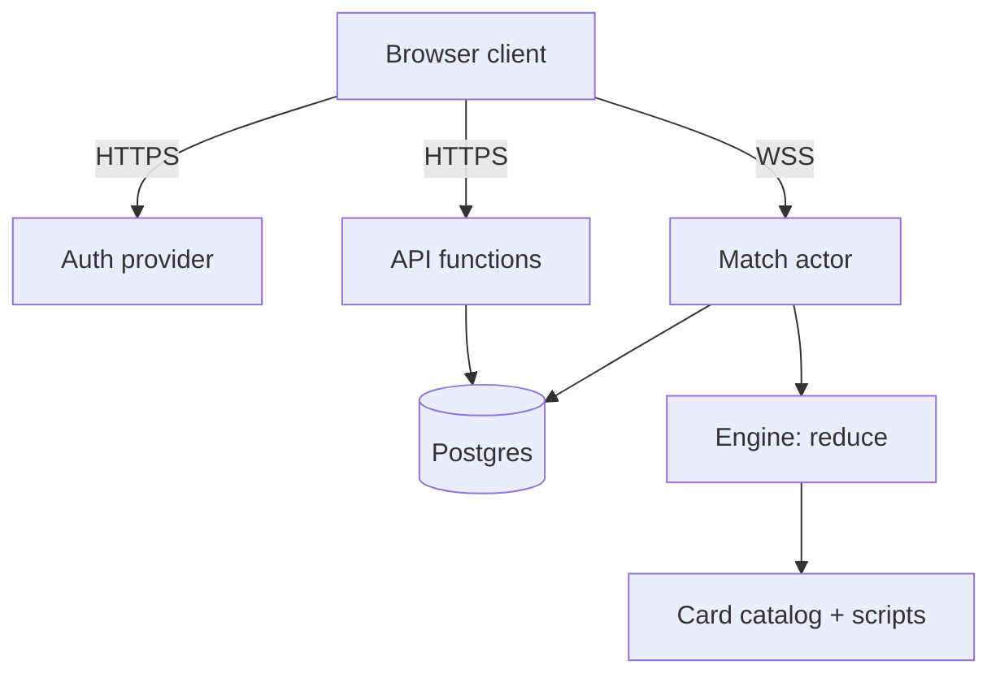

## 9. Architecture

The match runs on the server as a pure, seeded reducer inside one actor per match; the client sends intent and receives a filtered view.

### 9.1 Trust model

| Domain | Truth lives | Client may | JackiOh specifics |
| --- | --- | --- | --- |
| Identity and entitlement | Server | Read a projection | A collection is earned and opened as [[§14]] says, every grant a row of the ledger ([[§14.11]]): a new account starts with the starter cards ([[R1310000]]), and an account active before the economy went live ([[§14.12]]) kept every card it owned then ([[R1310002]]). Jlore, packs, pity counters, bars, tracks and quests are the server's too, each account reading only its own |
| Usernames | Server validates and stores | Propose (after the server's preview), render | A base name with a `#n` tag when it is taken, unique by case fold, `Player#n` until the player picks one, changed once a day; a label only: a player is always keyed by profile id, and a username is looked up only to check it is free, by the players tab's search, to sign in by it and to name the player a friend request asks ([[R1432]]–[[R1436]], [[R1443]], [[§9.4]]) |
| Decks and trios | Server validates and stores | Propose | Up to 10 named decks and 5 trios of 3 decks; a queued deck or trio passes [[§9.4]]'s rules, and a trio's decks share no card; an imported trio is checked and saved whole or not at all ([[R341]]) |
| Tutorial progress | Device, and the server for an active account | Propose (merged, never removed) | Lessons won and the Hide/Show choice; the union of both copies ([[R320]], [[R321]]) |
| Game settings | Device, and the server for an active account | Propose (the newer group wins) | The settings dialog's switches, volumes and choices, and the cosmetics the collection equips ([[R1295000]], [[R1579000]]), in five groups, each with the time it last changed; a group replaces the stored one only when later ([[R633]], [[R634]]), and the server refuses a cosmetic pick the account does not own ([[R1834001]]). A card's own cosmetic picks are kept in a table of their own, `card_cosmetic_picks`, which only its account reads and only the server writes, the device's copy their cache ([[R1834000]]). "Show opponents' cosmetics", in the `cards` group, changes only what its viewer draws ([[R1834004]]) |
| Match | Server | Read `viewFor(state, playerId)`, submit actions | Hidden: library order, the opponent's library, a card in your own library you were never shown ([[R312]]), opponent hand, face-down traps, the other player's pending-choice options |

One rule: the client sends intent ("play instance 7 in zone 3 with target 12"), never state.

A credential never travels in an address: a socket offers its sign-in as a subprotocol beside `jackioh.v1`, the only name the server answers with ([[R1379000]]).

### 9.2 Topology



The match actor (Durable Object or equivalent) is the only stateful component: it holds the state in memory, one WebSocket per player, an alarm for the turn clock, and it appends every resolved action to the log. Idle actors hibernate. Every socket, a player's, a co-op seat's and a watcher's, is signed in by its handshake's offered credential, never its address ([[R1379000]]).

### 9.3 Engine requirements (binding on section 10)

- `reduce(state, action, rng)` is pure: no I/O, no clock reads, no framework. Timestamps arrive as action data.
- Seeded RNG only, `Math.random` banned by lint. `(seed, log)` reconstructs any match.
- Mid-action choices are state, not callbacks: a choice made during resolution (Discover, mulligan, chained steps, Echo repeats, triggered effects) sets `state.pending` and returns; the answer is another action. The choices a card declares for its own play (zone, X, embiggen, Tribute, targets, modes) travel in the `play` action instead ([[R81]]). This is what makes prompts identical in live play, replays and tests.
- Every action carries a client nonce, deduped server-side: the log answers a nonce it already holds at the same seq with that row ([[R776000]]).
- `reduce` refuses illegal actions itself and returns the reason; client greying-out is UX only.
- Append-only action log per match. An actor stopped for a restart stores one checkpoint of its state after the log's newest row; the next rebuild starts there and folds only the rows after it when every check passes (the same rules build, catalog and checkpoint version, its row still logged, its integrity hash), and otherwise folds the whole log. A match that ends drops its checkpoint, and no replay reads one. A replay shows a seat each step exactly as `view_for` did, folded under the catalog version it was played on, and is refused on a version the build neither is nor carries or on a final-hash mismatch ([[R768]], [[R767000]]). Its board draws that seat's own open prompt as it was offered, folded, greyed and sending nothing, and the other seat's as the waiting panel ([[R2211000]]). A clip of one is shared as a GIF drawn from its steps' views alone, with no account name ([[R513000]]).

### 9.4 Accounts, collection, loadouts

- Managed auth provider; `profiles.status` in pending, active, banned. A pending account can log in, verify its email and see the code screen, and nothing else: no collection, loadout, queue or match. Redeeming an invite code flips pending to active.
- Codes: 16 characters (80 bits) from a 32-symbol alphabet without 0/O/1/I/l, formatted `XXXX-XXXX-XXXX-XXXX`, stored hashed. Redemption first refuses an account owing the age check or agreement to the terms in force, costing no attempt ([[R757000]], [[R757001]]); then it is one server-side transaction: (1) reject unless the account is pending with a verified email; (2) reject if this profile made more than 5 attempts in the last hour; (3) reject if this IP hash made more than 20; (4) log the attempt either way; (5) look up by hash and reject if revoked, expired or exhausted; (6) increment uses and set the account active, atomically. Missing, expired and exhausted codes return an identical error in identical time. A global circuit breaker disables redemption and alerts when system-wide failures cross a threshold in a window. Trusted devices (a signed device token that skips the code screen after a reinstall) are optional and never authorise an account.
- The client's code screen and sign-in screens are UX over the rules above and decide nothing the server does not. The code is typed into one field drawn as four groups, read exactly as the server reads it ([[R191]]), and submitted only when complete, so a partial code costs no attempt. The screen shows how many attempts the account has left in the window and, with none left, when one comes back. A refusal at steps 2 or 3 is shown as a rate limit with its wait ([[R192]]), never as the identical error. A code refused with [[R145]]'s identical error is not sent again until the player changes it, since it cannot turn good and each try counts, and the field is locked while a code is being redeemed. Sign-in, sign-up, confirmation resend, password reset and a signed-in player's change of email (from the account page (`/account`), [[R663]]) go straight to the auth provider ([[§9.2]]), except a sign-in by username, which the server makes for the player so that no address reaches the browser ([[R1443]]). Every refusal is mapped to the client's own sentence, and none reveals whether an account exists ([[R160]], [[R192]]). Emailed links are read once and scrubbed from the address bar ([[R193]]), and a session is renewed or ended as [[R194]] says. Every screen on the way (landing, sign-in, reset, the code screen, the gate's own panels, a screen whose code failed to load, and a check that runs long) offers a way back. The per-IP limit of step 3 counts the address [[R190]] names.
- Usernames. Every account has a username: a base name and, when another player holds that name, a numeric tag (`Max`, `Max#1`, `Max#2`). The base is `USERNAME_MIN_LENGTH` (2) to `USERNAME_MAX_LENGTH` (16) user-perceived characters of letters, digits, `_` and a letter's combining marks, in one script or a mix a language needs, and is stored in its NFKC form ([[R1432]]). A light profanity filter is the only content check, and no name is reserved ([[R1433]]). Two names clash when their NFKC case folds match: the first player to pick one gets it bare and each after the lowest free tag, and a new account starts as `Player#n` ([[R1434]]). A player changes their username at most once every 24 hours, through a preview the server answers with the exact username a save gives or why it refuses, and an account that has just turned active is asked for one before anything else, with a way to skip ([[R1435]]). A username is a label only: the server, the database and every request key a player by profile id, and every read that shows a player carries both ([[R1436]]); the one request that names its caller by username is a sign-in by username, made before there is a token, which the server turns into the provider's session for that profile ([[R1443]]).
- Friends. An active account adds a friend by their exact username, `name#tag` as [[R1434]] tags it: there is no search and no list to browse. A request by a name nobody holds and a request between two players either of whom blocks the other get the same answer, not found, so a request never tells whether a name exists or has blocked its sender. A request to oneself, to a friend, a second one to the same player, or one past `MAX_FRIENDS` (200) friends is refused with its reason, and requests past `FRIEND_REQUESTS_PER_HOUR` (20) in an hour are refused as a rate limit. A request the other player has already sent the requester is accepted at once, a mutual add. Accepting makes the friendship and deletes the request; declining it, and its sender canceling it, delete it; either friend may remove the friendship, which cancels every open challenge between the two, either way, and frees its room, as a block does ([[R1689000]]). A friend is keyed by profile id and shown by username ([[R1436]]), and a request or a friendship is readable by its own two players only.
- Blocks. A player may block another player. A block removes their friendship, every request and every replay share between them, either way, ends at once a watch of either by the other, and while it stands stops new requests, challenges, chat and replay shares between the two, both ways ([[§9.5]]); unblocking lifts it and restores nothing. A match between the two relays neither one's emotes to the other from the block to the match's end, while the game plays on as before ([[R1351000]]); a block never changes who the queue pairs. A player's blocks are readable by that player alone.
- Presence. A signed-in client of an active account sends a heartbeat every `PRESENCE_HEARTBEAT_MS` (45 s). A friend's status is in a match while a live match, a Conquest series or a co-op game ([[§13]]) holds them, online while their last heartbeat is within `PRESENCE_TTL_MS` (90 s), and offline otherwise. Heartbeats are the server's alone, and a status reaches only the player's friends. The client reads the friends list again every `PRESENCE_HEARTBEAT_MS`, the pace a status changes at, and a screen other than Play together only while its friends panel is open; the server answers it in one transaction by a fixed number of reads, whatever the number of friends. The unread counts and the challenges are read every `SOCIAL_POLL_MS` (10 s), one read of each shared by a tab's screens.
- Collection is an entitlement ledger (`collection` plus append-only `collection_grants`); catalog is static, versioned, shipped with the client; stale catalog version is rejected at save and at every door into a match: the queue, a room's join, a co-op room's join and a rematch offer ([[R1638000]]). The catalog version is the latest card patch's ([[R105]], [[R388]]): every patch is kept as a snapshot of the whole catalog, in order, so an older version of a card can still be read (the collection's History, a public Patch notes page, and the server's `GET /api/catalog/:version`), and a match folds under the version it started with. Becoming active grants the starter cards ([[R111]], [[R1310000]]), and every other card comes as [[§14]] says: a patch's new cards are granted to nobody ([[R1310001]]). Until the economy went live ([[§14.12]]), the launch grant was every non-token card and each patch's new cards went to every person's active account ([[R481]]). Every collection change writes `collection` and `collection_grants` in one transaction, and no client path writes either.
- Decks and trios. A player saves up to `MAX_SAVED_DECKS` (10) named decks and builds up to `MAX_SAVED_TRIOS` (5) trios from them; a trio is three of the player's saved decks, in order ([[R250]], [[R252]]). Both are drafts, so a save checks structure and never legality: a deck's **D1** name of 1 to `DECK_NAME_MAX_LENGTH` (40) characters, **D2** at most `DECK_SIZE` cards, **D3** every card a deckable card of the catalog, **D4** at most `MAX_COPIES` of a card, **D5** the deck's `portrait` `null` or a known portrait id ([[R641]]), and on the server one the account owns ([[R1827000]]); a deck also carries its playmat, backdrop and card back picks, each `null` or an id of its kind ([[R1297000]]), and on the server one the account owns ([[R1833000]], [[R1834001]]); a trio's **T1** name, **T2** three slots, any of them empty, **T3** no deck twice. An incomplete deck, a card the player does not own and a trio whose decks share a card are all kept, and judged when queued. A card is its catalog id: Radiant is a flag on a card in play ([[§5.2]]), never a second card ([[R251]]). Every deck and trio has an id the client mints, and saving one is an idempotent upsert of it alone ([[R256]]); deleting a deck empties the trio slots that held it. The catalog version the client holds is checked at save. A deck travels between players as a versioned deck code ([[R255]]), and a trio with its three decks as a versioned trio code ([[R339]]); both are at version 2 since patch v0.2.0, which writes each card's number with its set (Core n, Classic 1000 + n, Classic+ 2000 + n, Meditative 3000 + n, Meditative+ 4000 + n, [[R1410]]), and a version 1 code, which every code minted before it is, still reads as Core numbers; importing one makes the decks and the trio together, under both caps, or makes nothing and says how many slots it needs ([[R340]], [[R341]]). The single loadout of three decks that came before became three saved decks and one trio ([[R254]]). Each save of a deck keeps a version of its name and cards on the account, a save within `DECK_VERSION_DEBOUNCE_MS` (60 s) of the newest replacing it, at most `DECK_VERSIONS_KEPT` (20) per deck, and restoring one saves it again as a new version, so a restore can be undone ([[R2100000]]).
- Age and terms. A person may hold an account from `MIN_ACCOUNT_AGE_YEARS` (13). Sign-up asks the month and year of birth, nothing chosen and no age named, and an answer under the minimum makes no account and is remembered on the device; the server counts the age again, deletes an account under the minimum the way "Delete my account" does, and keeps only that the check passed, when and against which minimum, never the birth date ([[R757000]]). Sign-up needs an unticked box agreeing to the Terms and the Privacy Policy, and each account's agreement is kept per version (`TERMS_VERSION`, both pages' dates) with its time; an account that owes the version in force is asked again on the gated screens, never on `/account` or mid-match ([[R757001]]), and on `/replays` before its online half ([[R970000]]). A second change to a page on one day gives its half of the version a letter, and a test holds each version to the pages' words ([[R970001]]). The presence heartbeat records nothing while the account owes the terms ([[R970002]]).
- An active account also keeps its tutorial progress ([[§9.10]], [[R320]]): the player reads its own row, and the server merges into it and never removes a lesson.
- An active account also keeps its game settings ([[§10.11]], [[R633]]): the player reads its own row, and the server replaces a group of it only with a strictly later one ([[R634]]).
- Queue rules, checked by one validator module shared by client and server, when a deck or a trio is queued or brought to a room: **L1** a trio holds exactly 3 decks; **L2** exactly `DECK_SIZE` (25) cards per deck, which a deck saved at 20 before #1705 fails until it is filled ([[R1705001]]); **L3** at most `MAX_COPIES` (1) of a card per deck, a Core card and its Training Grounds Legacy card counting as two ([[R2511001]], superseding [[R2195000]]), no Token-tagged cards and no card of a set that has not shipped ([[R1420]]); **L4** a card id appears in at most one deck of a trio, so one deck may hold a Core card and another its Legacy card; **L5** copies never exceed the quantity owned; **L6** every card exists in the current catalog version and is not banned. A Best-of-1 deck must pass L2, L3, L5 and L6, and a Conquest trio all six ([[R253]]). A queue-time failure names the deck and the card. The chosen deck or trio is frozen into the queue ticket or the room.

### 9.5 Matchmaking and lifecycle

- Direct challenge by room code (6 characters from the invite-code alphabet) ships before the ranked queue and is the primary mode while the player base is small. Enqueue asserts the account is active and not in a match, a series or a live co-op match ([[R1065000]]), validates the chosen deck or trio ([[§9.4]]), freezes it into the ticket and returns the ticket id. Pairing runs on enqueue plus a sweeper every few seconds; the window widens ±50 rating every 10 s from ±100 and stops at `MAX_FAIR_GAP` (±400, its width at 60 s), so two people further apart than that never pair, however long they wait ([[R640001]]); both tickets are claimed in one atomic statement. A queue pair's seats come from [[R1989000]]'s coin on the match seed, so the same seed always seats the same way. A match seat is claimed the same way: the first writer wins and every other starter backs out through its own failed-start cleanup, so no queue pair, room join, rematch or series game seats a player twice ([[R890000]]). Since [[R1523000]] the guard is one seat ledger in the server, which every door into a 1v1 match, a series or a co-op match reserves all its seats through in one step, the flag staying the record and a second guard; a claim a newer server's epoch has fenced during a deploy writes nothing and answers 503. The client shows the queue's readout instead of an endless spinner: each mode's expected wait and the games played in the last hour, every number one the server counted ([[R640002]]), kept a few seconds so every waiting client's poll shares one count ([[R1996000]]). A queued player may leave the lobby while they wait: a pairing takes them to the game from wherever they are in the client, and while their match or series is live the main menu and the practice menu show a banner with the way back to it ([[R765]]). A ticket whose player has gone quiet is canceled before it can pair: every signed-in request refreshes the caller's presence, and a sweep cancels a ticket unheard from for longer than `QUEUE_TICKET_STALE_MS`, so an absent player is never seated and never charged ([[R897000]]).
- Empty-queue fallback. While the server's `LADDER_BOTS` is `on`, a ticket of any mode that has waited past its own fallback time, 15–40 s drawn from its id and a key no client holds, pairs with a ladder bot, an opponent the server plays itself ([[§9.12]], [[R1452]]). Each sweep pairs every two people it can first, so a person inside the window always comes before a bot, and a bot before a person further away than `MAX_FAIR_GAP` ([[R640001]]). The terms of service's "AI opponents" section says when and why ranked may pair a player with an AI opponent, what one looks like and does, and that nothing in the game marks it, and names no seat ([[R2614000]]). The bot is the free one on its schedule closest to the player's rating, never one of the player's last five opponents, and a player rated above every bot gets none but a grinder within `MAX_FAIR_GAP` of them ([[R1555000]]). The ticket and the bot are claimed together, as a pair of tickets is, and [[R1989000]]'s coin on the match seed seats them; whoever takes Player 1 takes the first turn, and the match is ranked ([[R1453]]). A Conquest ticket's bot holds a trio the pool dealt it, and the two play a ranked series, [[R1989000]]'s coin winner as series Player 1: the bot makes each sealed pick a person's delay after the pick phase opens, by a simple rule from the matchup, the series is rated once when it ends, and until it does nothing else seats the bot ([[R641000]]). While the top bots grind, a sweep that finds no ticket queued in any mode kicks off one ranked Best-of-1 match between the lowest-rated free grinder and the free bot closest in rating to it, at most one live and five minutes after the last ended, which the two play out alone, rated as any bot's game is; whoever queues meanwhile is paired as before ([[R1555000]]).
- The turn clock (75 s) ends a stalled turn. A prompt held by the non-active player has its own 30 s clock. The two mulligans share one 45 s clock, which a player's answer neither stops nor extends for the other ([[R268]]). Disconnect grace (60 s) and concede end the match as a loss, and the hard wall-clock ceiling (120 minutes since patch v0.2.0, [[R389]]) ends it as a draw through the `ceilingReached` action. In the client every way off a live 1v1 board asks first and names the grace in seconds, and once the match has a result it goes at once ([[R2479000]]). Every ending records a result and clears both players' in-match state, in one write: one the store fails is tried again, and one that never lands leaves the match live for the next socket's rebuild to record ([[R1437]]). The write clears a seat's in-match flag only while the flag still names the ending match, so a late result never takes a player out of a newer one ([[R1896000]]). A clock's action the store fails to write is tried again a second later until it lands, and an actor its log has moved past lets go for the next socket to rebuild it from the log ([[R776000]]). A live action whose `reduce` panics changes nothing and is answered `internal` and filed for the night bot, and a clock's action that does ends the match at once as the reaper's ceiling draw ([[R1253000]]). A reaper resolves anything past the ceiling, recording the result a match's log already holds and drawing only one that does not end ([[R833000]], [[R112]]), and deletes a room or a reserved match id still open five minutes past its expiry or its claim, which frees its code and both players ([[R1450]]). Ranked games move the hidden Glicko-2 rating ([[§9.12]], [[R603]]). The clocks, the ceiling, the grace window and the room codes are server config values ([[R79]]).
- Reconnect gets a fresh full view, never a log replay. Repeated `hello` frames while one is still queued collapse into it ([[R835001]]). The clock keeps running while a player is disconnected, and the grace countdown is stored on the match so both clients show it. A crashed actor rebuilds its state by folding `(seed, log)`, from its checkpoint when one passes ([[§9.3]]). A seat whose socket has not attached when the first socket reaches its match's actor (after a restart, or a player who never opens the match) is disconnected from then, and keeps a grace deadline the restart left stored ([[R744]]). A match socket that goes quiet is found rather than waited for: the server pings it every 15 s and drops it after 45 s with no frame of any kind, which is a disconnect and starts the grace, and closes one whose outgoing queue overflows; a page that wakes asks a socket it has not heard from for a ping interval for a full view and replaces it if none comes ([[R1441]]). A match socket refused because its sign-in did not verify (4401) opens once more when the page holds a different token, a renewed one; the 4401 stays final for the token it refused, as 4403 and 4404 are final for the match, so nothing loops ([[R1115000]]).
- Modes. The queue and the room challenge offer three modes, and a ticket pairs only with a ticket of the same mode ([[R257]]): **Best of 1**, one saved deck; **Conquest**, a trio (below; its queue name is still `bo3`, [[R330]]); **All Random**, both players dealt a deck by the weighted random deck-builder [[§9.9]] names, with no saved deck needed ([[R258]]); each player may pick "More cards from" a set for their own deck, the newest set that ships or any set that ships, at least half of it from that set, sent as intent with the queue, room or rematch request and dealt by the server ([[R1372]], [[R924000]]), and offered beside every random deck a player can start a game on, a friend's All Random challenge, sent or accepted, among them ([[R2031000]]). A room is made in its host's mode, and a joiner plays that mode ([[R264]]). The host and the joiner are seated by [[R1989000]]'s coin on the match or series seed, which the join's answer names. Its host may cancel a room nobody has joined, which frees its code at once ([[R110]]) and never touches a room someone joined, and the lobby lists the host's open rooms back to them, so a reload shows the code again; a room a friend's challenge opened is canceled with its challenge ([[R1075000]]). The host can share a room as a link that opens the lobby with the code filled in and the room's mode chosen; the joiner still picks and presses Join ([[R767]]).
- Portraits and emotes. A match's two seats are shown as hero portraits ([[R641]]), each fixed when the seat is fixed — a queued deck's own, an All Random seat's dealt at random, a Conquest game's the picked deck's — and sent to both clients on join and on reconnect in a `portraits` message ([[R642]]). Each seat's loadout of cosmetics, frozen as the match starts, rides the same way in a `loadouts` message, to a watcher too, and a card's own picks in a `cardLoadouts` message once a view has shown that card, none of it in `PlayerView` ([[R1834002]], [[R1834003]]). The emotes of [[§10.10]] are a pool of twenty-four — five voice lines in each portrait's own voice and nineteen shared emoji ([[R1340]]) — of which each seat is dealt a hand of eight each game, three lines and five emoji, from the match seed on a stream of its own (`{seed}:emotes:{seat}`), so the same eight come back on a reconnect, a restart and a replay, and no game state sees them ([[R1341]]). The `portraits` message carries the receiving account's own hand, never the opponent's and never `PlayerView` ([[R1342]]). In a match a player may send an emote of their hand through a top-level `emote` message that never enters `ActionBody`, the action log, the replay hash or a game record; the actor relays it to the opponent alone, refuses one outside the sender's hand silently and before the limit ([[R1342]]), drops it silently past the shared rate limit, and answers an unknown id as `malformed` ([[R643]]); between two players either of whom blocks the other it relays nothing, after both checks ([[R1351000]]).
- Rematch. After a match that is not a game of a Conquest series ends, either seat may offer a rematch: a normal one, or double-or-nothing ([[R672]]). An offer is taken only through `REMATCH_OFFER_TTL_MS` after the finished match's end, a later one lapsing silently and recording nothing ([[R2685000]]), and a new match is created only when both seats have offered with equal stakes within that window; mismatched stakes create nothing. The rematch swaps the finished match's seats — the previous Player 2 taking Player 1 — and replays its frozen decks under a fresh seed (an All Random rematch deals fresh decks from that seed, each leaning on the set its seat's offer picked, if any, [[R258]], [[R1372]], [[R924000]]), and it is ranked exactly when the finished match was. A match played on a catalog version other than the server's, a card patch having gone live since it began, offers no rematch: every offer on it, a ladder bot's too, is refused with `update_required`, telling the players the cards changed and to start a new game ([[R1638000]]). Either seat sees the offer buttons only while the opponent is still present — presence is the opponent's match socket being open, so the buttons disappear when they leave or log out. A seat may reopen its finished match's socket only within `REMATCH_OFFER_TTL_MS` of the match's end, and never once the retention purge has taken its log; after that the game is watched from the replays list ([[R1285000]]). A ladder bot has no socket: after a ranked game it reads as present for a linger it draws, as a person still on the death screen does, and may offer a rematch or meet one in that time ([[R639000]]). A game of a series offers no rematch: the Conquest continue flow owns what comes next.
- The opponent's aim. While a player aims a play, an Activate or an attack, by drag or by click-select, the opponent sees Hearthstone's targeting arrow from its source to the target it is over, gone when the aim ends. It travels in a top-level `aim` message that is never an `ActionBody` or part of `PlayerView` and decides no rule; its ends are public handles only — a hero, a zone of the field, a hand card's position — so a hand card's arrow starts at its back and a face-down card is only ever its zone. The actor shape-checks it, relays it to the opponent alone, coalesces it to one relay per `AIM_RELAY_INTERVAL_MS`, and drops one that names anything the opponent may not see ([[R738]]). A ladder bot's targeted moves show its aim the same way, through the same relay, a beat before the move ([[R639000]]).
- Conquest. A player takes the series by winning one game with each of the three decks of the trio frozen when they queued: `SERIES_WINS_NEEDED` (3) game wins, one per deck, because a deck that wins is locked for the rest of the series, while a deck that lost or drew may be picked again ([[R330]]). Before each game both players pick at once, from their decks that have not won, on the series screen: a pick is sealed, final once made and hidden from the other player, who sees only that it is in, and the game starts as soon as both are in ([[R331]], [[R338]]). A player with one deck left has it picked for them, and when both do the game starts at once ([[R332]]). Picking has a clock, which gives a late player their first deck that has not won ([[R333]]). A drawn game counts for neither side and locks nothing, and a series plays at most `SERIES_MAX_GAMES` (7) games, after which more wins takes it and equal wins is a series draw; a concede or a disconnect loses the game, not the series; between games a player may forfeit the series ([[R334]]). Series seat p1, [[R1989000]]'s coin winner on the series seed, goes first in odd games ([[R335]]). Each side sees which of both sides' decks have won, and nothing else of the other side's trio ([[R336]]). A series moves the rating once, when it ends ([[R262]]). It lives in the database, picks included, and survives a server restart ([[R263]]); one begun as a Best of 3 goes on as a Conquest ([[R337]]).
- Replays. Either seat of a finished match may watch it again, from its result panel or from the recent games (`/replays`), until the retention purge takes its action log (`MATCH_ACTION_RETENTION_DAYS`). `GET /api/replays` lists the caller's finished matches whose log is kept, newest first, a page at a time, and `GET /api/replays/:matchId` answers a page of steps of the caller's own seat; an account that held no seat gets what an unknown id gets, so a match id's existence never leaks ([[R768]], [[R767000]]). Nothing but each step's `view_for`, with the seats' frozen loadouts and the picks of the cards those steps show ([[R1834003]]), leaves: no seed, log, state or deck. "Watch the replay" opens a replay at its first step and "Share the last turn" at its last, its turn's GIF already being made ([[R768000]], [[R513000]]). A row of the recent games that can be watched can be downloaded as one JSON file for a bug report: its steps' views, the row's own facts and the build's catalog version, and no account's name or id ([[R1141000]]). A downloaded file opens again from the recent games: the page parses only the documented `jackioh-replay` v1 shape, or a co-op replay's `jackioh-duos-replay` v1 ([[R1242000]]), requires its own catalog version, holds the file to byte and step caps, and mounts the verified steps in an in-memory source, or a co-op file's on the co-op replay player, refusing anything else where it stands; the file is never uploaded or kept ([[R1141000]]).
- Play together. One page (`/together`) holds what a player does with friends, behind the sign-in and the active account Play online asks for: the friends list with each friend's status, the requests in and out with accept, decline and cancel, the blocked players with unblock, the add form by `name#tag`, which shows the server's refusal in its own words, and for each friend Challenge (an online friend in no match), Watch (a game the player may watch, below), Chat, Remove and Block; the replays friends have shared; and co-op rooms ([[§13.9]]). The landing's Play door opens the `/play` hub ([[R1578000]]), which holds every way to play on one screen, online first, and links this page; Play together lives at `/together` behind the gate. Every signed-in screen but sign-in and a password reset has a Friends button at the top right (on a board, in its controls), badged with the incoming requests (as last read), challenges and unread messages; its panel holds the player's `name#tag`, the add form, the incoming requests, the friends online first with Challenge, Watch and Chat as here, and a link here.
- Challenging a friend. A player challenges an online friend who is in no match: the challenge makes a room exactly as a room challenge does, in the challenger's mode with the same choices ([[R264]]), and an open challenge naming its code. A second open challenge to the same friend, and one to a friend who is in a match or offline, are refused. The friend sees the challenge wherever they are in the signed-in client; accepting it is joining the room by its code, which marks the challenge accepted, from the toast with the deck or trio picked there, a refused join offering the lobby with the code filled in ([[R767]], [[R1831000]]). The challenge dialog opens on the last mode and pick; a player in a game is offered none. Only the friend may join a challenge's room, and only while the two are friends neither of whom blocks the other: anyone else, and the friend once that has ended, gets the answer an unknown code gets, and a challenge whose friendship ends while it is being made is not opened ([[R1689000]]). Declining it, the challenger canceling it, and its expiry `CHALLENGE_TTL_MS` (2 minutes) after it was made each free the room. A challenge is kept no longer than that: once its `CHALLENGE_TTL_MS` has passed the sweeper deletes it, whatever became of it. A player sends at most `CHALLENGES_PER_HOUR` (30) challenges an hour. A friend's challenge is a room challenge, so unranked ([[§9.12]]).
- Watching a friend. A player may watch a friend's live 1v1 match, ranked or unranked, while fewer than `SPECTATORS_PER_MATCH` (8) watch it, and no setting turns that off: the friendship is the way out ([[R2615000]]). The watcher sees the friend's seat's `view_for`, each view `SPECTATE_DELAY_MS` (5 s) after the state it shows and with no legal action, so a watcher cannot tell the opponent what the friend holds while it still matters. A full match, a player who is not a friend and a blocked pair are refused, and a watcher already in is let go the same way (`forbidden`, then closed) the moment the two stop being friends or one blocks the other. A watcher's frames never reach the reducer, and a watcher leaving changes nothing in the match. Both players are told how many watch whenever that count changes. A watch ends with the match: once a watcher has been sent the view that shows the result, its socket is closed and both players are told the new count ([[R1107000]]). A co-op game cannot be watched ([[§13]]). A watch socket that goes quiet is checked when its tab wakes: a page that wakes probes a socket quiet past the ping interval with hello, which the server answers with the view it last sent that watcher and nothing newer ([[R1103000]]), and replaces it if nothing answers within the probe deadline, up to the reconnect attempt bound ([[R1441]]). A watcher's socket keeps a seat's limits: it is answered at most one later hello per `WATCH_HELLO_INTERVAL_MS` (1 s), and its frames that are not a hello, unanswered, close it with 1008 past `MALFORMED_FRAMES_PER_WINDOW` ([[R2609000]]).
- Shared replays. A player who held a seat in a finished match may share its replay with a friend: the friend's replay route then answers the sharer's seat's steps, as it answers the sharer ([[R768]]), until the sharer withdraws it (only the sharer can), the two stop being friends or one blocks the other, which deletes every share between them for good, or the retention purge takes the log. Anyone else still gets what an unknown id gets. The recent games and the replay player offer "Share with a friend", which shows the friends the replay is already shared with, read from the server as it opens, so the sharer withdraws a share there on any later visit ([[R1435000]]), and Play together lists the replays shared with the player, each opening its replay.
- Chat. Friends may write to each other, and nobody else: a message is 1 to `CHAT_MAX_CHARS` (500) characters once trimmed, a word the usernames' profanity filter catches ([[R1433]]) is masked with `*`, and a sender writes at most `CHAT_MESSAGES_PER_MINUTE` (20) a minute. A conversation is read a page at a time, `CHAT_PAGE` (50) messages, newest last, messages sent in the same instant in the order of their ids, each earlier page asked for by the cursor the page after it answered ([[R1384000]]), and reading a page marks it read; the client asks again every `CHAT_POLL_MS` (4 s) while a conversation is open, and the friends panel opens a conversation on any screen. A message the player sends shows at once at the end of the conversation, marked as sending, the sends going to the server one at a time in the order sent, and the server's copy replaces it when it answers; a refused or failed one is marked failed in the server's words, with Retry and Discard ([[R2120000]]). A message holding a room link of this site draws a Join button that opens the link in the app, while the message itself stays text ([[R2094000]]). A message may be reported, once per reporter, and its sender blocked ([[§9.4]]). A message is readable by its two players only, and the retention loop deletes those older than `CHAT_RETENTION_DAYS` (30).
- Co-op. Two friends play Duos against an AI team from a co-op room on Play together ([[§13]], [[§13.9]]); the friend is invited by the room's link, shared in chat or by hand ([[R2094000]]).

### 9.6 Build order

| Step | Scope | Spec sections it needs |
| --- | --- | --- |
| 1 | Pure seeded `reduce`, local hotseat, every Core card | 2–8, 10 |
| 2 | Auth, profiles, invite gate | 9.4 |
| 3 | Collection ledger; grant everything to everyone | 9.4 |
| 4 | Loadout builder and shared validator with the unique index | 2.6, 9.4 |
| 5 | Match actor, WebSocket, `viewFor`, action log, room-code challenge | 9.1–9.3, 10.8 |
| 6 | Turn clock, disconnect grace, concede, results | 2.5, 9.5 |
| 7 | Ranked queue with frozen decks | 9.5 |
| 8 | Economy: Jlore, packs, tokens, cosmetics, set tracks and quests, every grant through the ledger | 9.4, 14 |
| 9 | Play together: friends, challenges, watching, shared replays, chat, and Duos co-op | 9.4, 9.5, 12 |

Out of scope: public replay links, watching a player who is not a friend, tournaments, behavioral anti-cheat, real money ([[§14]]), and what [[§13]] leaves out of Duos. Player-facing replays and watching are in: a player watches their own finished games again, shares a turn as a GIF ([[R768]], [[R768000]]) and shares a finished game's replay with a friend, and a friend watches a live game, ranked or unranked, after a delay ([[§9.5]]).

### 9.7 Suggested repository layout

```
crates/
  engine/      reduce, state, events, rng, combat, triggers, zones, view_for; wire/ (action, event and
               catalog types); validator.rs (deck, trio and queue rules D1–D5, T1–T3, L1–L6, shared by
               client and server)
  cards/       catalog.json (634 cards + 140 tokens across Core, Classic, Classic+, Meditative, Meditative+, Stinkyscape,
               Training Grounds), patches/ (one snapshot per card patch),
               src/scripts/core/, classic/, classic_plus/, meditative/, meditative_plus/, stinkyscape/,
               training_grounds/: one file per card, its tests inside it
  ai/          the practice opponent
  wasm/        the engine, cards, AI and validator as WebAssembly for the client
  server/      API functions, match actor, matchmaking
  tools/       the `jackioh` CLI: fuzz, replay, the catalog and spec checks, the AI's gates
apps/
  web/         client (board, hand, prompts, animations driven by events)
e2e/           Cypress: hotseat games and networked room-code games
```

### 9.8 Abuse surface

| Vector | Mitigation |
| --- | --- |
| Claiming unowned cards | The collection is server-owned; loadouts are validated against it (9.4) |
| Farming or forging the economy | Every roll and grant is the server's, seeded and logged; a game's XP is capped, and the Jlore an account's games pay stops at `JLORE_GAMES_DAILY_CAP` a UTC day; a game the server runs (ladder, unranked, Conquest or co-op) has its actions counted from the server's own log, and a practice game pays only once the server has replayed it, on a seed of which an account holds at most `PRACTICE_SEEDS_OPEN_MAX` open ([[R1483000]], [[R1502000]], 14.8, 14.11) |
| Deck swapped after matchmaking | Decks are frozen into the ticket (9.4) |
| Reading a Conquest opponent's pick or decks | A pick leaves the server only in its owner's projection, and the other side's deck names and lists never do ([[R331]], [[R336]]) |
| Illegal actions | `reduce` rejects them; client checks are UX only (9.3) |
| Reading deck order or the opponent's hand | Never sent; `viewFor` sends counts (10.8) |
| Stalling | Server clock, disconnect grace, hard match ceiling (9.5) |
| A dead or unread match socket | Server ping and idle timeout start its grace; a bounded outbox closes a socket that stops reading ([[R1441]]) |
| Action flooding | Per-match rate limit in the actor, per-account rate limit at the API, which also counts every match, co-op and watch socket upgrade and refuses an account it knows is past it before the database is read ([[R2478000]]); refusals past [[R835000]]'s threshold in a match or [[R1717000]]'s at the API alert, `hello` repeats coalesce ([[R835001]]) and a watcher's are answered once per `WATCH_HELLO_INTERVAL_MS` ([[R2609000]]), malformed frames past [[R835002]]'s budget close the socket, a watcher's included ([[R2609000]]) |
| Invite code brute force | 80-bit hashed codes, per-account and per-IP limits, verified email, circuit breaker (9.4) |
| Multi-accounting to farm rating | Invite codes; watch for clusters of accounts sharing an IP hash |
| Friend-request spam, or probing which names exist | Requests by exact username only, an hourly limit, and an unknown name answered as a block is (9.4) |
| Unwanted chat | Friends only, a per-sender limit, the profanity mask, report and block (9.5) |
| Ghosting through a watcher | A friend only, ranked or unranked, the friend's own seat only, `SPECTATE_DELAY_MS` behind, and the friend can unfriend or block, which ends a watch already running at once (9.5, [[R2615000]]) |
| Challenge spam | A per-account hourly limit, and a challenge's row deleted once its `CHALLENGE_TTL_MS` has passed (9.5) |
| Reading the other team in Duos | A seat's view adds only its teammate's own view, and a ping is shape-checked and relayed to the teammate alone (12.6, 12.10) |

Every rejected action is logged with its reason, and accounts with an unusual rejection rate raise an alert.

### 9.9 Practice against the AI

Practice is a single-player game against a computer opponent, on the client's `/practice` route. It needs no account and no server. The engine and the AI run in the player's browser, in a Web Worker, and the page receives only `viewFor(state, human)`, the human's `legalActions` and whether the AI owes an action. The worker stands where [[§9.1]] puts the server. A practice game records no result, no rating and no collection change, and it replays exactly from `(seed, decks, handicaps, log)` ([[R187]]); an active account's free game on a server seed earns as [[§14.8]] says ([[R1303000]]). A finished free game is kept on the device, the last `PRACTICE_REPLAYS_KEPT` of them, with its setup, and its result dialog and the recent games replay it in the worker; a lesson and a game Glitch voided are not kept ([[R768]], [[R767000]], [[R768000]]).

The human always plays with this spec's resources, but for a lesson's smaller deck ([[§9.10]], [[R1705005]]). The AI seat gets a handicap ([[R180]]) by difficulty, held as `AI_DIFFICULTY` in `config.ts`:

| | Easy | Medium | Hard |
| --- | --- | --- | --- |
| Deck size | 25 | 30 | 35 |
| Max mana | min(turns, 4), as a human | min(turns + 1, 5) | min(turns + 1, 7) |
| Opening hand | as a human | +1 card | +1 card |
| Draws per turn | 1 | 1 | 2 |

"+1" means one more crystal than a human has on every turn, up to the tier's cap, with persistent and temporary mana modifiers on top exactly as for a human ([[R181]]). Hard includes Medium's extra opening card ([[R182]]), and its second draw is a separate draw ([[R183]]). An AI deck holds its tier's number of distinct, token-free cards of every set ([[R184]], [[R380]]): Medium's `MEDIUM_EXTRA_DECK_CARDS` (5) and Hard's `HARD_EXTRA_DECK_CARDS` (10) more than `DECK_SIZE` ([[R1705000]]). The Coin is not a resource of a tier: whichever seat goes second, the AI's or the human's, is dealt it after the mulligan at every tier ([[R244]]). The tiers change resources only: the AI's search, evaluation and budget are the same at every tier. Below Easy sits one more handicap, the tutorial's (`AI_TUTORIAL`, [[§9.10]], [[R290]]), which lowers the AI seat's resources instead of raising them; no player picks it, the tutorial deals it. In Duos the same AI plays both seats of the AI team, each with its tier's handicap, and the tier also sets that team's pool and pass cost ([[§13.7]]).

The AI (`crates/ai`) is pure and seeded like the engine. It also emotes: at match creation every AI opponent is dealt one of four personas — Balanced, Polite, BM or Silent — that rolls cosmetic emotes off an RNG injected apart from the engine's and the search's, under the players' own rate limit and caps ([[R645]]), choosing only within the hand of emotes the AI seat was dealt ([[R1344]]). The tutorial's persona is always Silent. The same AI plays the ladder bots on the server, at strengths of their own and on this spec's resources, and the same personas emote for them, through a Rust port of their tables and rolls; each bot keeps the persona it was dealt when it was made, by weights of its own, and waits out its emotes in windows refitted from people's ([[§9.12]], [[R1452]], [[R645]], [[R639000]]).

- **Information.** It decides from what its seat may know and nothing else ([[R185]]). Before it simulates, it determinizes: the opponent's hand, the backrow it cannot read and the opponent's library are resampled from the non-token cards of every set the opponent has not shown ([[R185]]), its own library is shuffled, and the seed is its own. A face-down card shows its cost ([[R351]]), so each one the seat cannot read is resampled from the Traps and Field Traps of that cost while one the opponent has not shown is left ([[R762]]).
- **Search.** Each action is chosen by a turn-level beam search over `legalActions` sequences played through `reduce` on several determinizations. The search starts with a lethal solver, a bounded search for a line that wins this turn on every determinization, answers the AI's prompts the same way, and re-plans after every action. A line the solver proves is played trimmed to the actions it needs: its shortest end that still wins on every determinization, less any other action it still wins without. Only its first action is played, and a free play that changes nothing, such as a (0) Spell played again from the graveyard, could otherwise stand in front of the same lethal at every decision ([[R1965000]]). An action every determinization allowed can still be refused when it is sent, by a cost the sampled worlds could not see; the AI then sends in its place the first action of the next of its finalists (the best first actions, scored on every determinization) that is accepted, best mean first, and only when none is does it fall back to ending its turn, an answer or any other legal action. A line that waits on one of the AI's own prompts, a Discover's for one, is ranked by the position its answers lead to, the AI answering ahead as it would, so a card whose payoff comes after its prompts is not dropped before the payoff lands. Every prompt the AI answers ahead, its own or the opponent's, in a simulated step or the opponent's reply, tries at most `AI_SEARCH.max_auto_answer_options` of its answers, drawn from all of them on the world's own stream rather than taken from the top of the list, so neither the order of a prompt's answers nor a late place among them keeps a strong or harmful answer from being weighed. The Coin is one more card to the search: the AI plays it when a line that spends its mana scores better than one that keeps it. The mulligan returns cards costing more than 3, and the AI answers it as soon as the mulligans open, without waiting for the human's, so the human sees the AI ready ([[R265]], [[R266]]). A question of a sequence (Meditative+ #20) is answered at once with no search, by the option its statement works out to, never Stop, so thirty questions stay inside the AI's budget ([[R1184002]]).
- **The opponent's reply.** The best lines are scored one turn deeper. On each determinization the opponent answers the line by a fixed rule and ends its turn, and the line is scored at the start of the AI's next turn. A line found on one determinization is played again on each of the others; where one of the AI's own prompts there does not offer the line's answer (each world draws its own Discover), the AI answers that prompt as it would ahead and plays on, so every finalist is scored after the reply on every world. The opponent plays a card the line itself put in its hand (a Pocket Chaos handed back, units a Flood bounced), when that improves its position, because the AI watched that card arrive. It uses an Activate of a card the AI can see face-up on the field (The Power to Punish's damage, a Heroic Power's rolled Ping) the same way, those aimed at the AI's hero tried first. Otherwise it swings with its board by static trade value: lethal first, then a kill it survives, a trade up, or the face. Lethal counts every attack it has left: when those would together reach the AI's hero past its Taunts, every attack on the hero counts as the win, so the face goes first and no attacker is spent on a kill. This is switched off (`AI_REPLY.open_lethal`) until a screen keeps it. A unit of its with Deft in Defense Position switches to Attack first when that unit's attack is then the best of its attacks ([[R49]]). When no attack is left worth making, it switches a unit of its from Attack to Defense Position if its own evaluation, the AI swinging next, prefers that: a unit that attacked has spent its switch unless it has Deft ([[§4.1]], [[R49]]). It plays none of the cards it held unseen, because those are samples, and never uses the Reveal of a face-down card. Every step is a real `reduce`, so traps, First Strike, Taunt and end-of-turn effects happen as they would in the game, with one exception: a turn the autopilot owes (Cognitive Offloading, [[R1183002]]) is left owed, not played (`reduce_unpiloted`), so a line that hands a turn to it is scored where that turn begins, as every other line that hands a turn over is.
- **Evaluation.** Hero health (concave, so the last points weigh most), hero armor, board stats and keywords through [[§10.4]]'s layers, cards in hand (a Unit the AI holds also by part of what the face it will enter with, Radiant or buffed, is worth over its printed one), library, unspent mana at the end of the turn, the enemy's face damage next turn against the AI's health and the reverse, and the enemy's face-down cards. A Dormant card on the board ([[§6.1]]) counts as the unit it wakes as, a share of it for each turn left on its countdown or a share of its own when it waits for an effect, though it threatens no face until it wakes ([[R2380000]]). A Unit standing in the backrow ([[§3.2]], [[R1081000]]) counts once, as the Unit it is, never again as a backrow card ([[R2490000]]). A unit's Death counts by what it leaves behind: once a decision, on a copy of a sampled world, the AI compares the sandbox's destroy of each unit whose Death it can read, its own hand's Units placed first, with its remove ([[R923003]]); the unit counts a share of the difference for its controller and a kill of it the whole difference less, so a Trigor counts toward the 6/6 it returns as ([[R2424000]]). A Starship Piece counts the same way by the copy its death fuses into its owner's Starship ([[§6.1]]), probed after every unit with a Death so it never takes their share of the budget ([[R2566000]]). A card with a start-of-turn or end-of-turn effect counts by what one firing of it gives its controller: once a decision, on the same copy, the AI fires each such effect once, for the Units on either field, the cards it can read in either backrow (never a face-down enemy card) and its own hand's Field Spells and Units, set or placed first, and the card counts a share of the change in its controller's evaluation, each crystal of mana gained at a next-turn crystal's worth, so a Mana Well counts toward the mana it gives and an enemy Gatling Pea toward the hits it deals, and a kill of such a Unit is worth its price ([[R2477000]], [[R2565000]]). A unit's Activate counts by what one use of it gives: once a decision, on the same copy, the AI ends its own turn and then the enemy's, tries each player's units' Activates it can see at the start of that player's next turn, as the reply does, and counts a share of the best use's change in its controller's evaluation, so a Cannon v3 on either side counts toward the Unit it can destroy each turn ([[R2564000]]). A card acting face-up in either backrow, a Field Spell such as The Power to Punish, counts its Activate the same way, and a face-down card never does ([[R2603000]]). A unit in Defense Position counts only part of its attack, since it cannot attack until it switches back (a unit with Deft can switch and still attack, so it keeps its whole attack and its threat to the face, [[R49]]), and the position's Taunt and Armor count only through the damage they stop ([[§4.1]]). Every point of damage on the enemy hero also counts at a flat rate, and more as the turn cap nears, because a game that reaches the cap is a draw ([[§2.5]]). A position scored after the opponent's reply counts the enemy's threat at a discount, because the AI moves first and can still answer it. A countdown on the board ([[R1181000]]) counts beyond the reply too, a payoff for its owner and a threat for the other side: a line that leaves one waiting is scored again with it resolved at the start of the AI's next turn, the two scores blended by a share per turn it would still wait (`AI_REPLY.countdown_share`).
- **Budgets.** Budgets count `reduce` calls, so the same state and AI seed give the same decision. The practice AI's, `AI_BUDGET`, is 1,200 nodes, of which the lethal solver may spend 300, twice the 600 and 150 it had; the ladder bots' two middle strengths and the Duos AI team keep those ([[R2575000]]). A step whose `reduce` does far more work than most is charged extra nodes for it, so a budget bounds time as well as count: a play that ranks every shipped card (Zephrys, Zephrys Zealotism, or a fused card holding one), an attack that may set off My Pawn, and a play the other side's Pareto Optimality judges (per card held). A step that casts one of those ranking cards without playing it, from a graveyard (Spell Tyrant) or at random (Call to Chaos, Jogg's Box), pays the same once it has run, since nothing in its action says so before. A search's step never plays the autopilot's turn (above): one that did, an End turn whose next draw cast Cognitive Offloading, cost a decision what hundreds of ordinary steps do. The browser adds a wall-clock cap, `PRACTICE_AI_CLOCK_MS` (3 s), to every practice game, one on a server seed included, since the server folds a practice claim without re-running its AI moves ([[R2560000]]). The quality gates and the shadow-ban sweep play at the browser's budget, and one decision at that budget takes under 1.5 s on the development machine. The timing gate reads the clock against a yardstick, a fixed piece of engine work timed just before each decision, and converts the ratio to the development machine's milliseconds, so a busy or slower machine slows both and fails nothing. It also times three pinned positions, decisions found slow (two by the improve screen of 2026-10-16, one whose search ended the turn into the other side's Cognitive Offloading), each under the tighter `AI_GATE.pinned_decision_ms`. A fat state's allowance is scaled from at most 600 nodes, so it costs what it did ([[R2575000]]).
- **Quality gates.** Three matchups measure the AI at the browser's budget on a frozen seed series that no tuning run plays, the subject alternating seats and every game folded back to its hash: the Easy AI against [[§10.7]]'s random policy (100 games), the Easy AI against a one-ply greedy baseline at equal resources whose evaluation weights tuning never moves (50 games), and the Hard AI against the Easy AI (50 games). `cargo jackioh gate` plays the first 20 games of each. Only wins count; a draw at the turn cap is reported beside them. The brief asked for 95%, 70% and 80% wins. On fresh deals the AI wins 94.5% ± 0.7 of 1,000 against random and 68.0% ± 1.5 of 1,000 against greedy, and as Hard 91.3% ± 1.6 of 300 against Easy. Against greedy that is short of the brief, and no change tried moved it past noise (a four-times search, perfect information, weights tuned by paired self-play, a reply that plays the opponent's sampled hand, kills on the last turn): the dealt decks decide most of these games. **Proposed, pending the user's acceptance:** a run of n games needs the brief's share of them, or the count that an AI as strong as measured reaches in 95% of runs of n games, whichever is lower (`gateNeeded`). That asks for 91 of 100 and 17 of 20 wins against random, 28 of 50 and 10 of 20 against greedy, and the brief's 40 of 50 and 16 of 20 for Hard against Easy. An AI at the measured rates fails any one of these runs by chance at most once in twenty, and one of the three about once in thirteen. A gate of this size catches a broken AI, not a lost point or two: a run fails with 90% probability only once the win rate falls to 86% (full) or 70% (smoke) against random, 46% or 34% against greedy, and 71% or 64% for Hard against Easy. A 5-point loss against greedy fails the full run one time in eight. A claim about strength needs hundreds of fresh deals, not the gate. Until the user accepts this rule, the brief's counts stand as the target. On the frozen series this AI reaches them against random (98 of 100 in the full run, 20 of 20 in the smoke run) and as Hard against Easy (45 of 50, and 16 of 20), and falls short against greedy only (31 of 50 where the brief asks 35, and 11 of 20 where it asks 14). Those are the counts since The Coin ([[R244]]) changed every game of the series. Before it they were 98 and 19 against random, 46 and 18 as Hard against Easy, and 34 and 13 against greedy (the full run against greedy then drew 4 games at the turn cap, and now draws 7); those were the counts once the edge-case hunt's rounds 9 and 10 changed how some of the games play, and docs/polish/3-ai.md, "Fix pass 2", gives the ones before that, one lower in every run but the smoke run against random. Every run still clears its proposed count, the smoke run of Hard against Easy exactly. Three games in fifty is inside what the gate itself cannot tell apart (above), so these runs do not say whether The Coin made the AI weaker against greedy; hundreds of fresh deals would. The Radiant pass ([[R275]], [[R276]]) changed the games in which a card turns Radiant, and the shadow ban swept again after it ([[R186]]) changed the AI's decks. With both, the full runs are 93 of 100 against random (3 turn-cap draws), 35 of 50 against greedy (2) and 48 of 50 as Hard against Easy (1), and the smoke runs 19, 14 and 18 of 20: every one clears its proposed count, and greedy's full run now reaches the brief's 35 while random's falls short of its 95. Five games fewer in a hundred against random is inside what the gate cannot tell apart, as above. With [[R762]]'s sampler (the greedy baseline keeps the one the gates were fixed on), the smoke runs are 20 of 20 against random, 17 of 20 against greedy and 20 of 20 as Hard against Easy: every one clears its proposed count. The full runs with [[R762]]'s sampler, played by the Rust port (`cargo jackioh gate --full`, which the daily super run plays in shards and holds to `gateNeeded`), are 94 of 100 against random, 35 of 50 against greedy and 47 of 50 as Hard against Easy, with no turn-cap draw, the counts the TypeScript AI's last green gates gave: every one clears its proposed count, and greedy's reaches the brief's 35. Every gate game must be clean: no AI action refused, thrown or off a fallback path, and no panic caught inside the AI's search. The search drops a line whose simulated step panics on a guessed world and counts it apart from a refused one; natively that panic is caught, but in the browser it is a trap that loses the whole decision, so a gate game with any fails, naming its seed, the seat whose search caught it and the first panic's message. The training lanes hold their games to the same ([[R1489000]]): a promotion fails on any game that is not clean, on either seat, naming its seed and seat, and self-play marks a game in which an AI fell back, had an action refused or caught a panic in its search, which `positions` leaves out of what the learned evaluation learns from.
- **Decks.** An AI deck is a curve- and tag-aware random draw of distinct non-token cards of every set, minus the shadow ban ([[R186]]). The training lanes' arena and promotion gate deal both seats by that one draw, each minus its own AI's shadow ban at Easy's resources, and weight neither by the unban lane's dealt-quality table, so a promotion's decks are drawn as practice's and the quality gates' are ([[R976000]]). A lane's promotion gate is a sequential test on its paired hold-out deals, H0 an edge of 0 against H1 +0.06 with a 5% chance of either error, which stops as soon as its evidence is clear, between 100 and 1,000 deals ([[R1679000]]). The draw may lean on a set: at least half the deck from it (`AI_DECK.leanMinShare`, a hard floor beside the units' and the theme's, all three kept together), the rest dealt as without it ([[R1370]]). Every deck the draw deals holds at most two Quickdraw cards (`AI_DECK.maxQuickdraw`), the cards it is forced to include counted, and Quickdraw is never its theme ([[R817000]]). "More cards from" leans a player's random deck, All Random's or practice's, on the set they pick: the newest set that ships ([[R1371]]) or any set that ships ([[R924000]]); the AI's own decks do not lean. The AI's random decks hold no card of a set behind its soft gate (`AI_DECK_GATED_SETS`), whatever ships; a player's random deck is dealt from every set, and a lean on a gated set leans on the newest set that ships and is not gated ([[R1390]]). The gate held the Meditative set until the AI was trained on its cards (generation 9, issue #732), and held the Stinkyscape set from its release (issue #1884) until issue #1885's sweep measured the AI on it and emptied the list. The shadow ban holds Meditative, Meditative+, Stinkyscape and Training Grounds cards only, at most half of each Meditative set and of Training Grounds and 35 of Stinkyscape's 175 (`STINKYSCAPE_BAN_CEILING`): no card of an earlier set is banned again ([[R732000]], [[R1186000]], [[R1885000]], [[R2203000]]). A sweep of record runs again after every push to `main` that moves the AI's generation, over the bans and the watched cards of the sets that may hold them, and after every one that ships a set, over that set's cards ([[R1678000]]). The shadow-ban sweep judges every card at the Easy and the Hard handicap, because the ban holds at every tier and a tier's mana decides what the AI can do with a card. Since patch v0.2.0 it runs in two passes and leans toward the cards at risk of a ban ([[R390]]): pass 1 forces each non-token card of every set that ships into AI decks as before; a card is at risk when a pass's numbers meet a flag's condition at half strength, or it is banned or on the watch list (`SHADOW_WATCH`, the cards that were at risk and cleared, which the next sweep counts as at risk from the start); pass 2 sweeps only the at-risk cards, with more games each (`seedsPerCardAtRisk`, 24), and in every pass-2 game the filler draw multiplies at-risk cards' weights (`atRiskBoost`, 4) and lifts the ban for those banned as `neverPlayed`, `selfHarm` or `selfKill`, never for `error` or `timeout`. A ban for `neverPlayed`, `selfHarm` or `selfKill` needs pass-2 evidence: 6 playable turns with no play (turns on which the rules let the AI play the card, not merely ones it had the mana for, [[R2425000]]), 8 plays, or 4 plays that lost the AI the game, at that tier, a card's numbers adding up over every game it was dealt in, forced or as filler; `error` and `timeout` ban as before, only the game's forced card, and are listed against at-risk filler of that game as suspects. A `timeout` is a decision slower than `AI_SWEEP.decisionMs` (2 s) or a game past 600 actions; a decision the sweep's clock finds slow is timed again as the timing gate times one, against the yardstick, and counts only if it is still over, and the sweep reports the clock's count beside it ([[R977000]]). A play that ends the game is left out of a card's mean evaluation change, which `evaluate`'s score for a finished game would decide alone, and counted as a win or a loss instead ([[R390]]). Pass 1's at-risk list is a pure function of pass 1's results and pass 2's seeds are named, so a sweep of record replays. The sweep never rewards the search for playing a card, which would measure another AI than the one that plays, and the ban's scope is unchanged: AI deck-building only.
- **Draw offers.** The AI never concedes or offers a draw, and it declines every draw offer at once ([[R188]]). The practice page does not show the Offer draw control for that reason; the action itself stays legal. A ladder bot's seat is the exception: it concedes and answers a draw offer as a person does ([[R639000]]).
- **The lethal hint.** In every game against the AI, at any tier, in a sandbox game and in a tutorial lesson ([[§9.10]]), the board rings the enemy hero and End turn and says "You have lethal" while the human has a sure win this turn, never how ([[R2102000]], [[R2291000]]). The check is the AI's lethal solver run for the human's seat on the human's own redaction ([[R185]]), so it never reads the AI's hand, library or face-down cards; a sampled trap that stops the line keeps it dark. It never shows online (a Duos game against the AI team included, which the server plays), in a hotseat game or on a replay, and the Lethal hint setting turns it off.

The human's deck is one of their saved decks (an active account's, complete ones only), a fresh random deck (with "More cards from" beside it, [[R1373]], [[R924000]]), or one of three named practice decks: Human Vanguard, Blitz and Fortress, each hand-built from Core cards outside the AI's shadow ban. A saved deck is offered only when it is complete and [[§9.4]]'s validator finds no fault in it under L2, L3 and L6, against the catalog the game is created with and with nothing banned; what the player owns (L5) and a custom card (L7) never hold one back. Any other saved deck is listed disabled, with the validator's reason and a link to Decks, and the worker's `createGame` still judges every deck it is sent ([[§2.6]]). Before the game starts the setup shows the chosen deck's cards and mana curve, read from the catalog the worker sends. The AI's turns are paced for the player to follow: each step waits while the board still animates the last one, or while the page marks a voice line as playing (`data-speaking`, capped so a mark nobody clears cannot stop the game). A practice game in progress survives a reload or a closed tab, as a live match survives a server restart by folding `(seed, log)`: after every answer the worker keeps the game on the device (its setup, its log and the AI's place in its own random stream), the page remembers only the setup it chose, and the next visit to `/practice` asks the worker to fold the log back and goes on from the same state, the AI included; a game that will not fold the same way, on another catalog version for one, is dropped and the setup shows. The save stays with the worker, because its log names the AI's hidden cards. Leaving a game through New game or the menu asks whether to Save and leave or Leave without saving: a game saved that way is not picked up by the next visit, which shows the setup with a banner at its top that resumes it, and starting another game from there ends it ([[R765]]). A finished game is not kept, and a link that starts a game starts it in place of the saved one. A tutorial lesson is not kept, since its coach follows the game from the deal ([[§9.10]]), so while a lesson is in progress the page asks before a reload or a closed tab ends it ([[R668]]).

**The sandbox.** The setup's Sandbox box starts a practice game with dev tools beside the board, for trying a card or a line on a board built by hand ([[R923000]]). A tool is one engine action, `sandbox`, sent as the human's intent, logged and folded like any other, and accepted only by a game created as a sandbox: it spawns any card or token of a set that ships, or one of the custom cards the game was created with ([[R962000]]), for either seat, into the hand, a free zone of the field its type stands in, the graveyard or the top of the library, placed by the engine's own verbs and never played ([[R923001]]); sets a hero's health and Armor or a player's mana and draws, within the bounds of the engine's config ([[R923002]]); and destroys a card on the field, its Death run, or removes any card the human can see to exile ([[R923003]]). The tools work on either turn, for either seat, but wait on the mulligan and an open prompt; `legalActions` never lists one, so the AI never takes one, and the panel can hold the AI's next step while the board is arranged. A sandbox game counts for nothing: no statistics, no last board brought or left, and a server match refuses the action.

### 9.10 The tutorial

The practice page opens with a tutorial: a path of five lessons, each a practice game ([[§9.9]]) against a computer opponent weaker than Easy, and each about one thing ([[R2434001]]). The human plays a fixed deck of Training Grounds cards ([[§8.11]]), the opponent a fixed deck of Core cards, from a fixed seed, and a coach lets the player discover each mechanic. Like any practice game it needs no account and no server, runs in the practice worker, and records no result ([[R187]]).

| # | Lesson | What the player finds | The human's deck |
| --- | --- | --- | --- |
| 1 | First steps (`basics`) | Mana, playing units, attacking the hero, trading, winning | mostly vanilla units, a few Cries, Rush |
| 2 | Cries and keywords (`keywords`) | Cry, Taunt, Armor, Divine Shield, Rush, Pierce | Cry and keyword units |
| 3 | Spells (`casting`) | Spells, removal | units and spells |
| 4 | Field Spells and Traps (`backrow`) | Traps, the opponent's face-down cards, Field Spells, Field Traps | units, spells, Field Spells and Traps |
| 5 | The final exam (`finale`) | Quickdraw, Legendary and Mythic cards, random effects, copying, and everything else | everything, TG #37 to #40 among it |

The human goes first in every lesson. Every other mechanic the Field Guide holds (summoning sickness, hero health, Defense Position, lanes, neighbors, Auras, tokens, the mulligan, The Coin, Radiant cards, tribes, Tribute, Death, tokens that last one turn, the yellow glow) is met in play, the last lesson's above all, and found without being a lesson's moment. The lessons before issue #2434 had other ids for lessons 2 to 4: `spells`, `traps` and `advanced` read as the lesson now in their place ([[R2434000]]).

- **The tutorial opponent.** The AI seat plays with the tutorial handicap, `AI_TUTORIAL`, the one below Easy ([[R290]]): a 12-card deck, at most 3 mana crystals, and a hero that starts at 20 health instead of 30. Its search, evaluation and budget are every tier's, so it plays sensibly with less: against a human who cannot lose (below) it finds no lethal, and a hit on a hero at its floor is worth nothing to it ([[R2201000]]). It plays only Training Grounds cards that are not Legendary or Mythic: `AI_TUTORIAL` sets `tutorialCardsOnly`, so it never plays, sets or casts a card of another set (a Core card among them) or one of `TUTORIAL_BARRED_RARITIES` (a token by its printed rarity), however the card reached its hand (dealt, drawn, Discovered, added by a random pool, returned); a card it holds on the field by other means (a summon, a steal) is left alone ([[R2533000]], which replaces [[R2433000]]'s Core-only bar). Its deck is the lesson's own fixed list of twelve Training Grounds cards, not a dealt one: no Legendary or Mythic card, copies only of a vanilla unit (`AI_TUTORIAL` sets `deckCopies` to `TUTORIAL_DECK_COPIES`), and nothing a later lesson teaches (vanilla units with a few Cries and Rush in lesson 1, no spell before lesson 3, no Trap, Field Trap or Field Spell before lesson 4) ([[R291]], [[R2434001]], [[R2533001]]).
- **Fixed deals.** Each lesson has a fixed seed, a fixed seat and two fixed decks, both Training Grounds cards, the opponent's never Legendary or Mythic ([[R2205003]], [[R2434001]], [[R2533001]]). The human's is twenty cards played under `TUTORIAL_HUMAN`, a human's resources with a deck of `EARLIER_DECK_SIZE` (20) cards ([[R1705005]]). `TUTORIAL_HUMAN` lets that deck hold up to `TUTORIAL_DECK_COPIES` (4) copies of a card ([[R2433001]]), and a lesson copies only a vanilla unit, one with no text or only Rush, as lesson 1 does to be mostly vanilla ([[R2434001]]). It also sets the hero floor, `TUTORIAL_HERO_FLOOR` (1): the human's hero never falls below 1, nothing the opponent does ends the game as the human's loss, and a human who does nothing at all still wins once the opponent's 12 cards run out and fatigue takes its 20 health, before the turn cap ([[§2.5]], [[R2201000]]). Lessons 1 to 4 hold no Legendary or Mythic card in either deck and set `poolHold` on both seats, which keeps Legendary and Mythic cards out of every random pool the game draws from ([[§5.1]], [[R2201001]]). Lesson 5 sets no hold, and its human deck holds the set's four: TG #37 Seance, #38 Tutorial Master, #39 Call to Chaos (Training-Grounds Edition) and #40 Goetzmann Game Design, the player's alone ([[R2205003]], [[R2434001]]). Like the floor, the hold travels in the lesson's handicaps, and no other game sets either. So a lesson deals the same opening hands and the same draws every time, and a lesson replays from `(seed, decks, handicaps, log)` like any practice game ([[R187]]). The Coin goes to the seat going second as always ([[R244]]), the opponent in every lesson.
- **The coach** ([[R2205000]]). Each lesson's script is a short welcome or none, then **moments**, then a last moment that ends with the game.
  - **What a moment is.** It shows once its board is set, on the player's own main phase or their own open prompt. It poses a goal or a question ("That wall of Taunt is in your way. Is there a way around it?"), never the click, and it points at nothing. A lesson has few: two to five, then the last.
  - **When a moment is done.** It names the Field Guide entries it sets up, and it is done once the view shows each of them found, however the player found them.
  - **Order.** A moment waiting for its board lets a later moment whose board has come show first.
  - **Discoveries.** Each Field Guide entry is a mechanic, its one-line rule and a predicate.
    - The predicate reads the human's view, their legal actions and the public catalog (§5.1).
    - The first time an entry is found, the coach shows a discovery bubble that names the rule ("You found Cry: it happens when you play the unit from your hand"), with Got it.
    - The bubble shows if the entry is on this lesson's list, or the player has not met it before and no later lesson holds it ([[R2434001]]). At most `TUTORIAL_BUBBLES_PER_MOVE_MAX` (2) "Got it"s show between two of the player's moves; any further entry is found without a bubble.
  - **Hints.** A moment carries a nudge and a pointed hint that rings the card, the lane or the hero. The level rises with each of the player's own turns the moment stays unfound, or with each Hint press; the bubble offers Hint while a hint is left.
  - **What the coach reads.** The human's view, the human's legal actions, whether the AI owes a move and the public catalog, and nothing else. So it shows nothing the board does not, and it decides nothing ([[R292]]).
  - **Nothing strands the player** ([[R314]]).
    - There is no Skip step.
    - A moment never holds the AI; only a tip or an `info` step does, and each shows Got it.
    - A moment still unfound after `TUTORIAL_MOMENT_TURNS_MAX` (3) of the player's own turns since it showed retires by itself.
    - The win names every mechanic of the lesson the game did not show found, with its rule.
    - The player can always exit the tutorial.
  - **Where it shows** ([[R2434003]]). Never in the middle of the board. On a desktop its bubble docks to a corner of the screen under the HUD, bottom right first, then bottom left, top right and top left, taking the first that covers neither the ring's target nor what a play asks for; the ring round a card, lane or hero is the pointing. On a phone it is a panel in the page between the HUD and the board, over nothing.
  - **Access.** The coach works with drag-to-play and with click-click, at desktop and phone sizes, honors reduced motion, and its buttons take keyboard focus.
- **Winnable, and never lost except by conceding** ([[R293]], [[R2205001]], [[R2434002]]).
  - On the coach's line, every lesson is won, every moment shows and is done, and every mechanic the lesson lists is found.
  - Each of these players also ends every lesson in the human's win before the turn cap, never a loss, a draw or a stall:
    - a beginner who plays only what the coach names;
    - a sensible player who ignores it;
    - a player who makes random moves;
    - a reckless one who attacks into everything and guards nothing.
  - Under every one of them the opponent plays only Training Grounds cards that are not Legendary or Mythic ([[R2533000]]).
  - Before the last lesson, no Legendary or Mythic card shows up, drawn or generated.
- **The Field Guide** ([[R2205002]]). It lists every mechanic the lessons set up, in lesson order: a met one with its rule, one not met as "?" with the lesson that sets it up.
  - **Where it opens:** from the lesson HUD and from the lesson path's header, as a modal dialog that takes focus and closes on Escape.
  - **The path:** each lesson's chips are its mechanics, each marked found once met.
  - **Storage:** the entries found are kept on the device only, beside the lessons won. Every mechanic of a lesson won counts as met, since a win names whatever its game did not show found.
- **Progress.** Lessons open in order: the first is always open, and winning one opens the next.
  - An earlier lesson id reads as the lesson in its place on the path, so a player who won lessons before issue #2434 sees them won ([[R2434000]]).
  - A win says what it opened and offers the next lesson.
  - A lesson can't be lost except by conceding ([[R2201000]]). A concede is a loss: the result says "You conceded. That counts as a loss.", the lesson is not won, and the device keeps it as lost, the path saying so, until it is won ([[R2434002]]). One the player leaves, or that ends without the human's win (a draw by the turn cap or a flight), offers a retry with a tip for that lesson.
  - Progress is kept on the device and, for a player signed in with an active account, on the account too, the two merged so a won lesson stays won on both ([[R294]], [[R320]], [[R321]]).
  - A player can hide the lesson path while a lesson is still to do and show it again; the choice travels the same way, the newest one winning ([[R322]]).
- **Every card prints its words.** A lesson teaches the cards by what they say, so on a lesson's board no card prints full art, the heroes' cards included, whatever the Full-art cards setting says ([[R1108000]], [[R1017001]]).

### 9.11 Card statistics

Every finished game leaves a record, and card win rates are read off the records, folded as each is written into totals that every figure reads, so balance decisions rest on data: the live games, and the AI's development runs played on a build before its patch ships ([[R376]]–[[R378]], [[R1044000]]). What an online game records, here and in the play telemetry and the player statistics below, has no opt-out ([[R2615001]]).

- **The record.** A game's record holds its match type ([[§9.5]]'s mode), its patch (the newest patch in [[R388]]'s `patches.json` of the build that played it, which is also its catalog version), each seat's pilot (human or AI), which seat took the first turn, each seat's decklist, opening hand, the cards it drew into its hand and the cards it played from it with whether each was Radiant as played ([[R1147000]]), all of them dealt cards; apart from them, the Created cards ([[R943]]) the seat made, the controller of the card or effect that minted each, that were used (played, cast, or summoned or set by an effect, by either seat, each instance once at its first use, with its turn and face), those it made that were never used, and those it played from its hand ([[R2089000]]); and per-seat counts of its fatigue draws and damage, the Traps it set and that fired, its units' position switches and the cards an effect made Radiant ([[R1256000]]), and the result. The engine reads it off `(seed, decks, log)` (`summarizeGame`), so the game state and the log are unchanged. The server files a live match under its match id once the result has committed; the record names no account and never costs a result ([[R376]]); one whose filing failed is filed by the retention loop before the purge takes its log ([[R1596000]]).
- **The totals.** The server folds each record it writes into totals in the same transaction, and only when the write is new: records counted by patch, source, mode and both seats' pilots; each card's breakdowns below, and its games by the turn it was played on and with each card that shared its deck, by patch, source, mode and seat pilot; and each patch's decklists people took into live Best-of-1 games, for the ladder bots. Every figure below reads the totals, by the same counting a record file is read with, and is byte for byte what the records gave. A record's detail is kept `GAME_RECORD_RAW_RETENTION_DAYS` (7) after it was written, once folded, for `stats-export` and the analysis notebooks; its id, and so its counts, outlive it and the log's retention ([[R1044000]], [[R1044001]]). A record written before the totals whose detail does not read is set aside when it is folded: marked folded with no counts and its detail emptied, with an alert naming it, so it never holds back the records behind it ([[R1715000]]). A development run's file may instead be filed as totals only, `stats-import --totals-only`: its records are folded and no row is written for them, and the file is claimed once by the SHA-256 of its contents, so the same file never counts twice and each game is read off the file ([[R1976000]]). Each record folded also folds its whole game under its records key: who went first and won, how it ended, how many turns it ran and [[R1256000]]'s counts, so the game figures outlive the detail too; a record folded before they were kept counts in the records and not in them, with no back-fill ([[R1994000]]). A practice game records nothing and sends nothing ([[R187]]), so it leaves no record.
- **Sources.** A record is live, a match the server ran, or development, a game of an internal AI run (`cargo jackioh stats`): AI-against-AI All Random games, both decks dealt by [[R258]]'s deal and both seats on this spec's resources at the browser's budget, filed under the patch the run says it tests. A development record enters the database only through `jackioh-server stats-import`, which refuses any other kind, and no figure counts one unless the query asks for development data ([[R378]]). A game against a ladder bot ([[§9.12]]) is a live game: its human side counts like any live game's, and its bot side, filed with the AI pilot, counts only when a query asks for the AI's seats ([[R1451]]). A run with a card forced into one seat's deck (`cargo jackioh stats --force`) files records of the same shape under a series of its own, for `cargo jackioh stats compare` to read beside another build's run of the same seeds, never for `stats-import` ([[R1284000]]). The learn lane's self-play exports ([[R1006001]]) become development records too through `cargo jackioh stats from-selfplay`: each game that still reaches its hash under the catalog it was played on, finished and clean, filed under `dev:<patch>:selfplay:<seed>`, which no `stats` run may take ([[R1676000]]).
- **The breakdowns.** A card's figures come from the decks that held it, each deck once per game: in deck, in the opening hand, going first, going second, and played against its baseline, drawn but not played. Each is a win rate, wins over games with a draw a game not won, with its number of games beside it. The played delta is the played win rate minus the drawn-but-not-played win rate, in percentage points ([[R377]]). Never drawn, the decks that held the card and never had it in hand, is in deck less played less drawn but not played, for games, wins and draws alike; the drawn delta, the drawn win rate (played and drawn but not played together) minus the never-drawn win rate in percentage points, is the card's delta wherever its figures are shown, in the played delta's place ([[R2427000]]). The played decks are further split by face: decks that played the card Radiant at least once, and decks that played it only on its normal face ([[R1147000]]). A Created card is no deck's card and has figures of its own, kept apart from the deck's under the same key and read by its catalog id over the seats that made it, each seat once a game: used, made but never used (its baseline), the used split by face at first use, and the Created delta between the first two ([[R2089000]]).
- **Play telemetry.** A live match also leaves a record of how it was played, kept by match and seat and naming no account, for the ladder bots to copy a person's pace: each move a person made (a ladder bot's moves are not a person's and make none, [[R1452]]) with its think time (from the push of the view that made it the seat's move), the clock left and the legal choices, each emote relayed before the result and what it followed, and each seat's concede, draw offers, rematch offer and timeouts. The server writes it with the result and never at the result's expense, keeps it `PLAY_TELEMETRY_RETENTION_DAYS` (365) after the match, deletes a seat's rows with its account, and fits from it, the AI's seats left out, the human think times and the rest of the habits a ladder bot copies (concessions, draw answers, timeouts, rematches, emote delays and personas), to paste into config ([[R1442]], [[R639000]]).
- **Player statistics.** The player's own tally ([[R639]]) is kept on the device, not in these records: games finished and how they ended, and for each card how many games it was seen in, how often the player played it, how often the opponent played it where the player could read it, how often a copy of the player's own was destroyed, how often one of the opponent's was (since [[R2648000]], only a death the other seat caused), and ([[R1582000]]) how often the opponent's Allure took a copy of the player's, dealt the lethal blow of a game the player won, fired as the player's Trap and stood on the player's side when a game they won ended, and ([[R1743000]]) the damage a copy of the player's dealt and its biggest hit and most overkill, its attacks, the healing it caused, its draws, its Radiant changes and the games the player won and lost with it played, with the win streak, its best and the longest game's turns and plays, and ([[R2649000]]) how each card fared with the game's own mechanics (Temporary, Brittle, Feng Shui, Trades, Created copies, combat and its keywords, freezes, Flashback, mana saved, counters, burns, bounces, Starships). It counts the player's online matches and practice games, and not a tutorial lesson or a hotseat game. It is read off the views the client already holds, so it can name only a card the player was shown ([[§9.1]], [[R97]]): a trap the opponent sets face-down is not counted until it is revealed. It sits in the browser's `localStorage`, makes no request and leaves no trace on the server, and no figure above reads it. Its Pocket Pick, the card the player plays far more often than the human seats of live games do, is read off it against the player base's play rates (`GET /api/stats/play-rates`), a request that sends nothing of the tally ([[R1583000]]).
- **Queries.** `jackioh-server stats-cards` reads any combination of match type, patch and pilot (human, AI, or both together, "unified"), over live data, development data or both, for every card or one, and prints the Created cards' table after the deck's, as `cargo jackioh stats report` does, `GET /api/stats/cards` answers it as `created` and `/stats` shows it below the deck table ([[R2089000]]); the Cards tab's Show tokens toggle, off by default, adds the tokens alone above it, each with the win rate of the seats that made it, read off the same figures ([[R2370000]]). Naming a patch reads that patch's games alone, so its pre-release run and its live games compare as two queries of the same patch, one with `--source=dev` and one without; no one query sets the two side by side ([[R377]], [[R378]]). A query that names no pilot counts the human seats when it reads live data alone and every seat when it reads development data, so a ladder bot's side is read only when a query names the AI's seats or every seat, or reads both sources (`--source=all`), which counts every seat of both unless a pilot is named ([[R1451]]).
- **Public statistics and the publication gate.** Public card win-rate data is accessible without an account on `/stats` and inside the card detail view (`CardDetail`). To prevent misleading statistics on freshly shipped patches, AI development games pad the card statistics until the active patch has logged `PUBLIC_STATS_MIN_LIVE_GAMES` (1000) live games (ranked and unranked combined, tutorial games excluded). Below 1000 live games, public card stats combine AI development runs and live games, which the response labels "AI games + live games (provisional)"; the page says only that its figures are provisional, and shows neither the source nor the gate's progress ([[R661]]). At and above 1000 live games on the patch, the gate flips: public statistics use live games only, and AI development games are ignored with no toggle to bring them back. Each card is read over its own window: from the later of its X's start and the last micro that played it, the gate counting every live game on the window's versions; a short window shows the card's previous window when that one clears, and only when both are short do AI games pad it ([[R1367000]]). Each game record names the build that played it, its commit and the AI generation of a seat the AI played ([[R1367000]]). Public card statistics count the human seats of live games, never a ladder bot's, and every seat of development games; the gate counts every live game on the patch, a game against a bot included ([[R1451]]). A card with fewer than `CARD_STATS_MIN_SAMPLE` (20) games displays "not enough games" rather than a percentage, and its drawn delta displays "not enough data" until its drawn games and its never-drawn games are each `CARD_STATS_MIN_SAMPLE` or more ([[R654]], [[R2427000]]). The card aggregates endpoint (`GET /api/stats/cards`) is public and cacheable with `CARD_STATS_CACHE_TTL_SECONDS` (300 s). So is the game figures endpoint (`GET /api/stats/games`), over the window every card shares at the patch under the same gate, every game read whole and split by both seats' pilots, which the Cards tab's Game figures panel shows for the picked patch (the first player's share of the games somebody won, unknown when every game was drawn, and no draw figure, [[R2567000]]; the median game's turns; and the share of games that reach fatigue, [[R2446000]]), "not enough games" below `CARD_STATS_MIN_SAMPLE` and how many of the patch's games it counts ([[R1994000]]). The server computes each patch's card figures once for each source and pilot, off the totals, and keeps them that long, so a figure on `GET /api/stats/cards` or the card drill-down (`GET /api/stats/cards/:id`) may be up to `CARD_STATS_CACHE_TTL_SECONDS` old, as the header already allows ([[R978000]], [[R1044000]]). The drill-down reads every shipped patch's history off one load, kept once for each pilot and match type and shared by every card's page ([[R2491000]]). Player statistics from [[R639]] are synced to the account (`GET /api/stats/player`, `PUT /api/stats/player`), pruned to the public summary's inputs and bounded by `PLAYER_STATS_BYTES_MAX` ([[R1142000]]), and the server keeps only those inputs, as whole counts and for cards its catalog holds ([[R1771000]]); the public players tab reads aggregates from `GET /api/stats/players` (cached `PLAYER_STATS_CACHE_TTL_SECONDS`, 60 s), excluding a player whose row is private ([[R654]]); Settings offers no opt-out, so a new row is public and a row made private before stays private ([[R2000000]]). Each of its rows carries the player's `profileId` and `username`, and its search matches usernames by NFKC case fold ([[R1436]]).
- **Patches on `/stats`.** `GET /api/stats/cards` lists every patch the page can show, newest first: each window the cards share, with its versions, its games and its live games. Above the tabs a picker offers the `STATS_PATCHES_OFFERED` (5) newest patches with `STATS_PATCH_MIN_GAMES` (1,000) games or more and the patch shown, and beside it the patch before and the patch after, so the page steps by patch, never by micro ([[R1973002]]). For the statistics, a patch that a later version replaced before any game was played on it is read as a micro over the cards it changed, so it restarts no other card's figures; a major and the newest version keep their tier ([[R1973001]]).
- **The sets.** `/stats` has a Sets tab beside the cards. For the patch and match type the page shows, it reads every card of every set from `GET /api/stats/cards`, whatever the Cards tab filters, and the previous patch's, and sums them in the client: each set with games, highest pooled win rate first, with its cards (those with `CARD_STATS_MIN_SAMPLE` games and all), its card-games, its pooled win rate (its cards' wins over their card-games) with one standard error, the mean and median of its cards' win rates over those with the sample floor's games, its change since the previous patch, its best and worst card, and how many of its cards are `SET_STATS_OUTLIER_Z` (3) or more standard errors over 50% and under it. Tiles name the set with the highest pooled rate, mean card and median card, and below the table the strongest and weakest cards, `SET_STATS_OUTLIER_Z` or more standard errors from 50%, at most `SET_STATS_CARDS_LISTED` (10) a side, open their details. Decks mix sets ([[R380]]), so a set's rate is how its cards fare in mixed decks ([[R1966000]]).
- **The daily run.** `GET /api/stats/ci` (public) lists the last `CI_RUNS_LISTED` (14) runs of the daily super run (`.github/workflows/super.yml`) on `main`, newest first, each with when it started, its commit, whether it passed, failed or is still running, and a finished run's jobs that did not pass; the server reads them from GitHub's Actions API and keeps what it answered `CI_RUNS_CACHE_TTL_SECONDS` (120 s), and a read that fails answers `unavailable` ([[R1935000]]). `/stats` no longer shows them: [[R1973000]] took its Daily runs tab off the page, and the route stays.

### 9.12 Ranked ladder

Every player has a hidden skill rating to climb with and a visible Grape tier to show for it, and the top 100 compete on a numbered global leaderboard ([[R603]]–[[R612]]).

- **The hidden rating.** Each player carries a hidden Glicko-2 rating — rating, deviation and volatility — starting at a new player's values. One rated game is one rating period for both sides, each rated against the other's rating from before the game, so the order of computation changes nothing. Draws, offered or by the turn cap, score 0.5 for both; concedes and disconnects are losses like any other ending. A `fled` game is a win for the fleer and a draw for the other side, each side scored by its own result (1 and 0.5) against the other's rating from before the game, its pips moved by its own result and its record counting a win and a draw; a voted-out game is the removed player's loss ([[R1843004]]). The update is deterministic: the same inputs give the same outputs on every machine ([[R603]]).
- **What rates.** Only the ranked match type moves a rating or a rank: a match the queue paired, or a rematch of a ranked match ([[R672]]). A room challenge is unranked and records both ratings unchanged. A game of a Conquest series is recorded but not rated; a ranked series moves the rating once, as one game between its two sides, when it ends ([[R604]]).
- **The visible tiers.** A player who has not finished the season's placement games is shown as Raisin, with how many placements they have played. Past them, the ladder is one integer per player — pips above the bottom of Rotten Grape III — read as Rotten Grape, Normal Grape, Large Grape, Golden Grape and Mythic Grape, each of three divisions (III at the bottom, I at the top) of pips per division. The tiers below Jlorious target the Grape drop rates as percentiles of the season's placed people, with no ladder bot among them ([[R640000]]) — Rotten 12%, Normal 60%, Large 20%, Golden 7%, Mythic 1% — and the boundaries are config values, tuned without code changes ([[R605]]).
- **How pips move.** A win gives pips and a loss takes pips; a draw moves nothing. The move leans gently toward the hidden rating: a game played a division or more away from the rank the rating calls for leans one pip extra toward it when the game's own move already heads that way — a win below the called-for rank or a loss above it — so the visible rank converges on true skill without big point swings. Wins in a row earn bonus pips below Mythic Grape ([[R606]]).
- **Floors and peaks.** A player cannot drop below the Grape tier they have reached this season, though divisions inside a tier can still drop. Each season's best — the highest ladder reached, or the best Jlorious position held — is kept and shown as a badge on the profile ([[R607]]).
- **Jlorious.** The final tier is not a ladder position but the top 100 placed Mythic Grape players by hidden rating, shown as a numbered leaderboard position (#1–#100) instead of divisions. When fewer than 100 Mythic players qualify, every one of them is Jlorious. A player who falls out of the top 100 is Mythic Grape again, where the tier floor holds them ([[R608]]). Jlorious is people's alone: a ladder bot whose rating would qualify stays Mythic Grape ([[R640000]]).
- **Seasons.** A new season opens on each minor version bump (v0.2 → v0.3), named by the minor version. Opening one soft-resets every rated player's hidden rating: pulled partway toward the players' mean, deviation widened and capped at a new player's, volatility kept. Everyone starts the season back in Raisin placements; the first season resets nothing ([[R609]]).
- **Bots.** Each AI bot keeps its own internally maintained Glicko-2 rating, rated like a player's when a rated game seats one ([[R610]]), and after an AI promotion its deviation is widened before its next rated game, so its rating re-settles on the new AI ([[R1560000]]). A ranked match seats one only through the empty-queue fallback, a rematch of a match it played or, while the top bots grind, the empty-queue kickoff of a match between two bots, and a ranked Conquest series only through the fallback ([[§9.5]], [[R1453]], [[R639000]], [[R641000]], [[R1555000]]): a ladder bot, a profile of the server-only kind `bot` that the server plays itself. At each door [[R1989000]]'s coin seats it, so it starts from the first seat as often as the second. It plays on this spec's resources with no handicap, through the practice AI's search at one of five strengths, each with a skill, the share of its decisions that follow the search at all, the rest being a beginner's move drawn from a one-ply reading of what it sees ([[R2214000]]), with a measured Elo for the skill ([[R747000]]), the strengths measured against the strongest by an offline calibration, run again after each AI promotion, and a player rated above every bot is given none but a grinder ([[R748000]], [[R1555000]]), at a person's pace inside its clock, with an emote persona of its own; it has no socket and so no disconnect grace, and its match replays from `(seed, log)` like any other ([[R1452]]). It concedes only facing a lethal showing on the board that it cannot stop ([[R2660000]]), and may offer a draw while it trails clearly, at a hand-set chance ([[R2660001]]). It answers a draw offer, lets an occasional turn run out, shows its aim before a targeted move and, once a ranked game ends, a series game aside, stays a while and may offer or meet a rematch, each at the rates and the pace fitted from people's play ([[R639000]]). The pool holds a quarter as many active bots as the people who finished a match in the last week, between 8 and 200, retires and reinstates bots as that number moves, and gives each a name, an account age, a schedule and two or three Best-of-1 decks ([[R1454]]), and a Conquest trio, three decks sharing no card, from which it picks a deck before each game of a series, by the matchup and at a person's pace ([[R641000]]). It wears cosmetics drawn as a person's: a wardrobe from its seed, kept off the ledger, of the starters and what enough people have owned long enough, at the rates people of its account age own each, and picks drawn from it at the rates people wear them, fitted from people's matches ([[R1834005]], [[R1834006]]). While the season's third-highest placed person is more than `BOT_GRIND_GAP` above every bot, the top three bots grind: they are on 20 hours a day, may meet a player above every bot, play each other while the queue is empty, and step up a strength every ten rated wins, their ratings still their games' alone ([[R1555000]]). A bot holds a season row that its ranked games move as a person's games move theirs, and nothing a client reads labels a bot or tells its seat from a person's: the leaderboard and the match screen show that row as a player's, never in Jlorious ([[R610]], [[R1452]], [[R640000]]). The Terms say so, and say what a bot looks like and does ([[R2614000]]). Practice stays in the browser and unrated ([[R187]]).
- **Rated-game records.** Every rated game is recorded with the patch and build version, the pilot per player, the result, and the rating before and after for both sides, with each side's visible rank before and after alongside ([[R611]]).
- **Reads.** The client reads its own rank and win streak, the leaderboard, and both seats' ranks and win streaks on the match screen, with each seat's rank before and after the game once a ranked match's rated record is written (a ranked series' on its last game), which the result panel shows as the seat's move and the match bar as its new rank ([[R2388000]]); the profile shows its tier, division and pips with its season badges and, from the season's first ranked game, its win–loss–draw record for the season, labeled apart from the all-time record ([[R2255000]]), and the Play online lobby shows the same rank with a link to the leaderboard ([[R661]]). While a player's ranked win streak is `RANK_STREAK_FLAME_LENGTH` (3) or more, a flame with its count shows beside their rank on the profile and on their seat of a ranked match's line, and nowhere else ([[R2101000]]). No read carries the hidden rating, not even to its owner ([[R612]]). Each player a read shows, its own caller included, comes with their `profileId` and `username`; the old `tag`, a hash of the profile id shown as a name, is gone ([[R1436]]).
