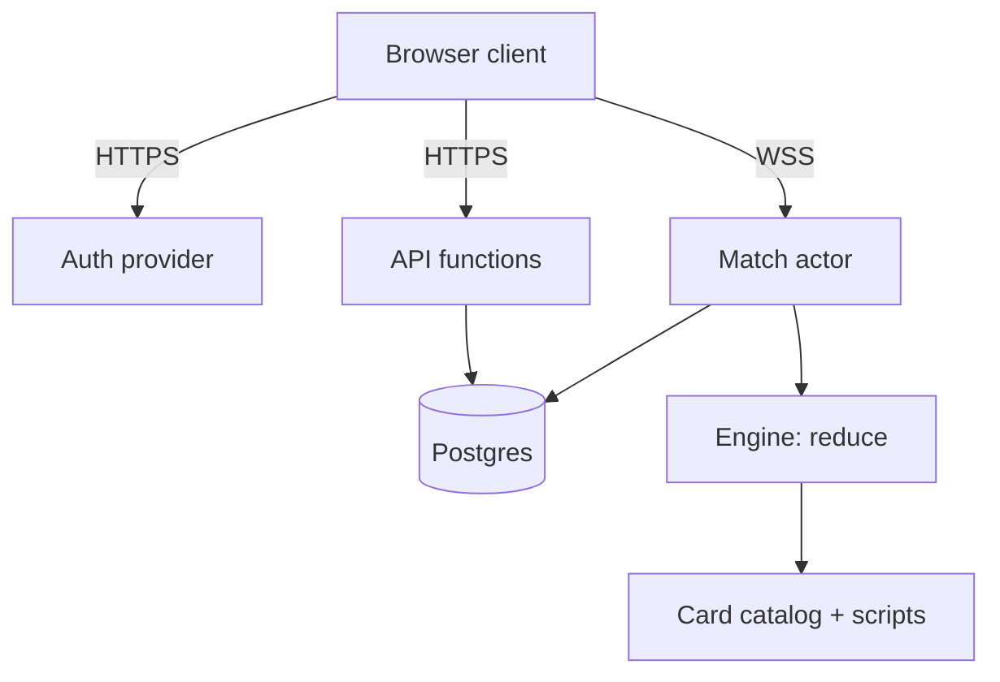

### 9.2 Topology

The match actor (Durable Object or equivalent) is the only stateful component: it holds the state in memory, one WebSocket per player, an alarm for the turn clock, and it appends every resolved action to the log. Idle actors hibernate. Every socket, a player's, a co-op seat's and a watcher's, is signed in by its handshake's offered credential, never its address ([[R1379000]]). A daily game ([[§9.13]]) has no actor: each of its requests loads its match, folds it and appends to its log, and nothing of it stays in memory between moves.
