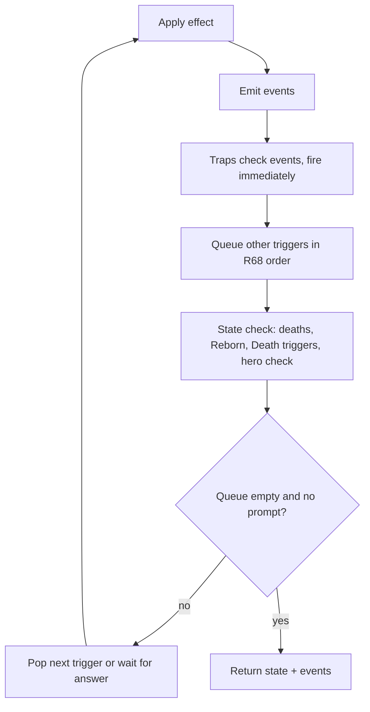

### 10.3 Events and triggers

Every visible state change emits an event. This is the complete list, and BUILD's animation table has one row for each: `cardPlayed`, `cardResolved`, `summoned`, `damage`, `healthLost`, `healed`, `divineShieldLost`, `destroyed`, `enteredGraveyard`, `exiled`, `bounced`, `burned`, `fatigue`, `libraryOverflow`, `discarded`, `drawn`, `addedToHand`, `shuffledIn`, `buffed`, `keywordGranted`, `counterChanged`, `costChanged`, `modifierChanged`, `radiantSet`, `transformed`, `fused`, `positionSwitched`, `controlChanged`, `rotated`, `swapped`, `locked`, `trapFired`, `attackDeclared`, `attackCancelled`, `manaChanged`, `turnStarted`, `turnEnded`, `turnAutoEnded`, `promptOpened`, `promptAnswered`, `drawOffered`, `drawAnswered`, `gameOver`, and since patch v0.2.0 `cardAnnounced` (a play entering [[§10.5]]'s announce window, showing what `cardPlayed` would), `countered`, `stolen` (a steal off the field, hidden per zone), `unlocked`, `activated`, `animated`, `deanimated`, `crumbled` (a Brittle count reached 0), `degraded`, `upgraded`, `redirected`, `healthSet`, `questProgressed`, `questCompleted`, `rolledBack`, `chaosRolled` (the effects a Call to Chaos rolled, named to both players, [[R436]]), `flickered` ([[§6.3]] Flicker), `drawLimited` (a draw a draw limit stopped, [[§2.4]]), `turnCutShort` (a turn an effect ended, [[§2.2]]), `marked` (a mark on a card, such as #50's pending steal, [[R437]]), `numberChanged` (a number C+ #41 KY's Constant set, hidden per zone) and `glitched` (what a Glitch did, [[R676]]), and since patch v0.3.X `damageAbsorbed` (a hit the target's Armor took whole, a report nothing answers, redacted as `damage` is, [[R1361]]), `translated` (a card both players read is shown in Chinese from now on, [[R1301]]), `discardPrevented` (a discard a discard guard stopped, [[R800]]) and `emoted` (a player's emote, public, which only a card that hears emotes answers, [[R1127]]), Meditative #40's `fengShui` (each Feng Shui's judgement of a play, [[R983]]), and since this part `jadeChanged` (a player's Jade Counter rose to its value, public, [[R961]]), and Meditative #22's `secretChosen` (a secret was kept, naming only its player and id, [[R860]]), `secretRevealed` (a secret was revealed, naming its owner and choice, [[R864]]), `predicted` (a Fortify Mind's guess was judged, naming the guess and its outcome, [[R864]]), and since the Meditative riders `deradianted` (a cleared Radiant flag, hidden per zone like `radiantSet`, [[R1102]]) and `manaSpent` (mana a play or an activation took, public, emitted only while something answers it, [[R1109]]), C+ #62's `curveDrawn` (the zones KY's Papaya's curve passes through, public, [[R831003]]), since Meditative+ #18 `autopilotEngaged` (the engine plays the rest of a player's turn, public, [[R1183002]]), since Stinkyscape's Dormant `awakened` (a Dormant card awakened, public, [[R1839002]]), since Stinkyscape+ `evolved` (a card evolved, public, [[R3536005]]), since Tradable `traded` (a player Traded a card, public, naming no card: its `shuffledIn` and `drawn` follow, [[R1838001]]), and since Stinkyscape's Credits `marketCreditsChanged` (a player's Credits rose to their value, public, [[R1840005]]; a Resource is a hand card, gained with `addedToHand`, [[R2250000]]); and since the Starship `starshipFused` (a dead Starship Piece's copy fused into its owner's Dormant Starship, public, [[R1852000]]) and `starshipLaunched` (a Starship launched, with its name and its pieces, public, [[R1852003]]); and since #1843 `voteCast` (a card voted to remove a player, with the tally, the card named as the card itself is, [[R1843000]]), `votedOut` (a full tally removes a player: the cards that agreed, each named as itself, just before `gameOver`, [[R1843000]]) and `fled` (a player escaped the universe, and what it leaves the other player, public, just before `gameOver`, [[R1843002]]); and since #1847 `starscapeTravelled` (a player traveled one node of their starscape map, public, [[R1847001]]); and since #1850 `held` (a permanent taken off the field beneath the card that holds it, hidden per zone like `exiled`, [[R1850003]]); and since the Marketplace `marketBought` (a card bought at the Marketplace for its Credits, hidden per zone as `addedToHand` is, its price public, [[R1853003]]) and `marketSold` (a `handSale` hand card sold at the Marketplace for its quote, public, [[R1853003]], [[R1861000]]; nothing emits it since issue #4410, [[R4410000]]); and since #1855 `boardReplaced` (a side's board replaced by a preset, public, before its cards' `exiled` and `summoned`, [[R1855000]]); and since #2652 `rolled` (a card's coin flips or die rolls, one batch per verb or hook with every face Lucky drew and the one kept, a report nothing answers, [[R2652001]], reaching only its controller while its card was face-down, [[R2652000]]); and since #2783 `hookResolving` (a card's Cry, Death, start-of-turn or end-of-turn hook, Whenever trigger or Activate begins to resolve, a marker just before its effects that nothing answers, reaching only a seat that could read its card, [[R2783000]]); and since #3857 `armorGained` (a hero's kept Armor gain, naming its player, the amount and the Armor after, public, a report nothing answers, [[R3857000]]); and since #3925 `loopCapped` (an interaction reached `RESOLUTION_EVENT_CAP` events and its resolution loop stopped, naming the seat whose interaction it was, public, a report nothing answers, [[R3925000]]); and since #5045 `damageNullified` (a damage pool nullified part of a hit, naming the pool's card, the hit's source and target and the amount, redacted as `damage` is, a report nothing answers, [[R5045000]]) — 101 in all. Payloads patch v0.2.0 added to older events: `destroyed` names the controller it died under and whether it died Radiant ([[R89]]); `drawn` carries `turnDraw`, the draw's count on its turn, public ([[R457]]); `counterChanged` carries `placed` for a Plague placement ([[R471]]) and the kind `brittle` ([[R385]]); since Stinkyscape+ it carries the kinds `burn` and `toxic` for a Unit's or a hero's counters (a hero named `hero-<player>`, as `damage` names it), `placed` the amount a gain added and none on a tick's drop or a Vanilla's clearing ([[R3540000]], [[R3540004]]). Since patch v0.3.X `damage` carries `absorbed`, the Armor's part of the hit ([[R1360]]), and `controlChanged` carries `how`, a steal or a give ([[R1366]]); both are absent where they have nothing to say, are the client's reports, and are left out of the events the trigger loop holds, so no rule reads them and no state hash moves for them. Since Meditative batch 16 `summoned` may carry `sourceId`, the card whose effect summoned it (M #63, [[R1088]]): present only where the summoning effect names its source, the client's report likewise, and likewise left out of what the trigger loop holds. Since #2783 `damage`, `damageAbsorbed`, `healed`, `destroyed` and `summoned` may carry `via`, the keyword behind them — Cleave, Trample, First Strike, Pierce, Lifesteal, Poisonous or Reborn (and, on the `damage` of a start-of-turn tick, Burn or Toxic, [[R3540001]]), a `destroyed`'s First Strike saying that the unit fell before it could strike back — set by the engine where the keyword applies, the client's report likewise, and likewise left out of what the trigger loop holds ([[R2783001]]). Since #4395 `destroyed` may carry `animated`, true for a Field Spell, Trap or Field Trap that died standing in a unit zone as an Animated Unit ([[R383]]); absent on every other death, the client's report likewise, and left out of what the trigger loop holds ([[R4395001]]). A new event type is added here and to BUILD M5-T4 together. Triggers are functions `(event, state) → Effect[]` registered by card scripts and by zone (hand triggers for Corpse Eater and C #33 Joro, deck triggers for C+ #37 Wardrum, graveyard triggers for C #47, backrow triggers for traps).

Resolution loop after any action or answer:

"Apply effect" means a whole script's effect list, so the state check never splits one effect ([[R59]]). Traps are checked before other triggers because they are responses (the end-of-turn trap window of [[§2.2]] is the one scheduled exception, [[R62]]); a trap that fires during the opponent's turn resolves to completion (including forced attacks and prompts for the trap's owner) before the opponent's action continues. Start-of-turn and end-of-turn are events too, so Mana Well, Moths and Combo-Index are ordinary triggers, and Bread and Butter and Intern Stimmy fire in the end-of-turn trap window. A replacement ([[§6.2]]) is not a trigger: it acts at its fixed point before the event it changes, and a trap that watches one fires there.

**The loop cap** ([[R3925000]]). No interaction resolves on past `RESOLUTION_EVENT_CAP` events (BUILD §2). An *interaction* is what starts a resolution loop: every action a seat takes (a play, an attack, an activation, End turn, a prompt's answer), each answer a `timeout` gives and the End turn it takes ([[R79]]), each action the autopilot ([[R1183002]]) or an AI turn ([[R44]]) takes, a turn the engine ends for a seat ([[R82]], [[R456]]), and the setup and a Glitch's reset ([[R676]]), which are no seat's; each starts a new count. Every event counts, the reports nothing answers among them. Once an interaction has emitted that many, the next turn of any loop resolving it (this loop, the repeat of [[§4.5]] step 5, owed work draining, a trap dispatch, an announce window) stops it there, as it stops a loop that goes round that many times with no event: the trigger queue and every event not yet offered are dropped, `loopCapped` names the seat whose interaction it was, and a last state check collects the dead without a Death, a Reborn, a Starship fusion or a "would die" replacement, its hero check still ending a game that has ended. Card text then stays off until the next interaction: no event is offered, no trap fires, no queued trigger runs, and an effect list stops at its next effect, as at a game's end ([[R216]]). Owed work still drains, its cards' text off, so the engine's own steps under way (a play's last steps, a combat, a turn's end) finish, and control goes back to the seat whose interaction it was. A prompt that opens before the cap is a pause, not a stop, and its answer is the next interaction; so is the answer to one an engine step opens after it. The count is no game state, so a game that never reaches the cap hashes as before. The cap is the backstop behind every card's own terminator (REVIEW A3.6), not a strategy: the AI does not plan around it.
